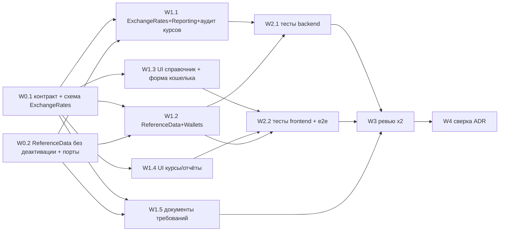
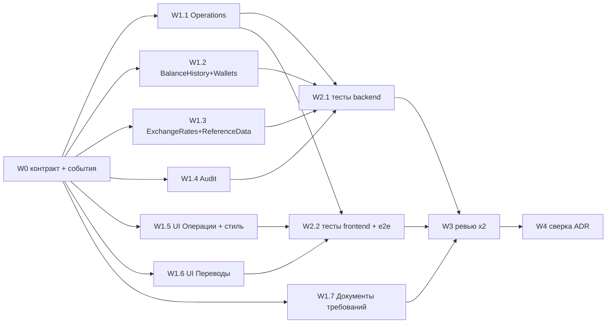

# Прогресс проекта

## Решения пользователя по итогам анализа ADR (2026-09-29)

Анализ прежнего набора ADR (14 записей на 2026-09-29) против кода выявил расхождения, требующие бизнес-решений. Решения принимаются по одному вопросу; здесь фиксируется только итог. Код и тексты ADR ещё **не изменены** — правки выполняются отдельным шагом после закрытия всех вопросов.

### Вопрос 1. Абсолютная корректировка баланса — РЕШЕНО

Общее правило: **введённое пользователем вручную не меняется; рассчитанное системой пересчитывается.**

1. Пользователь заявляет баланс на дату D («на 10 сентября было 350»). Заявленное значение — факт от пользователя, система его не меняет.
2. Система создаёт на дату D корректирующую операцию с названием «Неизвестные траты» (остаток отрицательный) или «Неизвестные доходы» (остаток положительный). Сумма = заявленный баланс − баланс на дату D без этой операции. Расчёт ведётся от баланса **на дату D**, а не от текущего баланса кошелька.
3. Сумма корректирующей операции пересчитывается при любом изменении операций с датой ≤ D так, чтобы заявленный баланс на дату D сохранялся. При смене знака остатка название меняется.
4. Заявленный баланс — это баланс на **конец дня** D. Все операции с датой D поглощаются корректировкой независимо от времени внесения, включая внесённые после заявления баланса. Время у операций не вводится.
5. Несколько заявленных балансов обрабатываются по порядку дат; каждый поглощает расхождение, накопившееся после предыдущего.
6. Если пользователь вручную меняет сумму корректирующей операции, она становится обычной операцией с фиксированной суммой и больше не пересчитывается; заявленный баланс после этого не гарантируется.
7. Корректировка дельтой (пользователь сам вводит сумму изменения) — фиксированная, не пересчитывается.

Расхождение с текущим кодом: `OperationEffectCalculator` считает разницу один раз от `Wallet.CurrentBalance` и замораживает её. Закрывает пункт «Absolute-корректировка и будущий пересчёт истории» из раздела «Известные упрощения / TODO». Соответствует ADR-0003 («Последствия», п.3); ADR-0003 нужно дополнить пунктами 2, 4 и 6.

Уточнение пользователя (2026-09-30):

8. **Корректирующая сумма — системная запись**, нужна для схождения баланса. Считается приложением автоматически.
9. Если корректирующая сумма равна 0, запись **не показывается совсем**.
10. Корректирующую запись **нельзя удалить и нельзя восстановить** — мягкое удаление из вопроса 4 на неё не распространяется.

11. **Пользователь не может редактировать корректирующую сумму.** Чтобы её устранить, он добавляет недостающую операцию или исправляет существующую — корректирующая сумма пересчитывается сама. **Пункт 6 выше отменён.**

12. **Исправление заявленного баланса — повторным вводом** (вариант A): пользователь вводит новый баланс на ту же дату, он заменяет прежний. Отдельной записи для управления заявленным балансом нет.

Следствие п.12, отдельно с пользователем не обсуждалось: заявленный баланс нельзя отменить совсем, только заменить другим значением.

Вопрос 1 закрыт. Оформлен как [ADR-0003](architecture/adr/0003-balance-history.md).

### Вопрос 2. Что считать «историей» кошелька — РЕШЕНО

**История кошелька — только операции** (включая обе «ноги» переводов и корректирующие операции). Слепки баланса историей не считаются: они рассчитаны системой, а не введены пользователем. Начальный баланс, отличный от нуля, историей тоже не считается.

1. Кошелёк без операций можно удалить окончательно, даже если по нему уже созданы слепки.
2. При удалении кошелька его слепки удаляются вместе с ним, с записью в аудите.
3. То же определение действует для запрета смены валюты кошелька (`PUT /wallets/{id}/currency`).
4. Принятое следствие: удаление кошелька с ненулевым начальным балансом изменит историческую общую сумму за прошлые даты.

Расхождение с текущим кодом: `BalanceHistoryWalletHistorySource` возвращает `true` при наличии любого слепка, а слепки создаются планировщиком для всех кошельков — пустой кошелёк становится неудаляемым после первого прогона. Требует правки ADR-0002 (определение «связанных данных» для Wallet) и ADR-0002, §2: у порта `IWalletHistorySource` остаётся один владелец данных (Operations), ожидаемое число реализаций в `CrossModuleContractsRegistrationTests` меняется с 2 на 1.

### Вопрос 3. Считать ли курс валюты её «использованием» — РЕШЕНО

**Курсы использованием не считаются.** Валюта используется, только если на неё ссылается кошелёк или операция. Курсы (последние и исторические) загружены системой, а не введены пользователем.

1. Валюту без кошельков и операций можно удалить окончательно, даже если по ней уже загружены курсы.
2. При удалении валюты её курсы удаляются вместе с ней.

Расхождение с текущим кодом: `ExchangeRatesReferenceItemUsageProbe` возвращает `true` при наличии любого курса, а после решения от 2026-09-16 курс получает каждая валюта справочника, поддерживаемая Frankfurter. Требует правки ADR-0002 (определение использования для Currency) и ADR-0002, §4: у порта `IReferenceItemUsageProbe` остаются два владельца данных (Wallets, Operations), ожидаемое число реализаций в `CrossModuleContractsRegistrationTests` меняется с 3 на 2.

### Вопрос 4. Удаление операций и переводов — РЕШЕНО

**Удаление операции — только мягкое.** Запись помечается как удалённая, остаётся в списке, в расчётах не учитывается, её можно восстановить.

1. Удалённая запись отображается серой, перечёркнутой красной линией.
2. Удалённая запись не участвует в расчёте текущего баланса, слепков, общей суммы и корректирующих операций (вопрос 1).
3. Удалённую запись можно восстановить; после восстановления она снова участвует в расчётах.

Заменяет решение от 2026-09-11 (граница «сегодня», ADR-0002, §3) и правило ADR-0002 о физическом удалении операции. Затрагивает контракт `docs/api/openapi.yaml` (семантика `DELETE`, признак удаления в ответах, восстановление), схему `operations` (новый признак, без потери данных) и UI списков операций и переводов.

Уточнения (пункты 4–7 предложены агентом, пользователь возражений не высказал; пункт 8 — явное решение пользователя, вариант A):

4. Мягкое удаление действует для операций и переводов с любой датой, включая сегодняшнюю. Физического удаления операций нет.
5. Перевод удаляется и восстанавливается целиком, обе «ноги» вместе. Отдельную «ногу» удалить нельзя.
6. При удалении и при восстановлении баланс, слепки и корректирующие операции пересчитываются; оба действия фиксируются в аудите.
7. Удалённую запись нельзя редактировать, пока она не восстановлена.
8. **Удалённая операция считается историей кошелька и использованием элементов справочника.** Кошелёк, у которого есть хотя бы одна операция (в том числе удалённая), можно только архивировать. Тип операции и валюту, на которые ссылается хотя бы одна операция (в том числе удалённая), можно только деактивировать. Восстановление удалённой записи поэтому возможно всегда.

Принятое следствие пункта 8: кошелёк, в который хотя бы раз вносили операцию, окончательно удалить нельзя — способа стереть удалённую операцию нет.

### Вопрос 5. Источник списка валют и курсов — РЕШЕНО В ОСНОВЕ, уточнения открыты

Факты, установленные проверкой 2026-09-30 (запросы к сервису):

- Приложение использует Frankfurter API **v1**: адрес по умолчанию `api.frankfurter.app` перенаправляет на `api.frankfurter.dev/v1`. В v1 30 валют; RUB, KZT, BYN, UAH и др. отсутствуют.
- Актуальный API — **v2** (`api.frankfurter.dev/v2`): `GET /v2/currencies` вернул 166 валют (сайт сервиса заявляет 208; причина разницы не проверялась), курс RUB→EUR получен. Криптовалют (BTC, ETH) нет.
- Формат v2 отличается: `rates?base=X&quotes=Y`, ответ — массив `[{date, base, quote, rate}]`. `FrankfurterClient` требует переписывания, смены адреса недостаточно.
- v2 отдаёт курсы за период одним запросом (`from`/`to`, проверено на 8 днях, включая выходные) и несколько валют назначения сразу (`quotes=EUR,USD`). Ограничение на длину периода не проверялось.
- Список валют в приложении сейчас не связан с сервисом: статический `frontend/src/app/shared/currencies/iso-currencies.ts` (159 валют), backend принимает любой код.

Решения пользователя:

1. **Список валют хранится в БД и обновляется вместе с курсами** из Frankfurter.
2. **Приложение берёт курсы и валюты только из БД.** Обращения к сервису в момент чтения данных нет.
3. **Названия валют — всегда английские, из сервиса.** Файл `iso-currencies.ts` удаляется целиком.
4. Произвольный код валюты не принимается; криптовалюты не поддерживаются (следует из п.1).

Инженерная задача без решения пользователя: перевод клиента на API v2.

Расхождение с текущим кодом по п.2: `ExchangeRateLookup.GetOrFetchHistoricalRateAsync` обращается к сервису и пишет в БД во время `GET /reporting/total-amount`. Требует правки ADR-0004; обоснование ADR-0005 (криптовалюты) теряет силу, само решение о точности не затрагивается.

Решение пользователя о двух списках валют (2026-09-30):

5. **Доступные валюты** — те, что есть в сервисе. Хранятся в БД, обновляются вместе с курсами, пользователь ими не управляет. Нужны только для списков выбора: при создании кошелька и при добавлении валюты в активные.
6. **Активные валюты** — те, которые использует пользователь; ими он управляет сам.
7. При создании кошелька валюта выбирается из доступных и **автоматически становится активной**.
8. Активную валюту, привязанную к кошельку, удалить из активных нельзя.
9. **Курсы запрашиваются только по активным валютам.** Заменяет решение от 2026-09-16 («все валюты справочника, включая деактивированные»).

10. **Состояния «деактивирована» у валюты нет** (вариант A). Валюта либо активна, либо нет. Заменяет правило ADR-0002 о деактивации для справочника `Currency`; для типов кошельков и типов операций деактивация сохраняется.
11. Валюту можно убрать из активных, только если на неё не ссылается ни кошелёк (включая архивный), ни операция (включая удалённую — вопрос 4, п.8). Курсы использованием не считаются (вопрос 3).
12. Принятое следствие: по валюте, оставшейся только в архивных кошельках, курс продолжает обновляться.

Пункты, предложенные агентом, без возражений пользователя: если сервис убрал валюту, она исчезает из доступных; если она при этом активна — остаётся активной с последним известным курсом (ADR-0004, п.6).

13. **Исторические курсы дозагружаются в фоне** (вариант B). Когда валюта становится активной, фоновая задача загружает её курсы за период от самой ранней даты начала учёта до сегодняшнего дня. Чтение (`GET /reporting/total-amount`) к сервису не обращается.
14. Принятые следствия: пока дозагрузка не завершена, общая сумма за прошлые даты неполная; при смене основного кошелька дозагрузка повторяется по всем активным валютам к новой основной валюте (курсы хранятся как пара «валюта → основная валюта», ADR-0004, п.4).

Вопрос 5 закрыт. Затрагивает ADR-0004 (версия API, источник списка валют, только активные валюты, исторические курсы), ADR-0002 (жизненный цикл `Currency`), ADR-0004 (фоновая задача получает новую обязанность — дозагрузку), `docs/api/openapi.yaml`, схемы `reference_data` и `exchange_rates`.

### Вопрос 6. Ветки и окружения деплоя — РЕШЕНО

Фактическое состояние со слов пользователя (2026-09-30): на Vercel production собирается только из `master`, для всех остальных веток — preview-деплой. Привязки staging к `release-candidates/v0.1.0`, описанной в ADR-0008, на Vercel нет.

Состояние репозитория: `master` содержит v0.2.0 (влит 2026-09-14) — утверждение ADR-0008 «`master` — ранний скелет, не деплоится» устарело.

Backend на Railway (со слов пользователя, 2026-09-30): развёрнут, окружение одно — из `master`. Второго окружения и второго Postgres, описанных в ADR-0008, нет. Preview-сборки frontend обращаются к этому же единственному backend.

Следствия фактической схемы: preview-сборка любой ветки работает с боевыми данными; preview ветки, меняющей API, несовместим с backend из `master` до слияния.

**Решение пользователя: оставить как есть (вариант A).** Целевая схема совпадает с фактической: один backend и одна база из `master`; production-frontend из `master`; preview-frontend для остальных веток обращается к тому же backend. Отдельного staging нет. Риски (preview пишет в боевые данные; после вопроса 4 такие записи нельзя стереть окончательно) пользователю названы и приняты.

Preview-сборки, со слов пользователя, открываются и работают со входом. Каким образом их адреса разрешены в CORS, в репозитории не видно: код (`Program.cs`) допускает только точные адреса из `Cors:AllowedOrigins`, значения заданы в настройках Railway.

Требует переписать ADR-0008: убрать второе окружение Railway и привязку staging к `release-candidates/v0.1.0`, убрать утверждение о недеплоящемся `master`, описать фактическую схему и её риски. Комментарий в `frontend/scripts/write-env.mjs` («both Railway environments (prod/staging)») тоже устарел.

### Итог: ADR пересобраны по темам (2026-09-30)

По решению пользователя набор ADR пересобран: вместо 17 файлов, в которых одна и та же часть логики была размазана по нескольким записям, — 9 ADR, по одному на тему ([оглавление](architecture/adr/README.md)). Каждый ADR описывает текущее решение целиком, с разделом «Состояние реализации» для того, что в код ещё не попало. Нумерация новая, старые номера из кода и документации убраны полностью; ссылки в комментариях кода переписаны на новые номера и разделы.

Решения по вопросам 1–6 выше вошли в: вопрос 1 → ADR-0003 §6; вопросы 2–4 → ADR-0002; вопросы 3 и 5 → ADR-0004 (и ADR-0002 §4); вопрос 6 → ADR-0008. Уточнения, закрытые пользователем 2026-09-30:

1. **Заявленный баланс не считается историей кошелька.** Кошелёк без операций удаляется окончательно вместе со своими заявленными балансами (ADR-0002, §2).
2. **Все существующие данные — тестовые.** Сохранять значения балансов при переходе существующих абсолютных корректировок на модель ADR-0003 §6 не требуется.
3. **Деактивированных валют в данных нет.** Состояние «деактивирована» убирается без переноса данных (ADR-0004, §7).

Это снимает бизнес-ограничения на миграцию, но не заменяет подтверждения перед самим выполнением изменения схемы, теряющего данные (правило «Критичный стоп», п.2 в `CLAUDE.md`).

Остаётся неподтверждённым одно следствие: заявленный баланс нельзя отменить, только заменить другим значением или удалить вместе с кошельком (ADR-0003, §6, п.8).

Не обновлено и ждёт этапа реализации: `docs/requirements/user-scenarios.md`, `glossary.md`, `docs/architecture/ddd-model.md`, `docs/api/openapi.yaml`, `docs/api/api-design.md`, `docs/database/schema.md`. До реализации эти документы описывают прежнее поведение, совпадающее с кодом; `high-level-architecture.md` §2 и §5 приведены к ADR-0001.

Инженерные находки анализа, не требующие решения пользователя и не исправленные (зафиксированы в разделах «Отклонения в коде» / «Состояние реализации» соответствующих ADR):

- `BalanceSnapshotSchedulerHostedService` вызывает `BalanceRecalculationService` напрямую, без `TransactionScope`: запись слепка и его аудита не атомарна, а `pg_advisory_xact_lock` вне транзакции не удерживается (ADR-0001, «Отклонения в коде»). Вывод сделан чтением кода, сбой не воспроизводился.
- `RefreshExchangeRatesCommand` намеренно не `ICommand`: аудит обновления курсов не атомарен с сохранением курсов (ADR-0001, §4; ADR-0006).
- Каскадный пересчёт вместе с записью аудита на каждый слепок выполняется в одной транзакции HTTP-запроса; при правке операции многолетней давности это тысячи записей при лимите `TransactionScope` в 1 минуту (ADR-0003, «Последствия»).
- Ограничение «ровно один экземпляр backend» теперь записано явно (ADR-0001, §8).
- Модуль Reporting не приведён к шаблону ADR-0007 §2. Записи ниже в этом файле «CI/CD пока не настроен» и «Аудит — модуль-заглушка» устарели.

## Внедрение ADR — шаг 1: инженерные исправления без изменения поведения (2026-10-01)

Ветка `release-candidates/v0.3.0`. Два независимых исправления шли параллельно двумя `backend-services-engineer`, затем `code-quality-reviewer`, затем два агента-исправителя по его находкам.

**1. Плановый проход слепков — через команду и транзакцию (ADR-0001 §4/§6, ADR-0003 §4).** Новая команда `BackfillWalletBalanceSnapshotsCommand` (`BalanceHistory.Application/UseCases/BackfillWalletBalanceSnapshots/`) вычисляет `fromDate` и вызывает `BalanceRecalculationService`; `BalanceSnapshotSchedulerHostedService` шлёт её через `ISender` в **отдельном DI-scope на каждый кошелёк** (внешний scope — только для `IWalletDirectory`). Слепки, их `AuditEntry` и advisory lock одного кошелька — одна транзакция PostgreSQL (интеграционный тест проверяет одинаковый `xmin`). Регрессионный тест на изоляцию кошельков: триггер БД роняет вставку слепков первого кошелька, второй получает N слепков и N записей аудита; на общем scope тест красный (слепки первого утекали в транзакцию второго без аудита).

**2. `TransactionBehavior` не подключался к командам без результата.** В MediatR 12 void-`IRequest` не наследует `IRequest<Unit>`, а ограничение behavior'а требовало `IRequest<TResponse>` — все `Delete*Command` (операции, переводы, кошельки, три справочника) выполнялись **без** `TransactionScope`. Ограничение ослаблено до `ICommand<TResponse>`; регрессионный тест `TransactionBehaviorRegistrationTests` обходит все `ICommand<>` во всех Application-сборках (общий список `ModuleAssemblies` в Host, используется и `Program.cs`), выводит `TResponse` из `IRequest<>` и проверяет наличие behavior'а и совпадение `ICommand<T>` с `IRequest<T>`; на старом ограничении падал на `DeleteWalletCommand`.

**3. Клиент Frankfurter — API v2 (ADR-0004 §1).** `FrankfurterClient`: `rates?base=&quotes=[&date=]`, ответ-массив, адрес по умолчанию `https://api.frankfurter.dev/v2/` (нормализация завершающего `/`). Классификация ответов: 422 и `200 []` → `FrankfurterUnsupportedCurrencyException` (пропуск пары); 404 (неверный адрес), тело не-JSON, неверная форма элемента → `FrankfurterUnavailableException` без ретраев; сеть/таймаут/5xx/IOException → 3 попытки; отмена вызывающим кодом пробрасывается как `OperationCanceledException`. Фейки в интеграционных тестах переведены на v2. 20+ юнит-тестов клиента без сети (`FrankfurterClientTests`). Проверено живыми запросами: выходной день → сервис отдаёт ближайшую более раннюю дату; дата раньше начала данных → `200 []`.

**Документация:** ADR-0001 («Отклонения в коде» — остался только пункт про аудит курсов; §4 — привязка behavior'а к `ICommand<TResponse>`), ADR-0003 §4 и «Состояние реализации», ADR-0004 §6 и «Состояние реализации», ADR-0006 «Состояние реализации», `high-level-architecture.md` §5.

**Проверки:** `dotnet build` — 0 ошибок; юнит-тесты 225/225; интеграционные 86/86 (Testcontainers).

**Отложено (из ревью, не блокирует):**
- Одновременные переводы A→B и B→A (создание/правка/удаление) могут взаимно заблокироваться в PostgreSQL (40P01 → 500): блокировки строк двух кошельков плюс два advisory lock в одной транзакции. Было и раньше для create/update; варианты — детерминированный порядок по `WalletId` или повтор при 40P01.
- Лимит `TransactionScope` 60 с теперь распространяется на первичное досоздание слепков кошелька с далёкой датой начала учёта (N слепков + N записей аудита); при подтверждении риска — явный `Timeout` команды или досоздание порциями.
- Нет теста атомарности путей `Delete*` (одинаковый `xmin` у `audit_entries`/`wallets`/`balance_snapshots`) — добавить в волне тестов блока A.
- Тесты планировщика могут быть нестабильны около полуночи UTC (`Today` в тесте vs `UtcNow` в сервисе); `TimeProvider` в проекте не внедрён — общий долг.
- Оставшиеся предупреждения CS9107 в `AuditApiTests`/`CrossModuleContractsRegistrationTests` снимаются переходом на `IntegrationTestBase.Fixture`.

## Блок B — ADR-0004 §7–§9 внедрён: доступные и активные валюты, чтение из БД, история курсов (2026-10-01)

План «ПЛАН: внедрение ADR-0004 §7–§9 …» ниже выполнен целиком: W0 (2) → W1 (5 параллельных) → W2 (2) → W3 (2 ревьюера) → W3.1 (3 исправителя + перепрогон e2e) → W4. Коммиты: `9188b8d` (контракт, схема, модель), `8fd2842` (реализация), `9bb9187` (тесты), итоговый — исправления по ревью и сверка документации. Бизнес-неоднозначностей не возникло; шесть прочтений приняты при реализации и записаны в ADR-0004 «Последствия» с пометкой «выведено, отдельно не обсуждалось» (смена валюты кошелька — только на активную; период дозагрузки по всем кошелькам, включая архивные; история продлевается до сегодня ежедневно; валюты, которых нет в сервисе, остаются активными с прежними названиями; валюта с закончившимися данными стоит одного запроса за проход; ручное обновление запускает дозагрузку истории).

**Что сделано (ADR-0004 §7–§9, технические решения — ADR-0004 §10):**
- Список доступных валют — `reference_data.available_currencies` (владелец ReferenceData, заполняет ExchangeRates через `IAvailableCurrencyCatalog` при каждом обновлении курсов, в т. ч. без основного кошелька); активные валюты — `reference_data.currencies` без `is_active` (миграция с guard, деактивация удалена из API и UI); `POST /currencies {code}` только из доступных (400/409), `GET /currencies/available`; `POST /wallets` принимает `currencyCode` и активирует валюту в той же транзакции (`ICurrencyActivation`, advisory lock по коду: эксклюзивный при активации/удалении, разделяемый для кошелька на уже активной валюте; 23505 → 409); названия — английские из сервиса, статический `iso-currencies.ts` удалён.
- Курсы только по активным валютам; чтение (`/exchange-rates/latest`, `/reporting/total-amount`) — только из БД, ленивый `GetOrFetchHistoricalRateAsync` удалён; историческая сумма берёт ближайший более ранний курс, причина исключения — с кодом валюты, UI показывает «Курс по состоянию на …» и «Сумма неполная…».
- Дозагрузка истории — `BackfillExchangeRateHistoryCommand` (вне `ICommand`), таблица покрытия `historical_rate_coverage`, порции `ExchangeRates:HistoryChunkDays` (366) с запасом 7 дней, upsert, очистка устаревших пар; триггеры — активация валюты, создание кошелька, смена валюты кошелька, смена основного кошелька (сигнал доставляется после фиксации транзакции), ручное обновление и плановый суточный проход.
- Живые факты Frankfurter v2 (2026-10-01) записаны в ADR-0004 «Контекст»: 166 валют с `end_date`, период не усекается (USD→EUR с 1999 — 10 133 строки), ряд ежедневный включая выходные, `200 []` для периода до начала данных.
- UI: вкладка «Валюты» (добавить из доступных через комбобокс с поиском и клавиатурой, убрать из активных с подтверждением, подсказки и ссылка на курсы), форма кошелька из доступных, экран курсов без основного кошелька, отчёт; доступность комбобокса (`aria-describedby`/`invalid`/`required` через `app-field`, live-область, blur, Home/End).
- Документы: `user-scenarios.md`, `glossary.md`, `ddd-model.md`, `api-design.md`, `schema.md`, `high-level-architecture.md`, design-спеки, `openapi.yaml`; ADR-0001/0002/0004/0005/0006 сверены с кодом. Тестовая инфраструктура: `FrankfurterFake` (каталог, периоды, выходные, конец данных, сбои, счётчики), `RunExchangeRatesBackgroundPassAsync`.

**Баги, найденные ревью/тестами и исправленные:**
- Пустая порция истории трактовалась как «данных нет вообще»: валюты с закончившимися данными (HRK, LTL, LVL, EEK, RUB у ЕЦБ) никогда не получали историю за свой период — теперь левая часть идёт до `requiredFrom`, тест красный на старом коде.
- Параллельные `POST /wallets` с одной ещё не активной валютой давали 500 (нарушение уникальности после проверки) — advisory lock по коду.
- `DELETE /currencies/{id}` не брал блокировку и мог гоняться с созданием кошелька — блокировка до проверки использования, тест на гонку.
- Ручное обновление сбрасывало суточный таймер и могло бесконечно откладывать дозагрузку истории — на ручное обновление запускается дозагрузка.
- Ошибки БД при замене списка доступных давали 500 вместо 502 — перехватываются как сбой списка.
- `PrimaryWalletChangedHandler` слал сигнал до фиксации транзакции (фон мог прочитать старую основную валюту) — сигнал после `TransactionCompleted`; старый `Task.WhenAny` в фоновом цикле мог проглотить сигнал — переписан на `WaitToReadAsync`.
- Комбобокс на вкладке валют не имел доступного имени (`id` на хосте); фейк Frankfurter без выходных проверял сам себя — добавлен режим с выходными и тест «курс за субботу применяется».
- Тексты исключений ReferenceData с GUID и ссылкой на `schema.md` уходили в UI; причина исключения кошелька из суммы содержала GUID валюты.

**Проверки (итог):** `dotnet build` 0 ошибок; юнит 400/400; интеграционные 201/201 (Testcontainers); архитектура OK (30 проектов, 74 связи); `ng build` без предупреждений (бюджет `wallets-page.component.scss` ужат); `ng test` 430/430; границы OK; e2e — все pass/fail-спеки зелёные против локального backend и реального Frankfurter (справочник валют 1/1, кошельки 5/5, курсы 3/3, операции 3/3, переводы 3/3, история 3/3, меню карточки 7/7, select-arrow 2/2); `openapi.yaml` валиден.

**Отложено (пункты следующих циклов):**
- Гонка `ChangeWalletCurrency` с `DELETE /currencies/{id}` — обработчик смены валюты не берёт разделяемую блокировку по коду.
- `refreshed_at` у всех 166 доступных валют обновляется при каждом прогоне; при сбое `ReplaceAsync` на `SaveChanges` трекер `ReferenceDataDbContext` не очищается явно.
- Аудит переименования валют при фоновом прогоне идёт вне общей транзакции (прогон не `ICommand`) — тестом не проверено.
- Преобразование `CurrencyId` в код при исключении кошелька — лишний lookup на кошелёк; можно отдавать код из `IWalletTotalsSource`.
- Подсвеченная опция комбобокса не прокручивается в видимую область при навигации стрелками по длинному списку; у «Повторить» загрузки типов кошельков фокус не возвращается.
- Login-лимит 5/мин мешает прогону e2e-файлов с ≥5 тестами подряд (`wallet-card-menu.spec.ts`), любой `curl` на `/auth/login` тратит лимит — отметить в `frontend/e2e/README.md`; опциональные e2e на тост/подсказки/blur и 502 без основного кошелька.
- Статические витрины `docs/design/wallet-form.html`, `exchange-rates.html` устарели.
- Тесты около полуночи UTC (общий долг, `TimeProvider`).

Остаток по ADR-0004: нет. Следующий блок — C: заявленный баланс и корректирующая сумма (ADR-0003 §6).

## ПЛАН: внедрение ADR-0004 §7–§9 — доступные и активные валюты, чтение из БД, история курсов (2026-10-01)

**Статус: выполнен 2026-10-01, см. раздел «Блок B — ADR-0004 §7–§9 внедрён» выше.**

**Статус: запланирован, к выполнению.** Блок B.

Источник правды: [ADR-0004](architecture/adr/0004-currencies-and-exchange-rates.md) (§4–§9, «Последствия», «Состояние реализации»). Смежные документы: [ADR-0002](architecture/adr/0002-record-lifecycle.md) §4 (валюта либо активна, либо нет; использование — кошельки и операции, включая удалённые; курсы удаляются вместе с валютой — уже реализовано в блоке A), [ADR-0001](architecture/adr/0001-modular-monolith.md) §2 (порты), §4 (транзакции), §5 (события), §6 (фоновые задачи), §7 (сигнал через `Channel`), [ADR-0005](architecture/adr/0005-money-precision.md) (точность), [ADR-0006](architecture/adr/0006-audit.md) (аудит прогонов курсов). Также решения по вопросам 3 и 5 выше и уточнение 3 итога от 2026-09-30: деактивированных валют нет, все данные тестовые. План составлен по коду ветки `release-candidates/v0.3.0` (коммит `b3ae2e3`). Scope — **XL**: ExchangeRates (новый процесс дозагрузки, клиент, фоновый сервис), ReferenceData (новая модель данных, миграция с удалением колонки), Wallets, Reporting, Audit, два экрана UI, e2e-фикстуры, контракт API. Поэтому план разбит на пункты, которые не пересекаются по файлам.

### П.0. Вне объёма (сознательно)

- **Корректирующая сумма и заявленный баланс** (ADR-0003 §6) — блок C.
- **Индикатор «история курсов загружается» в UI и отдельная причина исключения кошелька для этого случая.** ADR-0004 §9 требует только исключить кошелёк из суммы с указанием причины — это уже работает. Тексты причин в `GetTotalAmountQuery` (сейчас в них `CurrencyId`, а не код валюты) не меняются; при необходимости — отдельный пункт.
- **Запрос нескольких валют одним вызовом (`quotes=A,B`) через инверсию курса «основная → валюта».** ADR-0004 §4 требует прямую пару без кросс-курсов, а инверсия вносит округление (противоречит ADR-0005). Один запрос — на одну валюту.
- **Фильтрация валют, выведенных из обращения** (`end_date` в ответе `/v2/currencies`). Доступные — это всё, что отдаёт сервис (§7). Колонки `start_date`/`end_date` не хранятся (YAGNI).
- **Удаление существующих валют, кодов которых нет в сервисе** (тестовые коды `T…`, `XYZ`, криптовалюты). Остаются активными, см. R3.
- **Персистентная очередь заданий или outbox для дозагрузки.** ADR-0004 отклоняет outbox. Потерю сигнала покрывают таблица покрытия (R12) и плановый прогон.
- HTML/JS-макеты `docs/design/*.html|*.js` не переделываются; текстовые спецификации экранов обновляются.
- `TimeProvider` не внедряется (общий долг, см. шаг 1).

### П.1. Definition of Done (по пунктам ADR-0004)

**§7 Доступные и активные валюты**
- D7.1 `GET /currencies/available` → 200, массив `AvailableCurrency {code, name, isActive}` из `reference_data.available_currencies`, отсортирован по `code`, без пагинации. Названия английские, из сервиса. До первой загрузки — `[]`. К сервису не обращается.
- D7.2 Список доступных обновляется в каждом прогоне `RefreshExchangeRatesCommand` (старт, плановый, ручной, по сигналу), **в том числе без основного кошелька**. Обновление полное: новые коды добавляются, у существующих меняются названия, отсутствующие в ответе удаляются. Пустой ответ, ошибка или неразборчивое тело оставляют список как есть. При ручном обновлении это `HadFailures` → 502.
- D7.3 `POST /currencies` с телом `{code}`: код есть среди доступных и ещё не активен → 201 `Currency`, название берётся из доступных. Кода нет среди доступных (произвольный код, криптовалюта) → 400. Уже активна → 409.
- D7.4 Деактивации нет. `POST /currencies/{id}/deactivate`, `DeactivateCurrencyCommand`, `CurrencyDeactivated` и его обработчик аудита удалены. Колонки `reference_data.currencies.is_active` нет. В схеме `Currency` нет `isActive`. У `GET /currencies` нет параметра `includeInactive`.
- D7.5 `DELETE /currencies/{id}` = «убрать из активных». Используется (кошелёк или операция, включая удалённые) → 409, текст без слова «деактивация». Иначе → 204; удаляются последние и исторические курсы и строки покрытия истории (R18).
- D7.6 `POST /wallets` принимает `currencyCode` вместо `currencyId`:
  - код доступен, но не активен → валюта становится активной в той же транзакции (событие `CurrencyCreated`, запись аудита `Currency`/`Created`), кошелёк создан → 201;
  - код уже активен → используется существующая валюта, дубля нет;
  - код ни активен, ни доступен → 400, валюта не создана;
  - создание кошелька отклонено проверкой → активация откатывается.
- D7.7 `PUT /wallets/{id}/currency` принимает только активную валюту; неизвестный `currencyId` → 400. Сейчас валидации нет вовсе.
- D7.8 Курсы обновляются только по активным валютам (строки `reference_data.currencies`). У `ICurrencyLookup` нет `IsActive` и `GetActiveAsync`.
- D7.9 При обновлении списка названия активных валют, коды которых есть в сервисе, приводятся к английским названиям сервиса. Каждая смена — событие `CurrencyRenamed` и запись аудита `Currency`/`Updated` (diff `Name`) с актором прогона.
- D7.10 Frontend:
  - `shared/currencies/iso-currencies.ts` удалён;
  - форма создания кошелька выбирает валюту из доступных через `app-currency-select`, без быстрого добавления валюты;
  - экран справочников, вкладка «Валюты»: добавление из доступных (только `isActive=false`), список активных, действие «Убрать из активных» с подтверждением, без «Деактивировать»;
  - при пустом списке доступных — подсказка.

**§8 Чтение только из БД**
- D8.1 Ни один `GET` не обращается к Frankfurter. Интеграционный тест со счётчиком вызовов фейка проверяет `GET /reporting/total-amount` (текущая сумма и сумма за прошлую дату, в том числе без истории), `GET /exchange-rates/latest`, `GET /currencies`, `GET /currencies/available` — 0 вызовов.
- D8.2 `IExchangeRateLookup.GetOrFetchHistoricalRateAsync` удалён, вместо него `GetHistoricalRateAsync`, который только читает. `ExchangeRateLookup` не зависит от `IFrankfurterClient`, `IExchangeRatesUnitOfWork`, `ICurrencyLookup`.
- D8.3 Историческая общая сумма берёт курс из `historical_exchange_rates` на дату или ближайшую более раннюю; `ratesAsOfDate` — фактически применённая дата. Курса нет → кошелёк исключён с причиной.

**§9 Исторические курсы**
- D9.1 `BackfillExchangeRateHistoryCommand` загружает для каждой активной валюты, кроме основной, курсы к основной валюте за период `[самая ранняя AccountingStartDate среди всех кошельков, включая архивные, − 7 дней; сегодня (UTC)]`. Загрузка идёт порциями не длиннее `ExchangeRates:HistoryChunkDays` (по умолчанию 366), от новых дат к старым. Строки записываются upsert'ом по `(from, to, rate_date)`, ход загрузки фиксируется в таблице покрытия (R11, R12).
- D9.2 Дозагрузку запускают:
  - активация валюты (`CurrencyCreated`, в том числе автоматическая при создании кошелька);
  - создание кошелька (`WalletCreated`: дата начала учёта может оказаться раньше текущей самой ранней);
  - смена валюты кошелька (`WalletCurrencyChanged`: у основного кошелька меняется основная валюта);
  - смена основного кошелька (`PrimaryWalletChanged`);
  - старт приложения и плановый прогон.

  Сигнал уходит фоновому сервису **только после фиксации** транзакции команды; при откате сигнала нет.
- D9.3 После смены основного кошелька пары к новой основной валюте загружаются за весь период; история и покрытие пар к прежней основной валюте удаляются в конце прохода.
- D9.4 Идемпотентность. Повторный проход без новых данных делает не больше одного запроса на пару (правый край: `covered_to − 7 … сегодня`) и не создаёт дублей.
- D9.5 Отказоустойчивость:
  - `FrankfurterUnavailableException` прерывает проход, уже сохранённые порции и покрытие остаются, следующий проход продолжает с места остановки;
  - `200 []` в порции левой части означает, что более ранних данных у сервиса нет: левая граница считается достигнутой;
  - 422 — пара пропускается.
- D9.6 Аудит: одна запись `ExchangeRateHistoryLoaded` на проход, в котором что-либо загружено или произошёл сбой. Действие `HistoryLoaded`, `entity_id = Guid.Empty`, в `changes` — загруженные диапазоны и сбойные пары (по образцу `ExchangeRatesUpdated`, ADR-0006).
- D9.7 Без основного кошелька дозагрузка не выполняется (§4).

**§5 (дополнение, выведено из §5 и §9):** `WalletCurrencyChanged` основного кошелька запускает обновление курсов. Сейчас курсы к старой основной валюте живут до следующего планового прогона (до 24 ч), а `GET /exchange-rates/latest` в это время пуст.

**Качество (все пункты):**
- `dotnet build` — без новых предупреждений;
- `dotnet test` (unit + integration) — зелёный;
- `node backend/scripts/check-architecture.mjs` — OK, новых ссылок между проектами нет;
- `ng build`, `ng test`, `npm run check:boundaries` — OK;
- e2e-смоук П.5 — зелёный локально;
- `docs/api/openapi.yaml` совпадает с реализацией (проверка `code-quality-reviewer` через `dotnet-api-compatibility`).

### П.2. Проектные решения уровня реализации (приняты планировщиком, бизнес-правил не меняют)

| # | Решение | Обоснование |
|---|---|---|
| R1 | **Список доступных хранится в `reference_data.available_currencies`, владелец — ReferenceData.** Таблица: `code varchar(16) PK`, `name varchar(200) NOT NULL`, `refreshed_at timestamptz NOT NULL`. Сущность `AvailableCurrency` (ReferenceData.Domain) без событий. ExchangeRates загружает список и пишет его через порт способа (c) `IAvailableCurrencyCatalog.ReplaceAsync(IReadOnlyList<AvailableCurrencyItem>)`. Порт объявлен в `ReferenceData.Application/Abstractions/Integration`, реализован в `ReferenceData.Infrastructure/Integration/AvailableCurrencyCatalog.cs` и работает через `ReferenceDataDbContext` со своим `SaveChanges`. | Понятие «валюта» (доступная и активная) принадлежит справочнику. Проверка «код есть среди доступных» при активации остаётся внутри одного `DbContext`, без межмодульного вызова. Направление ExchangeRates → `ReferenceData.Application` уже существует (`ICurrencyLookup`), обратный порт (d) не нужен. Отклонено: таблица в `exchange_rates` — тогда ReferenceData пришлось бы читать её через обратный порт (d), а проверка активации стала бы межмодульной. «Последствия» ADR-0004 оставляют это решение этапу реализации. |
| R2 | **Активные валюты — это строки `reference_data.currencies`.** Колонка `is_active` удаляется, у `Currency` нет `IsActive` и `Deactivate()`. Добавляется `Rename(string name)` — поднимает `CurrencyRenamed`, если название изменилось. Имена событий `CurrencyCreated`/`CurrencyDeleted` и действия аудита `Created`/`Deleted` сохраняются; их смысл — «добавлена в активные» и «убрана из активных» (фиксируется в `ddd-model.md` и глоссарии). Миграция `AvailableCurrenciesAndNoDeactivation`: `CREATE TABLE available_currencies`; затем guard `DO $ … IF EXISTS (SELECT 1 FROM reference_data.currencies WHERE NOT is_active) THEN RAISE EXCEPTION … $`; затем `DROP COLUMN is_active`. `Down` возвращает колонку с `DEFAULT true` и удаляет таблицу. | Состояние «деактивирована» отменено (§7, ADR-0002 §4). Деактивированных валют в данных нет (уточнение 3 от 2026-09-30). Guard делает миграцию безопасной: если такая валюта всё же есть, миграция падает, а не теряет данные молча. Удаляется колонка, все значения которой `true`, — это не потеря данных, поэтому «Критичный стоп» п.2 не срабатывает. Переименование событий дало бы лишнее изменение в Audit без пользы. |
| R3 | **Существующие валюты, кодов которых нет в сервисе** (тестовые `T…`, `XYZ`, возможные криптовалюты), остаются активными с прежними названиями. Их курсы пропускаются молча (422 или `[]`, §6). Пользователь может убрать неиспользуемые вручную. | Аналог правила §6 «сервис убрал валюту — она остаётся активной». Миграция ничего не удаляет. Данные тестовые, отдельное решение не нужно. |
| R4 | **Синхронизация названий.** `AvailableCurrencyCatalog.ReplaceAsync` в той же единице работы вызывает `Currency.Rename(englishName)` для активных валют, код которых есть в ответе сервиса. `CurrencyRenamed(CurrencyId)` → аудит `Updated` через diff из `ChangeTracker`. Актор — тот, кто запустил прогон: `System` для фона, `User` для ручного обновления. | §7: «названия — английские, из сервиса». Старые русские названия (из `iso-currencies.ts`) заменятся при первом прогоне без отдельной миграции данных. ADR-0006: изменение записи справочника фиксируется. |
| R5 | **Правила замены списка.** Upsert по `code`, удаление отсутствующих. Пустой массив считается сбоем: список не меняется. `ExchangeRateUpdateFailed` не поднимается, так как событие описывает пары. Сбой загрузки списка (`FrankfurterUnavailableException`) логируется и ставит `HadFailures = true`. Сам список доступных не аудитируется: это каталог сервиса, не запись пользователя. Аудитируются изменения активных валют (R4). | Защита от стирания списка при сбое сервиса. Ручное обновление при недоступном источнике должно отвечать 502 даже без пар (только основная валюта). |
| R6 | **Активация.** Логика — в `ReferenceData.Application` (`CurrencyActivation`, использует `ICurrencyRepository` и новый `IAvailableCurrencyRepository`). Две точки входа: (1) `ActivateCurrencyCommand(Code)` (бывший `CreateCurrencyCommand`) для `POST /currencies`: уже активна → `CurrencyCodeAlreadyExistsException` (409), нет среди доступных → `CurrencyNotAvailableException` (`ReferenceDataDomainException`, 400); (2) порт способа (c) `ICurrencyActivation.EnsureActiveAsync(code)` → `CurrencyLookupResult?` для Wallets: возвращает существующую активную или создаёт новую из доступной; если код ни активен, ни доступен — `null`. Реализация порта — в `ReferenceData.Infrastructure`, сохраняет `ReferenceDataDbContext` внутри `TransactionScope` команды `CreateWallet` (как `IWalletBalanceGateway`). Нарушение `ux_currencies_code` при гонке (`23505`) → 409. | ADR-0001 §3: активация обязательна для корректности создания кошелька, поэтому это синхронный порт, а не событие. Атомарность «кошелёк + активация» соответствует §7 «автоматически становится активной». Активная валюта, которую сервис убрал, остаётся пригодной для кошелька (§6). |
| R7 | **Контракт API** (`docs/api/openapi.yaml`, W0.1):<br>• `Currency {id, code, name}` — `isActive` удалён;<br>• `CurrencyCreateRequest {code}` — `name` удалён;<br>• новая схема `AvailableCurrency {code, name, isActive}` и новый `GET /currencies/available` (`operationId: listAvailableCurrencies`);<br>• `GET /currencies` — без `includeInactive`, описание «активные валюты»;<br>• `POST /currencies` — «добавить в активные из доступных», ответы 201/400/409;<br>• `/currencies/{id}/deactivate` удалён;<br>• `DELETE /currencies/{id}` — «убрать из активных», 409 без слова «деактивация»;<br>• `WalletCreateRequest.currencyCode` (string, maxLength 16) вместо `currencyId`, 400 — «валюта недоступна»;<br>• `PUT /wallets/{id}/currency` — 400, если валюта не активна;<br>• `POST /exchange-rates/refresh` — «только активные валюты; обновляет и список доступных; 502 при сбое пар или списка»;<br>• `TotalAmount` — курсы только из БД, ближайший более ранний, причины исключения. | Проводной формат меняется несовместимо (`POST /wallets`, `POST /currencies`). Это принятый риск preview-сборок против backend из `master` (вопрос 6). Маршрут `/currencies/available` не конфликтует с `/currencies/{id:guid}`. |
| R8 | **Изменения портов.** `CurrencyLookupResult(CurrencyId Id, string Code)`; `GetActiveAsync` удалён; `GetAllAsync` — «все активные валюты». `WalletCurrencySetResult` получает `DateOnly? EarliestAccountingStartDate` (минимум по всем кошелькам, включая архивные). | §9: «от самой ранней даты начала учёта». Архивные кошельки входят, так как их история показывается. |
| R9 | **`IFrankfurterClient`.** Новые методы: `GetCurrenciesAsync()` (`GET currencies`, из элементов берутся `iso_code` и `name`; форма не та или код пустой → `FrankfurterUnavailableException`) и `GetRatesForPeriodAsync(from, to, DateOnly fromDate, DateOnly toDate)` (`rates?base=&quotes=&from=&to=`, возвращает `IReadOnlyList<(DateOnly Date, decimal Rate)>`). Метод `GetHistoricalRateAsync` на одну дату удалён. Классификация ответов и ретраи — как сейчас (422 и `[]` → Unsupported, 404 и не-JSON → Unavailable без ретраев). | Один запрос на валюту за период (§9, «Контекст»). Ограничение длины периода не проверялось, поэтому разбиение на порции (R11). |
| R10 | **`RefreshExchangeRatesCommandHandler`.** Первый шаг — загрузка списка доступных через `IAvailableCurrencyCatalog`, **до** проверки основного кошелька. Дальше — без изменений: пары активная → основная, очистка устаревших, один `SaveChanges`. Ручное обновление дозагрузку не запускает. | Первый кошелёк нельзя создать, пока список не загружен. Ручное обновление — синхронный HTTP-запрос, а многолетняя дозагрузка в него не помещается. |
| R11 | **`BackfillExchangeRateHistoryCommand`** (`IRequest<BackfillResult>`, **не** `ICommand` — внутри HTTP-вызовы, ADR-0001 §4). Команда в `ExchangeRates.Application/UseCases/BackfillExchangeRateHistory/`, обработчик — в `ExchangeRates.Infrastructure`, регистрируется вручную, как Refresh. Алгоритм прохода:<br>(1) нет основного кошелька → выход;<br>(2) `requiredFrom = min(EarliestAccountingStartDate, today) − 7 дней`;<br>(3) для каждой активной валюты, кроме основной, по строке покрытия: строки нет → левая часть `[requiredFrom; today]`; есть → правая часть `[covered_to − 7; today]`, если `covered_to < today`, и левая `[requiredFrom; covered_from − 1]`, если `requiredFrom < covered_from`;<br>(4) порции не длиннее `HistoryChunkDays`: правая часть, затем левая от новых дат к старым;<br>(5) порция = один запрос → upsert (загрузить существующие строки пары в диапазоне, `UpdateRate` или `Add`) и сдвиг покрытия → один `SaveChanges`;<br>(6) `[]` в левой порции → `covered_from = requiredFrom`, стоп по паре; 422 → пропуск пары; Unavailable → прерывание прохода; `DbUpdateConcurrencyException` (валюту удалили параллельно) → пропуск пары;<br>(7) очистка через `ExecuteDelete`: история и покрытие, где `to ≠ основная` или валюта не активна;<br>(8) событие `ExchangeRateHistoryLoaded`. | Покрытие непрерывно, поэтому прерванный проход продолжается с места остановки. Запас в 7 дней даёт «ближайший более ранний» курс для выходных и праздников на левой границе. Правый край продлевается ежедневно: иначе через месяц после дозагрузки историческая сумма молча брала бы устаревший курс как «ближайший более ранний». Новые даты — первыми, так как они полезнее. При недоступности источника проход не тратит пары × порции × 3 попытки. |
| R12 | **Таблица покрытия** `exchange_rates.historical_rate_coverage`: `from_currency_id uuid`, `to_currency_id uuid` (PK вместе), `covered_from date`, `covered_to date`, `updated_at timestamptz`; `CHECK (from <> to)`, `CHECK (covered_from <= covered_to)`. Сущность `HistoricalRateCoverage` (ExchangeRates.Domain) с методами `ExtendLeft(date)`, `ExtendRight(date)`. Миграция `AddHistoricalRateCoverage` только добавляет таблицу. | Детерминированная идемпотентность без эвристик по `MIN/MAX(rate_date)`: не нужно угадывать выходные и не нужно каждый день перезапрашивать заведомо пустой ранний период. Дозагрузка становится наблюдаемой. Строки кэша, оставшиеся от `GetOrFetch`, валидны и перезапишутся upsert'ом. |
| R13 | **Сигнал после фиксации транзакции.** Внутри `ExchangeRateRefreshSignal.RequestRefresh()`: если `Transaction.Current != null`, запись в канал откладывается до `TransactionCompleted` со статусом `Committed`, при откате сигнала нет; без внешней транзакции сигнал пишется сразу. Фоновый проход: `Refresh` в одном scope, затем `Backfill` в другом, актор `System`. После чтения сигнала из канала накопленные сигналы вычитываются (`TryRead`), чтобы серия событий одной команды дала один проход. | Сейчас `PrimaryWalletChangedHandler` сигналит внутри `TransactionScope` команды `SetPrimaryWallet` (публикация в `SavedChangesAsync`, ADR-0001 §5). Фон может прочитать БД **до** фиксации и обновить курсы к старой основной валюте — тогда исправление придёт только через сутки. Это скрытая гонка, найденная при планировании; исправление соответствует замыслу ADR-0001 §7 («вне транзакции издателя»). |
| R14 | **Подписчики в `ExchangeRates.Infrastructure/Integration`:** новые `CurrencyCreatedHandler` и `WalletEventHandlers.cs` (`WalletCreated`, `WalletCurrencyChanged`); существующий `PrimaryWalletChangedHandler`. Все вызывают `RequestRefresh()`. Ссылки на `Wallets.Domain` и `ReferenceData.Domain` уже есть (способ e). | Один вид сигнала: состояние, которое надо догнать, проход вычисляет сам, а активированной валюте нужен и последний курс, не только история. |
| R15 | **Путь чтения.** `IExchangeRateLookup.GetHistoricalRateAsync(from, to, date)` → `(Rate, RatesAsOfDate)?`: та же валюта → `(1, date)`, иначе `FindClosestBeforeAsync`. `GetTotalAmountQuery` вызывает этот метод, логика исключения и `ratesAsOfDate` не меняются. | §8. |
| R16 | `HistoricalExchangeRate` перестаёт быть append-only: появляется `UpdateRate(ExchangeRateValue, DateTimeOffset)`, комментарий класса — «загружаемая история, ADR-0004 §9». | Upsert при повторной загрузке правого края: курс сегодняшнего дня может уточниться после публикации ЕЦБ. |
| R17 | **Аудит.**<br>• `ExchangeRateHistoryLoaded(DateTimeOffset At, IReadOnlyList<HistoryRangeLoaded> Loaded, IReadOnlyList<ExchangeRatePairFailure> Failed)` → одна запись `HistoryLoaded` на проход (по образцу `ExchangeRatesUpdatedAuditHandler`);<br>• `CurrencyRenamed` → `Updated`;<br>• обработчик `CurrencyDeactivated` удалён. | ADR-0006: «результат каждого прогона обновления курсов» фиксируется батчевой записью, а не построчно. |
| R18 | `CurrencyDeletedHandler` дополнительно удаляет строки покрытия валюты (`ExecuteDelete`). | Иначе остаются осиротевшие строки. Они безвредны, так как у новой активации тот же код получает новый `CurrencyId`, но это мусор. |
| R19 | **Frontend.**<br>• `app-currency-select` остаётся, но типизируется своим `CurrencyOption {code, name}` (`shared/currencies/currency-option.ts`); `iso-currencies.ts` удаляется.<br>• `data-access/reference-data`: модель `AvailableCurrency`, `listAvailableCurrencies()`, `createCurrency(code)`; `deactivateCurrency` удалён; `listCurrencies({limit})` без `includeInactive`; у `Currency` нет `isActive`.<br>• `data-access/wallets`: `CreateWalletRequest.currencyCode`.<br>• Форма кошелька: контрол `currencyCode`, источник — доступные; быстрое добавление валюты удалено; при пустом списке — подсказка «Список валют ещё не загружен из сервиса курсов. Обновите курсы на экране „Курсы валют“ или повторите позже».<br>• Смена валюты кошелька — как сейчас, из активных.<br>• Справочники, вкладка «Валюты»: форма «Добавить в активные» (доступные с `isActive=false`), таблица активных (код, название), действие «Убрать из активных» через существующий диалог подтверждения; текст 409 — «валюта используется кошельком или операцией (включая удалённые)». | §7. Форма смены валюты не меняется (П.8, прочтение 1). |
| R20 | **Тестовая инфраструктура** (у каждого общего файла — один владелец):<br>• **W1.1** создаёт `IntegrationTests/Infrastructure/FrankfurterFake.cs` — маршрутизация по пути: `currencies` → настраиваемый каталог; `rates` с `from/to` → дневной ряд без выходных; `rates` без периода → последний курс; счётчик вызовов; режимы сбоя 5xx, 422, `[]`. Там же `ExchangeRatesTestHelpers.cs` — `RunExchangeRatesBackgroundPassAsync()`: scope, актор `System`, `Refresh` + `Backfill` через `ISender`. Нужен, потому что в тестовом хосте фоновые сервисы отключены (`RemoveAll<IHostedService>`).<br>• **W1.2** владеет `TestDataBuilder.cs`, `IntegrationTestBase.cs`, `ApiTestFixture.cs`. `CreateCurrencyAsync(code)` сначала засевает код в `reference_data.available_currencies` прямым SQL (`ON CONFLICT DO NOTHING`, строка подключения есть в фикстуре), затем вызывает `POST /currencies {code}`. Случайные коды `T…` продолжают работать. `CreateWalletAsync(currencyId:)` сохраняет сигнатуру и сам находит код по id через `GET /currencies`, поэтому места вызова в чужих тестах не меняются.<br>• **W2.2** владеет `frontend/e2e/fixtures.ts`. | Без маршрутизации существующие фейки (по `base`/`quotes`) упали бы на новом запросе `currencies` внутри refresh, и тесты получили бы 502. Прямой засев в БД не связывает тесты Wallets и Operations с ExchangeRates. Тестового кода в production нет. |
| R21 | `ChangeWalletCurrencyCommand` проверяет валюту через `ICurrencyLookup.GetAsync` → `CurrencyReferenceNotFoundException` (400). `CurrencyReferenceInactiveException` удаляется. | Сейчас `PUT /wallets/{id}/currency` принимает любой Guid, то есть кошелёк может сослаться на несуществующую валюту. |

### П.3. Волны выполнения

Параллельность определяется границами модулей и непересечением файлов. В W1 каждый backend-вызов собирает только свои проекты; полный `dotnet test` — в W2.

| Волна | Вызовы | Запуск |
|---|---|---|
| **W0** | 2 × `backend-services-engineer` | **одним сообщением**, блокирует W1 |
| **W1** | 2 × `backend-services-engineer` + 2 × `ui-builder` + 1 × `architecture-documenter` | **5 вызовов одним сообщением** |
| **W2** | 2 × `tdd-test-engineer` (backend; frontend + e2e) | одним сообщением |
| **W3** | `code-quality-reviewer` + `ux-parity-reviewer` | одним сообщением |
| W3.1 | исправления по ревью — владельцам файлов из W1, параллельно по модулям | только при находках |
| **W4** | 1 × `architecture-documenter` (итоговая сверка ADR) | один |

Итого 12 вызовов (+ условные исправления W3.1).

#### W0 — схема, контракт и объявления (2 параллельных вызова)

**W0.1. Контракт API + схема ExchangeRates — `backend-services-engineer`** (`api-designer`, `dotnet-api-compatibility`, `dotnet-efcore-data`)
- `docs/api/openapi.yaml` — всё по R7.
- `ExchangeRates/Domain/HistoricalRateCoverage.cs` (новый: `Create`, `ExtendLeft`, `ExtendRight`); `Domain/Events/ExchangeRatesEvents.cs` (+ `ExchangeRateHistoryLoaded`, `HistoryRangeLoaded`, R17).
- `ExchangeRates/Infrastructure/Persistence/Configurations/HistoricalRateCoverageConfiguration.cs` (новый), `ExchangeRatesDbContext.cs` (`DbSet`), миграция `AddHistoricalRateCoverage` + `ExchangeRatesDbContextModelSnapshot.cs` (генерируется `dotnet ef`, R12).
- Проверка: `dotnet build` проектов ExchangeRates.Domain и ExchangeRates.Infrastructure; YAML валиден.
- Не трогать: всё, что вне ExchangeRates.Domain, `Persistence/` и `openapi.yaml`.

**W0.2. Модель ReferenceData без деактивации + объявления портов — `backend-services-engineer`** (`dotnet-ddd-clean-architecture`, `dotnet-efcore-data`)
- ReferenceData.Domain:
  - `Currency.cs` — без `IsActive` и `Deactivate`, с `Rename` (R2);
  - `AvailableCurrency.cs` — новый: `Create(code, name, refreshedAt)`, `Update(name, refreshedAt)`;
  - `Events/ReferenceDataEvents.cs` — `CurrencyDeactivated` → удалить, + `CurrencyRenamed`;
  - `Exceptions/ReferenceDataExceptions.cs` — + `CurrencyNotAvailableException`.
- ReferenceData.Application:
  - `UseCases/Currencies/Currencies.cs`: удалить `DeactivateCurrencyCommand`, `includeInactive`, `CurrencyDto.IsActive`; `CreateCurrencyCommand` пока не менять;
  - `Abstractions/Integration/ICurrencyLookup.cs` (R8);
  - новые объявления `IAvailableCurrencyCatalog.cs` (+ `AvailableCurrencyItem(Code, Name)`) и `ICurrencyActivation.cs` — без реализации.
- ReferenceData.Infrastructure:
  - `Integration/CurrencyLookup.cs`;
  - `Persistence/Configurations/{CurrencyConfiguration.cs, AvailableCurrencyConfiguration.cs}`;
  - `ReferenceDataDbContext.cs`;
  - `Repositories/CurrencyRepository.cs` (`ListAsync` без `includeInactive`);
  - миграция `AvailableCurrenciesAndNoDeactivation` + snapshot, с guard (R2).
- ReferenceData.Api: `Endpoints/ReferenceDataEndpointsExtensions.cs` (удалить `deactivateCurrency`, убрать `includeInactive` у валют), `Contracts/ReferenceDataContracts.cs` (`CurrencyResponse` без `IsActive`).
- Wallets:
  - `Application/Abstractions/Integration/IWalletCurrencySet.cs` и `Infrastructure/Integration/WalletCurrencySet.cs` — + `EarliestAccountingStartDate` (R8, с реализацией);
  - `Application/UseCases/CreateWallet/CreateWalletCommand.cs` — только снять проверку `IsActive`.
- Audit: `Infrastructure/Integration/ReferenceDataAuditHandlers.cs` (`CurrencyDeactivatedAuditHandler` → `CurrencyRenamedAuditHandler`, действие `Updated`), `AuditModuleExtensions.cs` (регистрация).
- Тесты — только восстановление компиляции и удаление тестов деактивации валюты: `UnitTests/ReferenceData/{CurrencyTests, CreateCurrencyCommandHandlerTests}.cs`, `UnitTests/Wallets/WalletCommandHandlersTests.cs`, `UnitTests/ExchangeRates/RefreshExchangeRatesCommandHandlerTests.cs` (только вызовы конструктора `CurrencyLookupResult`), `IntegrationTests/ReferenceData/ReferenceDataApiTests.cs`.
- Проверка: `dotnet build` всего решения (после W0.1 и W0.2 решение должно собираться целиком); интеграционные тесты ReferenceData и Wallets зелёные.
- Не трогать: `openapi.yaml`, всё в `ExchangeRates/` кроме названного тестового файла.
- Риск: guard миграции на Railway (П.7).

#### W1 — пять параллельных вызовов (одним сообщением)

**W1.1. ExchangeRates + Reporting (+ аудит курсов) — `backend-services-engineer`** (`dotnet-core-expert`, `dotnet-efcore-data`, `dotnet-concurrency`)
- ExchangeRates.Application:
  - `Abstractions/IFrankfurterClient.cs` (R9);
  - `Abstractions/IExchangeRateRefreshSignal.cs` (документация R13);
  - `Abstractions/Integration/IExchangeRateLookup.cs` (R15);
  - `Abstractions/Persistence/{IHistoricalExchangeRateRepository.cs, IHistoricalRateCoverageRepository.cs (новый)}`;
  - `UseCases/RefreshExchangeRates/RefreshExchangeRatesCommand.cs` (документация);
  - новый `UseCases/BackfillExchangeRateHistory/BackfillExchangeRateHistoryCommand.cs`.
- ExchangeRates.Domain: `HistoricalExchangeRate.cs` (R16), поведение `HistoricalRateCoverage.cs`.
- ExchangeRates.Infrastructure:
  - `ExternalServices/FrankfurterClient.cs`;
  - `RefreshExchangeRatesCommandHandler.cs` (R10);
  - новый `BackfillExchangeRateHistoryCommandHandler.cs` (R11; опция `ExchangeRates:HistoryChunkDays`);
  - `Persistence/Repositories/{HistoricalExchangeRateRepository.cs, HistoricalRateCoverageRepository.cs}`;
  - `Integration/ExchangeRateLookup.cs` (R15);
  - `Integration/{CurrencyDeletedHandler.cs (R18), PrimaryWalletChangedHandler.cs, CurrencyCreatedHandler.cs (новый), WalletEventHandlers.cs (новый)}` (R14);
  - `BackgroundJobs/{ExchangeRateRefreshSignal.cs, ExchangeRateRefreshBackgroundService.cs}` (R13);
  - `ExchangeRatesModuleExtensions.cs`.
- Reporting: `Application/GetTotalAmountQuery.cs` (R15).
- Audit: `Infrastructure/Integration/ExchangeRatesAuditHandlers.cs`, `AuditModuleExtensions.cs` (+ `ExchangeRateHistoryLoaded`, R17).
- Если сеть доступна, один раз проверить живым запросом длину периода (например, `rates?base=USD&quotes=EUR&from=2015-01-01&to=<сегодня>`) и формат `GET /v2/currencies` (есть ли `end_date`). Результат записать в отчёт для W4 (ADR-0004 «Контекст»).
- Тесты — восстановление и новые общие файлы:
  - `UnitTests/ExchangeRates/{FrankfurterClientTests, RefreshExchangeRatesCommandHandlerTests, CurrencyDeletedHandlerTests}.cs`;
  - `UnitTests/Reporting/GetTotalAmountQueryHandlerTests.cs`;
  - `IntegrationTests/ExchangeRates/ExchangeRatesApiTests.cs`, `IntegrationTests/Reporting/ReportingApiTests.cs` — переход на `FrankfurterFake`;
  - **новые, владелец W1.1:** `IntegrationTests/Infrastructure/FrankfurterFake.cs`, `IntegrationTests/Infrastructure/ExchangeRatesTestHelpers.cs` (R20).
- Не трогать: ReferenceData, Wallets, `TestDataBuilder.cs`, `IntegrationTestBase.cs`, `ApiTestFixture.cs`.
- Зависимости: W0. Реализацию `IAvailableCurrencyCatalog` пишет W1.2 параллельно; в unit-тестах использовать подставку.
- Риски: П.6 №1, 3, 4, 9.

**W1.2. ReferenceData + Wallets — `backend-services-engineer`** (`dotnet-core-expert`, `dotnet-ddd-clean-architecture`, `dotnet-efcore-data`)
- ReferenceData.Application:
  - `UseCases/Currencies/Currencies.cs` — `ActivateCurrencyCommand` вместо `CreateCurrencyCommand`, `ListAvailableCurrenciesQuery` → `AvailableCurrencyDto(Code, Name, IsActive)`;
  - новые `Policies/CurrencyActivation.cs` (R6) и `Abstractions/Persistence/IAvailableCurrencyRepository.cs`.
- ReferenceData.Infrastructure:
  - `Integration/{AvailableCurrencyCatalog.cs (R1, R4, R5), CurrencyActivation.cs (порт, R6)}`;
  - `Persistence/Repositories/{AvailableCurrencyRepository.cs (новый), CurrencyRepository.cs}`;
  - `ReferenceDataModuleExtensions.cs`.
- ReferenceData.Api: `Endpoints/ReferenceDataEndpointsExtensions.cs` (`GET /currencies/available`; `POST {code}` → 201/400/409, `23505` → 409; тексты `DELETE`), `Contracts/ReferenceDataContracts.cs`.
- Wallets:
  - `Application/UseCases/CreateWallet/CreateWalletCommand.cs` (`CurrencyCode` → `ICurrencyActivation`);
  - `UseCases/ChangeWalletCurrency/ChangeWalletCurrencyCommand.cs` (R21);
  - `Domain/Exceptions/WalletExceptions.cs`;
  - `Api/{Contracts/WalletContracts.cs, Endpoints/WalletsEndpointsExtensions.cs}`.
- Тесты — восстановление:
  - `UnitTests/ReferenceData/*`, `UnitTests/Wallets/WalletCommandHandlersTests.cs`;
  - `IntegrationTests/ReferenceData/ReferenceDataApiTests.cs`, `IntegrationTests/Wallets/WalletsApiTests.cs`;
  - **владелец W1.2:** `IntegrationTests/Infrastructure/{TestDataBuilder.cs, IntegrationTestBase.cs, ApiTestFixture.cs}` (R20).
- Не трогать: ExchangeRates, Audit, Reporting.
- Зависимости: W0.
- Риски: П.6 №5, 6.

**W1.3. UI: справочник валют + форма кошелька — `ui-builder`** (`angular-architect`)
- Файлы:
  - `shared/currencies/iso-currencies.ts` — удалить;
  - `shared/currencies/currency-option.ts` — новый;
  - `shared/currencies/currency-select/*` — типизация;
  - `data-access/reference-data/reference-data-api.{models,service}.ts`;
  - `data-access/wallets/wallets-api.models.ts`;
  - `features/reference-data/pages/reference-data-page/*` — вкладка «Валюты» (R19);
  - `features/wallets/pages/wallets-page/wallets-page.component.{ts,html,scss}` — форма создания, удаление быстрого добавления валюты, тексты.
- Документы: `docs/design/screen-spec.md` («Полная форма кошелька»: валюта из доступных, без быстрого добавления), `docs/design/verification.md` (строка «Справочники»), `docs/design/ui-kit.md` (только если затронут компонент выбора валюты).
- Тесты: восстановление компиляции `*.spec.ts` своих файлов.
- Не трогать: `features/exchange-rates/**`, `features/reporting/**`, `frontend/e2e/**`.
- Зависимости: W0.1 (контракт).
- Риски: доступность комбобокса (метка, `aria-activedescendant`), пустой список.

**W1.4. UI: курсы и места вызова `listCurrencies` — `ui-builder`** (`angular-architect`)
- Файлы:
  - `features/exchange-rates/pages/exchange-rates-page/*` — `listCurrencies({limit})` без `includeInactive`; текст пустого состояния: обновление загружает и список доступных валют; кнопка «Обновить сейчас» остаётся доступной без основного кошелька;
  - `features/reporting/pages/reporting-page/reporting-page.component.ts` — `includeInactive` убрать;
  - `data-access/exchange-rates/*` — только если меняется модель;
  - `docs/design/extended-screen-spec.md` (раздел «Курсы валют»: курсы только активных валют).
- Не трогать: `data-access/reference-data/**` (владелец — W1.3; новую сигнатуру сервиса взять из R19).
- Зависимости: W0.1. Сборка `ng build` зелёная только после W1.3.

**W1.5. Требования и модель — `architecture-documenter`**
- `docs/requirements/user-scenarios.md`:
  - UC-01 — валюта из доступных, автоактивация;
  - UC-02 — смена валюты только на активную;
  - UC-08 и UC-09 — только активные валюты, вместе с курсами обновляется список доступных;
  - UC-21 — только БД, дозагрузка в фоне, неполная сумма до её завершения;
  - UC-28 — валюта: добавление из доступных, убрать из активных, деактивации нет;
  - таблица решений — строки Q6 и Q11; Q14 — пометка, что обоснование про криптовалюты утратило силу (ADR-0005).
- `docs/requirements/glossary.md`: Available Currency, Active Currency, Historical Rate Backfill; Exchange Rate — история.
- `docs/architecture/ddd-model.md`:
  - §2.2 — `Currency` без признака активности, `AvailableCurrency`;
  - §2.7 — история курсов загружается, покрытие;
  - §5 — инварианты справочника валют;
  - §6 — `ActivateCurrency`, `CurrencyRenamed`, `ExchangeRateHistoryLoaded`, реакции ExchangeRates на `CurrencyCreated`, `WalletCreated`, `WalletCurrencyChanged`; удалить `DeactivateCurrency`;
  - «Решения при формализации», п.1.
- `docs/api/api-design.md` (валюты, доступные, `POST /wallets`).
- `docs/database/schema.md`: `currencies` без `is_active`, `available_currencies`, `historical_rate_coverage`, новая семантика `historical_exchange_rates`, таблица схем.
- `docs/architecture/high-level-architecture.md` — порты `IAvailableCurrencyCatalog` и `ICurrencyActivation`, если там есть перечень.
- Не трогать: ADR (сверка — W4), `docs/PROGRESS.md`.
- Зависимости: W0.

#### W2 — тесты (одним сообщением, 2 вызова `tdd-test-engineer`)

- **W2.1 backend** → `backend/tests/LupexWallet.UnitTests/`, `backend/tests/LupexWallet.IntegrationTests/` по существующей структуре (П.5). `FrankfurterFake.cs` дорабатывается здесь же, так как W1.1 уже завершён и параллельного владельца нет. Прогон: полный `dotnet test`, `check-architecture.mjs`.
- **W2.2 frontend + e2e** → `frontend/src/app/**/*.spec.ts`, **`frontend/e2e/fixtures.ts` (единственный владелец)**, `frontend/e2e/{wallets,transfers}.spec.ts` (П.5). Прогон: `ng test`, `ng build`, `check:boundaries`, e2e локально.
- Зависимости: вся W1.

#### W3 — ревью (одним сообщением)

- `code-quality-reviewer`: + `dotnet-api-compatibility` против `openapi.yaml`, `postgres-pro`/`database-optimizer` для двух миграций (guard, `DROP COLUMN`, новая таблица), `dotnet-concurrency` для R13 (сигнал после фиксации, вычитка канала).
- `ux-parity-reviewer`: эталон — обновлённые в W1.5 `user-scenarios.md` и `api-design.md`, плюс ADR-0004 §7–§9.
- Находки: тривиальные — W3.1, одной записью в «Баги, найденные и исправленные»; требующие решения пользователя — отдельный пункт следующего цикла.

#### W4 — итоговая сверка документации — `architecture-documenter`

- `0004-currencies-and-exchange-rates.md`:
  - «Состояние реализации» — реализовано;
  - «Контекст» — факты живой проверки W1.1 (длина периода, `end_date`);
  - §9 — порции по `HistoryChunkDays`, запас 7 дней, ежедневное продление правого края, таблица покрытия, триггер `WalletCreated` и `WalletCurrencyChanged` (с пометкой «выведено при реализации»);
  - «Последствия» — решение R1 (где хранится список и каким портом связаны модули);
  - прочтения П.8 с пометкой «выведено, отдельно не обсуждалось».
- `0001-modular-monolith.md`: §2 — `IAvailableCurrencyCatalog` и `ICurrencyActivation` в строке (c); §7 — сигнал отправляется после фиксации транзакции (R13).
- `0002-record-lifecycle.md`: «Состояние реализации» — деактивация валюты убрана, остаётся только корректирующая сумма.
- `0006-audit.md`: `HistoryLoaded`, `CurrencyRenamed` → `Updated`, `CurrencyDeactivated` больше нет.
- `0005-money-precision.md`: проверить ссылку на криптовалюты.
- `adr/README.md`: статусы.
- Основной агент после W4 записывает итог блока в `docs/PROGRESS.md` и закрывает план.

### П.4. Граф зависимостей



### П.5. План тестов

**Unit (`LupexWallet.UnitTests`)**
- `ExchangeRates/FrankfurterClientTests`:
  - `GetCurrenciesAsync` — разбор `iso_code` и `name`; не массив или пустой код → Unavailable;
  - `GetRatesForPeriodAsync` — URL `rates?base=&quotes=&from=&to=`, несколько элементов, `[]` и 422 → Unsupported, 5xx — ретраи.
- `ExchangeRates/BackfillExchangeRateHistoryCommandHandlerTests` (новый, на подставках):
  - новая пара → порции ≤ `HistoryChunkDays` от новых к старым, левая граница с запасом 7 дней;
  - сдвиг самой ранней даты влево → догружается только левая часть;
  - правый край → один запрос `covered_to − 7 … сегодня`;
  - повторный проход без изменений → не больше 1 запроса на пару;
  - `[]` в левой порции → покрытие закрыто;
  - 422 → пара пропущена;
  - Unavailable → проход прерван, покрытие сохраняет прогресс;
  - нет основного кошелька → 0 вызовов;
  - основная валюта не запрашивается;
  - очистка пар к прежней основной;
  - событие `ExchangeRateHistoryLoaded`.
- `ExchangeRates/RefreshExchangeRatesCommandHandlerTests`: список загружается без основного кошелька; пустой список → `ReplaceAsync` не вызван и `HadFailures`; сбой списка → `HadFailures`.
- `ExchangeRates/ExchangeRateRefreshSignalTests` (новый): внутри `TransactionScope` с `Complete()` сигнал приходит после фиксации; без `Complete()` — сигнала нет; без внешней транзакции — сразу.
- `ExchangeRates/ExchangeRateLookupTests` (новый): ближайший более ранний; та же валюта → 1; нет данных → `null`.
- `ExchangeRates/CurrencyDeletedHandlerTests`: удаление покрытия.
- `Reporting/GetTotalAmountQueryHandlerTests`: историческая сумма через `GetHistoricalRateAsync`.
- `ReferenceData/CurrencyTests`: `Rename` поднимает `CurrencyRenamed` только при изменении.
- `ReferenceData/ActivateCurrencyCommandHandlerTests` (вместо Create): название из доступных; кода нет → `CurrencyNotAvailableException`; уже активна → 409.
- `ReferenceData/CurrencyActivationTests`: существующая возвращается без создания; доступная создаётся; иначе `null`.
- `Wallets/WalletCommandHandlersTests`: `EnsureActiveAsync` вернул `null` → `CurrencyReferenceNotFoundException`; смена валюты на неизвестную → то же.
- `Audit`: `CurrencyRenamed` → `Updated` с diff `Name`; `ExchangeRateHistoryLoaded` → `HistoryLoaded`, `entity_id = Guid.Empty`.

**Integration (`LupexWallet.IntegrationTests`, реальный Postgres)**
- `ReferenceData/ReferenceDataApiTests`:
  - `GET /currencies/available` — сортировка, `isActive`;
  - `POST {code}` → 201 с английским названием;
  - произвольный код или `BTC` → 400;
  - повтор → 409;
  - `DELETE` используемой → 409, текст без «деактивации»;
  - `POST /currencies/{id}/deactivate` → 404/405;
  - в `GET /currencies` нет `isActive`.
- `Wallets/WalletsApiTests`:
  - `POST /wallets {currencyCode}` с доступным неактивным кодом → 201, валюта в `GET /currencies`, аудит `Currency`/`Created`;
  - с активным кодом → без дубля;
  - с неизвестным → 400, валюта не создана;
  - с доступным кодом, но пустым именем кошелька → 400 и валюта **не** активирована (откат);
  - `PUT /currency` на неизвестный id → 400.
- `ExchangeRates/ExchangeRatesApiTests`:
  - refresh загружает список из фейка; русское название активной валюты становится английским, аудит `Updated`;
  - refresh без основного кошелька загружает список;
  - сбой `currencies` → 502, список прежний;
  - `[]` → список прежний.
- `ExchangeRates/HistoryBackfillTests` (новый):
  - основной EUR (дата учёта — сегодня − 400 дней) + USD → `RunExchangeRatesBackgroundPassAsync` → строки истории покрывают период, покрытие записано;
  - `GET /reporting/total-amount?date=<суббота>` → курс пятницы, `ratesAsOfDate` = пятница;
  - второй проход — не больше 1 запроса на пару (счётчик фейка);
  - смена основного кошелька + проход → пар к EUR нет, пары к новой основной загружены;
  - удаление валюты удаляет покрытие.
- `ExchangeRates/ReadPathDoesNotCallSourceTests` (новый): после подготовки счётчик фейка обнуляется; `GET` из D8.1, в том числе сумма за дату без истории (кошелёк исключён с причиной) → 0 вызовов.
- `Reporting/ReportingApiTests`: историческая сумма только из засеянной истории.
- `ReferenceData/CurrencyDeletionAtomicityTests`: покрытие удаляется в той же транзакции.
- `Infrastructure/CrossModuleContractsRegistrationTests`: числа для портов (d) не меняются; добавить разрешение `ICurrencyActivation` и `IAvailableCurrencyCatalog` из DI.

**Frontend unit (`ng test`)**
- `data-access/reference-data/reference-data-api.service.spec.ts`: `listAvailableCurrencies` → `GET /currencies/available`; `createCurrency` → тело `{code}`; `deactivateCurrency` отсутствует.
- `features/reference-data/.../reference-data-page.component.spec.ts`: в списке добавления только `isActive=false`; «Убрать из активных» с подтверждением; текст 409; нет «Деактивировать»; подсказка при пустом списке.
- `features/wallets/.../wallets-page.component.spec.ts`: в запросе `currencyCode`; источник — доступные; нет быстрого добавления валюты; смена валюты — из активных; подсказка при пустом списке.
- `shared/currencies/currency-select` — фильтрация по `CurrencyOption` (создать spec, если его нет).
- `exchange-rates-page`, `reporting-page`: без `includeInactive`.

**E2E-смоук (Playwright, локально против dev-backend с доступом к Frankfurter; не против боевого backend)**
- `fixtures.ts` (`createWallet`): EUR выбирается в комбобоксе доступных (ввести «EUR», выбрать вариант), без быстрого добавления.
- `wallets.spec.ts`: выбор валюты по коду через комбобокс вместо `select[formcontrolname="currencyId"]`.
- `transfers.spec.ts`: обе «ноги» в EUR через фикстуру.
- Новый сценарий (в `wallets.spec.ts` или отдельном `reference-data.spec.ts`): добавить валюту из доступных на экране справочников → убрать её из активных.

### П.6. Риски

1. **Длина периода в Frankfurter v2 не проверена.** Порции по 366 дней (настраиваемо) и живая проверка W1.1. Если сервис режет период молча (вернул меньше дат, чем ожидалось), покрытие всё равно сдвигается на запрошенный диапазон, и в истории остаются дыры. Смягчение: W1.1 сверяет фактическую первую дату ответа и при подозрении уменьшает порцию.
2. **Первая дозагрузка после деплоя.** Объём — активные валюты × годы запросов, тысячи строк. Выполняется в фоне, прерывается и продолжается. До завершения историческая сумма неполная, это принято ADR-0004 §9.
3. **Гонка дозагрузки с удалением валюты.** Осиротевшие строки истории и покрытия удаляются очисткой следующего прохода; конфликт upsert'а — пропуск пары. Остаточное окно то же, что в §6.
4. **Сигнал после фиксации (R13).** Если событие публикуется вне внешней транзакции (`Transaction.Current == null`), сигнал уходит сразу — поведение как сейчас. Покрыто unit-тестом.
5. **Несовместимость проводного формата** (`POST /wallets`, `POST /currencies`, удалённый `deactivate`). Preview-frontend против backend из `master` не сможет создать кошелёк до слияния. Принято пользователем (вопрос 6).
6. **Пустой список доступных на свежей установке или при недоступном сервисе** → первый кошелёк создать нельзя. Смягчение: загрузка при старте без основного кошелька (R10), кнопка ручного обновления, подсказка в форме (R19).
7. **Guard миграции на Railway.** Если в боевой базе есть деактивированная валюта (по словам пользователя, нет), хост не стартует при применении миграции. Проверить заранее (П.7).
8. **Прежние валюты не из сервиса** остаются активными со старыми названиями (R3). Экран справочников покажет их вперемешку с английскими. Пользователь может убрать неиспользуемые.
9. **Удаление истории прежней основной валюты** при смене основного кошелька даёт окно неполной исторической суммы до догрузки новой пары. Принято §9; при быстром переключении туда-обратно история загружается заново.
10. **E2E зависят от реального Frankfurter** в локальном dev-backend (список доступных). Без сети `createWallet` падает. Отметить в `frontend/e2e/README.md` (W2.2).
11. **Объём аудита переименований:** одноразово по записи на каждую активную валюту при первом прогоне — приемлемо.

### П.7. Ручная проверка (непроверяемо автотестами в текущей среде)

- **До слияния в `master`:** выполнить на боевой базе `SELECT count(*) FROM reference_data.currencies WHERE NOT is_active` — ожидается 0. Иначе guard миграции остановит старт.
- **Первый старт на Railway:**
  - миграции применены;
  - в логе загружен список доступных (≈166 валют);
  - названия активных валют стали английскими (записи аудита `Updated`);
  - лог дозагрузки показывает загруженные диапазоны;
  - историческая сумма за дату год назад считается без исключённых кошельков после завершения дозагрузки.
- **Живой Frankfurter:** длина периода и наличие `end_date` (если W1.1 не смог проверить без сети).
- **UI:** комбобокс валют в форме кошелька и на экране справочников — 360, 768, 1440 px, масштаб 200 %, клавиатура, скринридер (NVDA/Narrator) объявляет «код — название».

### П.8. Открытые вопросы

Бизнес-неоднозначностей, не закрытых ADR-0004, ADR-0002 и решениями по вопросам 3 и 5, не найдено. `CLARIFICATION_NEEDED` нет. Критичного стопа по `CLAUDE.md` нет: миграция защищена guard'ом и не теряет данных (R2), конфликта ADR нет.

Прочтения, принятые без отдельного вопроса. W4 фиксирует их в ADR-0004 с пометкой «выведено, отдельно не обсуждалось»; если пользователь не согласен — это отдельный мелкий пункт:
1. **Смена валюты кошелька — только на активную валюту.** Основание: §7 «доступные нужны только для списков выбора: при создании кошелька и при добавлении валюты в активные». Текущий UI уже предлагает активные; добавляется только серверная проверка (R21).
2. **Период дозагрузки** считается от самой ранней даты начала учёта среди **всех** кошельков, включая архивные. Поэтому создание кошелька с более ранней датой расширяет историю всех активных валют (триггер `WalletCreated`).
3. **История ежедневно продлевается до сегодняшнего дня.** Без этого правило §9 «ближайший более ранний» молча подставляло бы устаревший курс.
4. **Валюты, которых нет в сервисе, остаются активными** (R3). Аналог §6, данные тестовые.

## Блок A — ADR-0002 внедрён: мягкое удаление, история кошелька, использование справочников (2026-10-01)

План «ПЛАН: внедрение ADR-0002 — жизненный цикл записей» ниже выполнен целиком: W0 → W1 (7 параллельных вызовов) → W2 (2) → W3 (2 ревьюера) → W3.1 (3 исправителя) → W4. Коммиты: `e93ab4a` (контракт и события), `7f9c5d9` (реализация), `8ca1403` (тесты), итоговый — исправления по ревью и сверка документации. Бизнес-неоднозначностей не возникло, пользователь не привлекался.

**Что сделано (ADR-0002 §2–§5, технические решения — ADR-0002 §6):**
- Операции и переводы удаляются только мягко (`deleted_at` в `operations.operations`/`operations.transfers`, миграция `AddRecordSoftDelete` без потери данных), с любой датой, с восстановлением (`POST /operations/{id}/restore`, `POST /transfers/{id}/restore`); перевод — целиком; удалённая запись не редактируется; удалённые исключаются только из расчётов (`IWalletOperationsLookup`), списки, история и использование их видят.
- История кошелька — только операции (включая удалённые): `IWalletHistorySource` с одним владельцем; при удалении кошелька слепки удаляются (`BalanceSnapshotDeleted`, аудит на каждый), при смене валюты — перестраиваются в новой валюте.
- Курсы не считаются использованием валюты: `IReferenceItemUsageProbe` с двумя владельцами; при удалении валюты её курсы удаляются (`CurrencyDeleted` → ExchangeRates, в той же транзакции).
- Аудит: `Deleted`/`Restored` с diff по `DeletedAt`, `SnapshotDeleted`.
- UI: удалённые строки серые, перечёркнуты красным, с бейджем; «···» → «Восстановить»; ошибки удаления — в диалоге, восстановления — error-тостом (`role="alert"`); при 409 список перезагружается; ссылка «Открыть перевод» у «ног»; тексты про «операции, включая удалённые».
- Документы: `user-scenarios.md`, `glossary.md`, `ddd-model.md`, `api-design.md`, `schema.md`, `screen-spec.md`, `extended-screen-spec.md`, `ui-kit.md`, `verification.md`, `openapi.yaml`; ADR-0001/0002/0003/0004/0006 сверены с кодом.

**Баги, найденные ревью и исправленные в W3.1:**
- Гонка повторного DELETE/restore одной записи (две вкладки, повтор запроса) после перехода на мягкое удаление давала двойную дельту `CurrentBalance` — раньше второй физический DELETE затрагивал 0 строк и откатывался. `deleted_at` сделан concurrency token; `DbUpdateConcurrencyException` → `RecordModifiedConcurrentlyException` → 409 «запись изменена параллельно». Интеграционные тесты на гонку (`RecordLifecycleConcurrencyTests`, через `SELECT … FOR UPDATE` и `pg_stat_activity`) красные без токена: 4/4.
- Гонка фонового обновления курсов с удалением валюты: осиротевший курс был бы виден в `GET /exchange-rates/latest`, а `DbUpdateConcurrencyException` ронял бы весь прогон — очистка сверяется с каталогом валют, конфликтные пары пропускаются.
- `Wallet.ChangeCurrency` на ту же валюту поднимал событие и перестраивал слепки вхолостую — ранний выход.
- PATCH удалённой «ноги» перевода отвечал «сначала восстановите», хотя ногу восстановить нельзя — порядок проверок.
- Тексты исключений Operations/Wallets с GUID и ссылками на разделы требований уходили в UI как есть — переписаны; `TransferLegMismatchException` → 500 (внутренний инвариант).
- Контракт: 409 для `DELETE /wallet-types/{id}` и `/operation-types/{id}` ошибочно упоминал «кошельком или операцией» — исправлено.

**Проверки (итог):** `dotnet build` 0/0; юнит 287/287; интеграционные 140/140 (Testcontainers); архитектура OK (30 проектов, 73 связи); `ng build`, `ng test` 298/298, границы OK; e2e операции 3/3 и переводы 3/3 против локального backend; `openapi.yaml` валиден.

**Отложено (пункты следующих циклов):**
- Формат меток времени в аудите: значения из памяти пишутся с точностью 100 нс (`"O"`), `timestamptz` хранит микросекунды — `NewValue` не совпадает строково с сохранённым (ADR-0006 «Состояние реализации»). Исправление — общий `UtcNow` с усечением до микросекунд или формат в `DispatchDomainEventsInterceptor.Format`; затрагивает все модули.
- Объём аудита при удалении кошелька/смене валюты с многолетней историей: по одному `SaveChanges` на запись (ADR-0006 §4) — порядка 1–2 тыс. INSERT в одной транзакции; при подтверждении риска — накопление записей одного dispatch в один `SaveChanges`.
- Concurrency token покрывает гонки по признаку удаления; параллельные PATCH одной записи им не закрываются.
- Остаточное окно гонки удаления валюты с обновлением курсов (миллисекунды между перечитыванием каталога и `SaveChanges`) закрывается следующим прогоном; полное закрытие — только FK между схемами или блокировка, что противоречит ADR-0001 §1.
- В комментариях кода и тестов остались идентификаторы ранних фаз PROGRESS (W0.2…W3.2 в `app.routes.ts`, «W1.1 DoD», «W2.5, случай d», «риск №6» и т. п.) — отдельная мелкая чистка.
- `frontend/e2e/wallets.spec.ts` по-прежнему ищет «Удалить» на карточке (долг от 2026-09-16); login-лимит 5/мин мешает полному локальному прогону e2e подряд.
- Статическая витрина `docs/design/operations.html` устарела (отмечено в `screen-spec.md`).

Остаток по ADR-0002: состояние «деактивирована» у валюты уходит в блок B (ADR-0004 §7); корректирующая сумма — блок C (ADR-0003 §6).

## ПЛАН: внедрение ADR-0002 — жизненный цикл записей (2026-10-01)

**Статус: выполнен 2026-10-01, см. раздел «Блок A — ADR-0002 внедрён» выше.**

Источник правды: [ADR-0002](architecture/adr/0002-record-lifecycle.md) (§2–§5, «Состояние реализации»), смежные [ADR-0001](architecture/adr/0001-modular-monolith.md) §2, §5; [ADR-0003](architecture/adr/0003-balance-history.md) §2, §3, §5; [ADR-0006](architecture/adr/0006-audit.md); решения по вопросам 2–4 выше. План составлен по фактическому коду ветки `release-candidates/v0.3.0` (коммит `cc8d3f5`). Scope — **XL** (Operations + BalanceHistory + Wallets + ReferenceData + ExchangeRates + Audit + миграция + UI двух экранов), поэтому разбит на независимые по файлам пункты.

### П.0. Вне объёма (сознательно)

- **Заявленный баланс и корректирующая сумма** (ADR-0003 §6) — следующий блок. Правило «корректирующая сумма не удаляется мягко» (ADR-0002 §3, последний пункт) и удаление заявленных балансов вместе с кошельком (ADR-0002 §2) реализуются там же: сейчас таких записей нет.
- **Доступные/активные валюты, отказ от состояния «деактивирована» у валюты** (ADR-0004 §7). В этом блоке `POST /currencies/{id}/deactivate` и `DeactivateCurrencyCommand` остаются как есть; меняется только определение «используется» и судьба курсов при `DELETE /currencies/{id}`.
- `FrankfurterClient.cs` и `BalanceSnapshotSchedulerHostedService.cs` — их параллельно меняет другой агент; в этом блоке **не трогать**.
- HTML/JS-макеты `docs/design/*.html|*.js` (витрина) — не переделываются; текстовые спецификации экранов (`screen-spec.md`, `extended-screen-spec.md`, `verification.md`) обновляются. Расхождение витрины с правилом фиксируется одной строкой в `screen-spec.md`.
- Синхронное применение дельты к `Wallet.CurrentBalance` не пересматривается (пересмотр — вместе с ADR-0003 §6, см. его «Последствия»).

### П.1. Definition of Done (по пунктам ADR-0002)

**§2 Кошелёк**
- D2.1 У `IWalletHistorySource` ровно **одна** реализация — `OperationsWalletHistorySource`; она считает любые строки `operations.operations` кошелька, включая мягко удалённые и обе «ноги» переводов. `BalanceHistoryWalletHistorySource` удалён вместе с регистрацией. `CrossModuleContractsRegistrationTests` ожидает **1**.
- D2.2 Кошелёк без операций, но со слепками: `DELETE /wallets/{id}` → 204; все его слепки удалены в той же транзакции; в аудите — запись `WalletDeleted` и по записи `SnapshotDeleted` на каждый удалённый слепок (значение до удаления: дата и баланс).
- D2.3 Кошелёк, у которого есть только мягко удалённые операции: `DELETE` → 409, `POST /archive` → 200.
- D2.4 Смена валюты кошелька без операций, но со слепками: `PUT /wallets/{id}/currency` → 200; слепки перестраиваются в новой валюте (старые удаляются, новые создаются, оба действия в аудите). Последующее создание операции и плановый проход **не падают** на инварианте `BalanceSnapshot.UpdateBalance` (валюта слепка неизменяема). С операцией (в том числе удалённой) → 409.
- D2.5 Правила основного кошелька и архива не изменились (регрессия зелёная).

**§3 Операция и перевод**
- D3.1 `DELETE /operations/{id}` и `DELETE /transfers/{id}` → 204 для записи **с любой датой**; строка в БД остаётся, `deleted_at` заполнено. Физического удаления операций и переводов в коде нет (`IOperationRepository.Remove`/`ITransferRepository.Remove` удалены).
- D3.2 Удалённая запись исключена из `Wallet.CurrentBalance` (обратная дельта при удалении), из слепков и баланса на дату (`IWalletOperationsLookup`), из текущей и исторической общей суммы (`GET /reporting/total-amount`).
- D3.3 `POST /operations/{id}/restore` и `POST /transfers/{id}/restore` → 200 с восстановленной записью; дельта применяется заново, слепки пересчитываются от даты операции.
- D3.4 Перевод удаляется и восстанавливается только целиком: три записи получают один и тот же `DeletedAt`; `DELETE`/`restore` «ноги» через `/operations/{id}` → 409.
- D3.5 `PATCH /operations/{id}` удалённой операции → 409 (включая перенос на другой кошелёк); баланс не меняется.
- D3.6 Повторный `DELETE` удалённой записи → 409; `restore` не удалённой → 409; неизвестный id → 404.
- D3.7 Удаление и восстановление запускают каскадный пересчёт от даты операции до сегодня (ADR-0003 §2); для перевода — оба кошелька.
- D3.8 Аудит: `Operation`/`Deleted`, `Operation`/`Restored`, `Transfer`/`Deleted`, `Transfer`/`Restored` с diff `DeletedAt`; плюс существующие записи `WalletBalanceChanged` и слепков.
- D3.9 `GET /operations`, `GET /transfers`, `GET /operations/{id}`, `GET /transfers/{id}` отдают удалённые записи с `isDeleted: true` и `deletedAt`; порядок и курсорная пагинация прежние, параметра скрытия удалённых нет.
- D3.10 UI «Операции» и «Переводы»: удалённая строка остаётся в списке, текст серый (`--lw-text-muted`) и перечёркнут красной линией (`--lw-danger`), рядом текстовый бейдж «Удалена»/«Удалён» (цвет не заменяет текст, ui-kit §2 п.8). Для удалённой записи в «···» только «Восстановить» (для «ноги» перевода — прежнее «Открыть перевод»); «Изменить» недоступно. Подтверждение удаления больше не обещает необратимость и не упоминает запрет прошлых дат.

**§4 Справочники**
- D4.1 У `IReferenceItemUsageProbe` ровно **две** реализации (Wallets, Operations); `ExchangeRatesReferenceItemUsageProbe` удалён вместе с регистрацией. `CrossModuleContractsRegistrationTests` ожидает **2**.
- D4.2 Тип операции, на который ссылается только удалённая операция: `DELETE /operation-types/{id}` → 409, деактивация → 200.
- D4.3 Валюта, на которую ссылается удалённая операция, считается используемой (проверка пробника Operations). Валюта без кошельков и операций, но с курсами: `DELETE /currencies/{id}` → 204, её курсы (последние и исторические, в обе стороны пары) удалены в той же транзакции.

**§5 Аудит и списки**
- D5.1 Все действия D2.2, D2.4, D3.8 видны в `GET /audit-entries` по своим `entityType`/`entityId`.
- D5.2 Мягко удалённые операции и переводы видны в списках всегда (D3.9).

**Качество (для всех пунктов):** `dotnet build` без предупреждений-новичков; `dotnet test` (unit + integration) зелёные; `node backend/scripts/check-architecture.mjs` — OK; `ng build`, `ng test`, `npm run check:boundaries` — OK; e2e-смоук П.5 зелёный локально; `docs/api/openapi.yaml` совпадает с реализацией (проверка `code-quality-reviewer` через `dotnet-api-compatibility`).

### П.2. Проектные решения уровня реализации (приняты планировщиком, бизнес-правил не меняют)

| # | Решение | Обоснование |
|---|---|---|
| R1 | `Operation` и `Transfer` получают `DeletedAt: DateTimeOffset?` и вычисляемое `IsDeleted => DeletedAt is not null`. Колонка `deleted_at timestamptz NULL` в `operations.operations` и `operations.transfers`. | Одна колонка даёт и признак, и момент удаления; `NULL` для всех существующих строк = «не удалена», миграция без потери данных. |
| R2 | **Без глобального `HasQueryFilter`.** Удалённые исключаются явно и только там, где идёт расчёт: `WalletOperationsLookup.GetDailyDeltasUpToAsync` (`&& x.DeletedAt == null`). `OperationsWalletHistorySource` и `OperationsReferenceItemUsageProbe` по-прежнему видят все строки (меняются только комментарии). Репозитории списков удалённые не фильтруют. | Глобальный фильтр молча сломал бы `hasHistory`/`isUsed` (ADR-0002 §2, §4: удалённые считаются) и списки (§3: видны всегда). Все расчёты баланса (слепки, баланс на дату, историческая общая сумма) идут через единственный порт `IWalletOperationsLookup`, текущая общая сумма — через `Wallet.CurrentBalance`. |
| R3 | Домен `Operation`: `SoftDelete()` (проверки «не часть перевода», «ещё не удалена»; ставит `DeletedAt`, поднимает `OperationDeleted`), `Restore()` (проверки «не часть перевода», «удалена»; сбрасывает `DeletedAt`, поднимает `OperationRestored`). `Update`/`MoveToWallet` бросают `OperationIsDeletedException` для удалённой. Для «ног» — `internal` `SoftDeleteAsTransferLeg(DateTimeOffset)`/`RestoreAsTransferLeg()`, вызываемые только из `Transfer`. `UpdatedAt` при удалении/восстановлении не меняется. | Инварианты в агрегате, а не в обработчике; `UpdatedAt` остаётся моментом правки содержимого, момент удаления — в `DeletedAt`. |
| R4 | Домен `Transfer`: `SoftDelete(Operation source, Operation target)` и `Restore(Operation source, Operation target)` — проверяют, что переданы именно его «ноги» (`SourceOperationId`/`TargetOperationId`), ставят один `DeletedAt` на все три записи, поднимают `TransferDeleted`/`TransferRestored`; «ноги» поднимают свои `OperationDeleted`/`OperationRestored`. | Перевод целиком (ADR-0002 §3); BalanceHistory, как и сейчас, реагирует только на события операций (два кошелька пересчитываются через события «ног»). |
| R5 | Удаляются `Operation.EnsureCanBeDeleted`, `Transfer.EnsureCanBeDeleted`, `OperationDeletionNotAllowedException`, `TransferDeletionNotAllowedException`, правило «граница — сегодня» в обработчиках. Новые исключения (все → 409): `OperationAlreadyDeletedException`, `OperationNotDeletedException`, `OperationIsDeletedException` (правка удалённой), `TransferAlreadyDeletedException`, `TransferNotDeletedException`, `TransferLegMismatchException` (защитное, внутреннее). | Прежнее правило отменено ADR-0002 §3. |
| R6 | `CurrentBalance`: при мягком удалении — `IWalletBalanceGateway.ApplyDeltaAsync(walletId, AppliedDelta.Negate())` (как сейчас), при восстановлении — `ApplyDeltaAsync(walletId, AppliedDelta)`. Для перевода — по обеим «ногам». Дата и активность типа операции/архивность кошелька при восстановлении **не** перепроверяются. | Сохраняет существующую модель синхронного эффекта (ADR-0001 §3). «Восстановление возможно всегда» (вопрос 4, п.8); `AccountingStartDate` неизменяема, а дата операции уже прошла проверку диапазона при создании. Операции сейчас не проверяют архивность кошелька ни при создании, ни при правке — новый запрет не вводится. |
| R7 | Новые команды: `RestoreOperationCommand`, `RestoreTransferCommand` (`ICommand`, в `TransactionScope`). Эндпоинты `POST /operations/{id}/restore` → 200 `Operation`, `POST /transfers/{id}/restore` → 200 `Transfer` (по образцу `POST /wallets/{id}/archive`). `DELETE` остаётся глаголом мягкого удаления → 204. | Явное действие-глагол, как у архивирования; семантика `DELETE` для клиента не меняется по форме. |
| R8 | DTO/контракт: в `Operation` и `Transfer` добавляются обязательные `isDeleted: boolean` и `deletedAt: date-time | null`. Параметра фильтрации удалённых в `GET /operations`/`GET /transfers` нет. | ADR-0002 §5: видны всегда. `isDeleted` — по образцу `Wallet.isArchived`; `deletedAt` — для подсказки в UI и аудита. |
| R9 | Новые события: `OperationRestored(OperationId, WalletId, OperationDate)`, `TransferRestored(TransferId)` в `Operations.Domain/Events/OperationEvents.cs`; `BalanceSnapshotDeleted(WalletId, SnapshotDate, Money Balance)` в `BalanceHistory.Domain/Events/BalanceHistoryEvents.cs`. Сигнатуры существующих событий не меняются. | Контракт событий фиксируется в волне 0, чтобы подписчики в BalanceHistory и Audit писались параллельно с издателями. |
| R10 | BalanceHistory: `OperationRestoredHandler` → `RecalculateFromAsync(walletId, OperationDate)` (рядом с `OperationDeletedHandler`, который не меняется: `OperationDeleted` по-прежнему несёт дату). | ADR-0003 §2, §5. |
| R11 | BalanceHistory: `WalletDeletedHandler` (`INotificationHandler<DomainEventNotification<WalletDeleted>>`, `BalanceHistory.Infrastructure/Integration/WalletEventHandlers.cs`) — берёт `AcquireWalletLockAsync(walletId)`, загружает все слепки кошелька, для каждого `BalanceSnapshot.MarkAsDeleted()` (поднимает `BalanceSnapshotDeleted`) и удаляет, `SaveChangesAsync`. Регистрация вручную в `AddBalanceHistoryModule`; новая ссылка `BalanceHistory.Infrastructure → Wallets.Domain` (ADR-0001 способ e, допустимо `module-rules.mjs`). | ADR-0002 §2 и «Последствия»: реакция на событие удаления кошелька. Блокировка сериализует удаление с плановым проходом; `BalanceRecalculationService` для удалённого кошелька уже возвращается без действий (`wallet is null`). |
| R12 | BalanceHistory: `WalletCurrencyChangedHandler` — под той же блокировкой удаляет все слепки кошелька (как R11), **отдельным** `SaveChangesAsync`, затем `RecalculateFromAsync(walletId, AccountingStartDate)` создаёт слепки в новой валюте. | Инженерная необходимость, вытекающая из ADR-0002 §1–§2: после удаления `BalanceHistoryWalletHistorySource` смена валюты кошелька со слепками становится разрешённой, а `BalanceSnapshot.UpdateBalance` бросает исключение при смене валюты — первое же создание операции в этом кошельке упало бы (подписчик в транзакции команды). Отдельный `SaveChanges` нужен, чтобы удаление и вставка слепка с тем же ключом `(WalletId, SnapshotDate)` не конфликтовали в `ChangeTracker`. Следствие (не обсуждалось отдельно, выводится из §1 «рассчитанное системой пересчитывается»): историческая общая сумма за прошлые даты у такого кошелька пересчитывается в новой валюте — аналог принятого следствия про удаление кошелька с начальным балансом. |
| R13 | Аудит удаления/восстановления операций и переводов — стандартный diff из `ChangeTracker` (`RecordFromChangeTrackerAsync`, действие `Deleted`/`Restored`, поле `DeletedAt`). Аудит `BalanceSnapshotDeleted` — точечное обогащение (`RecordAsync`, действие `SnapshotDeleted`, поля `SnapshotDate` и `Balance` из события, `entity_id = WalletId`), по одной записи на слепок. | ADR-0006 §1 (Modified → изменённые поля, так же фиксируется архивирование/деактивация) и §2 (составной ключ слепка — обогащение по аналогии с `SnapshotCreated/Updated`); значения полей мягко удалённой записи не теряются — строка остаётся в БД, её история есть в предыдущих записях аудита. Одна запись на слепок — по аналогии с ADR-0006 §4. |
| R14 | ExchangeRates: `CurrencyDeletedHandler` (`ExchangeRates.Infrastructure/Integration/CurrencyDeletedHandler.cs`) удаляет последние и исторические курсы, где валюта — `From` или `To`, в транзакции команды удаления валюты (методы репозиториев `RemoveAllForCurrencyAsync`, реализация через `ExecuteDeleteAsync` либо загрузка+`Remove`). Новая ссылка `ExchangeRates.Infrastructure → ReferenceData.Domain`. Отдельной записи аудита на удалённые курсы нет (факт удаления валюты уже в аудите; удаление устаревших пар при обновлении курсов тоже не аудитируется построчно). | Вопрос 3, п.2 («при удалении валюты её курсы удаляются вместе с ней»); без этого снятие `ExchangeRatesReferenceItemUsageProbe` оставило бы осиротевшие курсы (межсхемных FK нет, ADR-0001 §1). |
| R15 | Миграция `Operations`: `AddRecordSoftDelete` (`dotnet ef migrations add` в `Operations.Infrastructure`, обновляется `OperationsDbContextModelSnapshot.cs`) — `ADD COLUMN deleted_at timestamptz NULL` в обе таблицы. Новых индексов нет (выборки по-прежнему по `ix_operations_wallet_date`). `Down` удаляет колонки. | Добавление nullable-колонки не теряет данных — «Критичный стоп» п.2 не срабатывает. |
| R16 | UI: глобальный модификатор строки `.app-table tr.is-deleted` в `frontend/src/styles.scss` (владелец — W1.5): ячейки с данными `color: var(--lw-text-muted)`, `text-decoration: line-through`, `text-decoration-color: var(--lw-danger)`, толщина 1–2 px; ячейка действий не перечёркивается. Бейдж `app-badge` с текстом «Удалена» (операция) / «Удалён» (перевод), тон `neutral`. Удаление — через существующий диалог подтверждения с новым текстом («запись останется в списке, исключится из расчётов, её можно восстановить»); восстановление — без подтверждения (действие обратимо), с тостом «Операция восстановлена»/«Перевод восстановлен» и перезагрузкой списка. | ADR-0002 §3 (серая, перечёркнутая красной линией), ui-kit §2 п.8, §5 «Modal»: «не обещать откат, если его нет» — теперь откат есть. |

### П.3. Волны выполнения

Параллельность определяется границами модулей (`high-level-architecture.md` §2) и непересечением файлов. Каждый backend-вызов собирает **только свои проекты** (`dotnet build <проект>`), полный `dotnet test` решения — в волне 2: в волне 1 решение временно может не собираться целиком из-за параллельных правок.

| Волна | Вызовы | Запуск |
|---|---|---|
| **W0** | 1 × `backend-services-engineer` | один, блокирует всё остальное |
| **W1** | 4 × `backend-services-engineer` + 2 × `ui-builder` + 1 × `architecture-documenter` | **7 вызовов одним сообщением** |
| **W2** | 2 × `tdd-test-engineer` (backend; frontend + e2e) | одним сообщением |
| **W3** | `code-quality-reviewer` + `ux-parity-reviewer` | одним сообщением |
| W3.1 | исправления по ревью — владельцам модулей из W1, параллельно по модулям | только при находках |
| **W4** | 1 × `architecture-documenter` (итоговая сверка ADR) | один |

Итого 13 вызовов (+ условные исправления W3.1).

#### W0. Контракт API и контракт событий — `backend-services-engineer` (скиллы `api-designer`, `dotnet-api-compatibility`)

Контракт — источник истины, поэтому обновляется до реализации; тем же агентом фиксируются записи новых событий (без логики), чтобы подписчики писались параллельно с издателями.

- `docs/api/openapi.yaml`:
  - схемы `Operation`, `Transfer`: `isDeleted` (required, boolean, readOnly), `deletedAt` (required, `[string, "null"]`, date-time, readOnly);
  - `DELETE /operations/{id}`: мягкое удаление с любой датой, 204; 409 — часть перевода или уже удалена; убрать текст о «прежнем правиле»;
  - новый `POST /operations/{id}/restore` (`operationId: restoreOperation`): 200 `Operation`, 404, 409 — часть перевода или не удалена;
  - `PATCH /operations/{id}`: 409 дополняется «операция удалена — сначала восстановите»;
  - `DELETE /transfers/{id}`: мягкое удаление обеих «ног», 204; 409 — уже удалён;
  - новый `POST /transfers/{id}/restore` (`operationId: restoreTransfer`): 200 `Transfer`, 404, 409 — не удалён;
  - `GET /operations`, `GET /transfers`: описание — удалённые записи включаются всегда, признак `isDeleted`;
  - `DELETE /wallets/{id}`: 409 — «у кошелька есть операции (включая удалённые)… или он основной»; 204 — «слепки удаляются вместе с кошельком»;
  - `PUT /wallets/{id}/currency`: 409 — «есть операции (включая удалённые)»; описание — слепки перестраиваются в новой валюте;
  - `DELETE /currencies/{id}`, `DELETE /operation-types/{id}`: 409 — «используется кошельком или операцией (включая удалённые)»; для валюты — «курсы использованием не считаются и удаляются вместе с ней»;
  - `GET /wallets/{id}/balance`: удалённые операции не учитываются.
- `backend/src/Modules/Operations/Domain/Events/OperationEvents.cs`: + `OperationRestored`, `TransferRestored` (R9), комментарий класса.
- `backend/src/Modules/BalanceHistory/Domain/Events/BalanceHistoryEvents.cs`: + `BalanceSnapshotDeleted` (R9).
- Проверка: `dotnet build` проектов `Operations.Domain`, `BalanceHistory.Domain`; YAML валиден.
- Риски: несовместимость проводного формата для preview-frontend против backend из `master` (ADR-0008) — принято пользователем (вопрос 6); новые поля только добавляются.

#### W1 — семь параллельных вызовов (одним сообщением)

**W1.1. Operations — `backend-services-engineer`** (`dotnet-core-expert`, `dotnet-ddd-clean-architecture`, `dotnet-efcore-data`)
- Файлы: `Operations/Domain/Operation.cs`, `Transfer.cs`, `Exceptions/OperationExceptions.cs` (R1, R3–R5); `Application/UseCases/DeleteOperation/DeleteOperationCommand.cs`, `DeleteTransfer/DeleteTransferCommand.cs` (R6), новые `UseCases/RestoreOperation/RestoreOperationCommand.cs`, `UseCases/RestoreTransfer/RestoreTransferCommand.cs` (R7); `UpdateOperation/UpdateOperationCommand.cs` (исключение для удалённой — до вызовов `IWalletBalanceGateway`); `Models/OperationDto.cs`, `TransferDto.cs` (R8); `Abstractions/Persistence/IOperationRepository.cs`, `ITransferRepository.cs` (убрать `Remove`); `Abstractions/Integration/IWalletOperationsLookup.cs` (док: только не удалённые); `Infrastructure/Integration/WalletOperationsLookup.cs` (R2); `OperationsWalletHistorySource.cs`, `OperationsReferenceItemUsageProbe.cs`, `OperationsModuleExtensions.cs` (только комментарии: «одна реализация», «удалённые считаются»); `Persistence/Configurations/OperationConfiguration.cs`, `TransferConfiguration.cs`; `Persistence/Repositories/*`; новая миграция + `OperationsDbContextModelSnapshot.cs` (R15); `Api/Endpoints/OperationsEndpointsExtensions.cs` (DELETE/restore/PATCH → коды по контракту W0), `Api/Contracts/OperationsContracts.cs`.
- Тесты — только восстановление компиляции и инверсия устаревших ожиданий, без нового покрытия: `UnitTests/Operations/{OperationTests,TransferTests,DeleteOperationCommandHandlerTests,DeleteTransferCommandHandlerTests,UpdateOperationCommandHandlerTests}.cs`, `IntegrationTests/Operations/{OperationsApiTests,TransfersApiTests}.cs` (`*_DatedBeforeToday_ReturnsConflict` → 204 + `isDeleted`).
- Зависимости: W0. Риски: забыть проверку «удалена» в `MoveToWallet`; `ChangeTracker` должен видеть `Modified` (не `Deleted`) — иначе аудит даст полный снимок вместо diff; миграция генерируется инструментом, а не вручную.

**W1.2. BalanceHistory + Wallets — `backend-services-engineer`** (`dotnet-core-expert`, `dotnet-ddd-clean-architecture`, `dotnet-efcore-data`)
- Файлы: удалить `BalanceHistory/Infrastructure/Integration/BalanceHistoryWalletHistorySource.cs`; `BalanceHistory/Domain/BalanceSnapshot.cs` (`MarkAsDeleted()` → `BalanceSnapshotDeleted`); `Application/Abstractions/Persistence/IBalanceSnapshotRepository.cs` + `Infrastructure/Persistence/Repositories/BalanceSnapshotRepository.cs` (`GetAllForWalletAsync`, `Remove`); `Infrastructure/Integration/OperationEventHandlers.cs` (+ `OperationRestoredHandler`, комментарий про `TransferRestored`, R10); новый `Infrastructure/Integration/WalletEventHandlers.cs` (R11, R12); `BalanceHistoryModuleExtensions.cs` (снять регистрацию history source, убрать устаревший комментарий про границу «сегодня», зарегистрировать 3 новых обработчика); `LupexWallet.BalanceHistory.Infrastructure.csproj` (+ `Wallets.Domain`); `Application/Policies/BalanceRecalculationService.cs` (только комментарий про удалённый кошелёк). Wallets: `Application/Abstractions/Integration/IWalletHistorySource.cs` (док и текст исключения в `WalletHistorySourceExtensions`: один владелец), `UseCases/DeleteWallet/DeleteWalletCommand.cs`, `UseCases/ChangeWalletCurrency/ChangeWalletCurrencyCommand.cs` (комментарии).
- Тесты: `IntegrationTests/Infrastructure/CrossModuleContractsRegistrationTests.cs` — **владелец файла W1.2**, выставляет обе цифры: 1 и 2 (вторая станет зелёной после W1.3); `UnitTests/Wallets/WalletHistorySourceExtensionsTests.cs`, `UnitTests/BalanceHistory/*` — восстановление компиляции.
- Не трогать: `BackgroundJobs/BalanceSnapshotSchedulerHostedService.cs`.
- Зависимости: W0. Риски: см. П.6 (R12 — порядок `SaveChanges`; объём аудита при удалении кошелька с длинной историей).

**W1.3. ExchangeRates + ReferenceData — `backend-services-engineer`** (`dotnet-core-expert`, `dotnet-efcore-data`)
- Файлы: удалить `ExchangeRates/Infrastructure/Integration/ExchangeRatesReferenceItemUsageProbe.cs`; `ExchangeRatesModuleExtensions.cs` — снять регистрацию пробника, зарегистрировать `CurrencyDeletedHandler` (**только эти строки**; файл перечитать непосредственно перед правкой — возможна параллельная работа другого агента над модулем); новый `Infrastructure/Integration/CurrencyDeletedHandler.cs` (R14); `Application/Abstractions/Persistence/ILatestExchangeRateRepository.cs`, `IHistoricalExchangeRateRepository.cs` + реализации в `Infrastructure/Persistence/Repositories/`; `LupexWallet.ExchangeRates.Infrastructure.csproj` (+ `ReferenceData.Domain`). ReferenceData: `Application/Abstractions/Integration/IReferenceItemUsageProbe.cs` (док и текст исключения: ровно два владельца, удалённые операции считаются, курсы — нет), `UseCases/Currencies/Currencies.cs` (комментарии).
- Тесты: `UnitTests/ReferenceData/DeleteCommandHandlersTests.cs`, `IntegrationTests/ReferenceData/ReferenceDataApiTests.cs`, `IntegrationTests/ExchangeRates/ExchangeRatesApiTests.cs` — восстановление компиляции/ожиданий.
- Не трогать: `ExternalServices/FrankfurterClient.cs`, `BackgroundJobs/*`.
- Зависимости: W0 (контракт). Риски: конфликт слияния в `ExchangeRatesModuleExtensions.cs`; гонка фонового обновления с удалением валюты (П.6).

**W1.4. Audit — `backend-services-engineer`** (`dotnet-core-expert`)
- Файлы: `Audit/Infrastructure/Integration/OperationsAuditHandlers.cs` (+ `OperationRestoredAuditHandler`, `TransferRestoredAuditHandler`, действие `Restored`, R13), `BalanceHistoryAuditHandlers.cs` (+ `BalanceSnapshotDeletedAuditHandler`, действие `SnapshotDeleted`), `AuditModuleExtensions.cs` (3 регистрации). `WalletAuditHandlers.cs` не меняется (проверить, что `WalletDeleted` уже фиксируется).
- Тесты: `UnitTests/Audit/*` — только если ломается компиляция.
- Зависимости: W0 (типы событий). Риски: минимальные.

**W1.5. UI «Операции» + общий стиль удалённой строки — `ui-builder`** (`angular-architect`)
- Файлы: `frontend/src/styles.scss` (R16, **владелец класса `.is-deleted`**); `data-access/operations/operations-api.models.ts` (`isDeleted`, `deletedAt`), `operations-api.service.ts` (`restore(id): Observable<Operation>`); `features/operations/pages/operations-page/operations-page.component.{ts,html,scss}` — строка удалённой операции, бейдж «Удалена», «···» → «Восстановить», скрыть «Изменить», новый текст подтверждения и сообщений об ошибке (убрать «уже учтена в истории баланса»); `docs/design/ui-kit.md` §5 «Таблица / строка списка» — состояние «удалённая»; `docs/design/screen-spec.md` (раздел «Операции»: новое правило удаления/восстановления, пометка об устаревшей витрине); `docs/design/verification.md` (строка «Правила действий»).
- Зависимости: W0. Риски: контраст `--lw-text-muted` на `--lw-glass-strong` ≥ 4.5:1 проверить; перечёркивание не объявляется скринридером — поэтому бейдж обязателен.

**W1.6. UI «Переводы» + тексты кошельков — `ui-builder`** (`angular-architect`)
- Файлы: `data-access/transfers/transfers-api.models.ts`, `transfers-api.service.ts` (`restore`); `features/transfers/pages/transfers-page/transfers-page.component.{ts,html,scss}` — удалённая строка (класс `.is-deleted` из W1.5, бейдж «Удалён»), «···» → «Восстановить перевод», тексты подтверждения без «без возможности восстановления»/«Отменить нельзя» и без правила прошлых дат; `features/wallets/pages/wallets-page/wallets-page.component.ts` — тексты ошибок смены валюты/удаления («операции, включая удалённые», без «слепков»); `docs/design/extended-screen-spec.md` (раздел «Переводы», ссылка на ADR-0002).
- Не трогать: `styles.scss` (класс только использовать).
- Зависимости: W0; визуальная проверка — после W1.5. Риски: расхождение стиля с W1.5 — класс и тексты зафиксированы в R16.

**W1.7. Требования и модель — `architecture-documenter`**
- Файлы (описывают целевое поведение по ADR-0002, чтобы `ux-parity-reviewer` в W3 сверял с актуальным эталоном): `docs/requirements/user-scenarios.md` — UC-02 (валюта: только без операций), UC-04 (кошелёк без операций, слепки удаляются вместе), UC-14 (мягкое удаление с любой датой, восстановление, запрет правки удалённой), UC-16 (удаление/восстановление перевода целиком), UC-23 (пересчёт при удалении/восстановлении), UC-28 (использование включает удалённые операции; курсы — нет); `docs/requirements/glossary.md` (мягкое удаление, восстановление, история кошелька, использование элемента справочника); `docs/architecture/ddd-model.md` §2.4, §2.5, §5 (инварианты Operation/Transfer/Wallet/справочников), §6 (команды `RestoreOperation`/`RestoreTransfer`, события `OperationRestored`, `TransferRestored`, `BalanceSnapshotDeleted`, реакции на `WalletDeleted`/`WalletCurrencyChanged`/`CurrencyDeleted`); `docs/api/api-design.md` (мягкое удаление, восстановление, коды 409); `docs/database/schema.md` (схема `operations`: `deleted_at` в обеих таблицах, без новых индексов).
- Не трогать: ADR (итоговая сверка — W4), `docs/PROGRESS.md` (ведёт основной агент).
- Зависимости: W0. Риски: расхождение с реализацией — снимается в W4.

#### W2 — тесты (одним сообщением, 2 вызова `tdd-test-engineer`)

- **W2.1 backend** → `backend/tests/LupexWallet.UnitTests/`, `backend/tests/LupexWallet.IntegrationTests/` по существующей структуре (П.5). Прогон: полный `dotnet test`, `check-architecture.mjs`.
- **W2.2 frontend + e2e** → `frontend/src/app/**/*.spec.ts`, `frontend/e2e/{operations,transfers}.spec.ts` (П.5). Прогон: `ng test`, `ng build`, `check:boundaries`, e2e локально.
- Зависимости: вся W1.

#### W3 — ревью (одним сообщением)

- `code-quality-reviewer` (+ `dotnet-api-compatibility` против `openapi.yaml`, `postgres-pro`/`database-optimizer` для миграции `AddRecordSoftDelete`).
- `ux-parity-reviewer` — эталон: обновлённые в W1.7 `user-scenarios.md` и `api-design.md`, плюс ADR-0002 §3, §5 и ui-kit §2 п.8.
- Находки: тривиальные — исправляются в W3.1 и фиксируются одной записью в «Баги, найденные и исправленные»; требующие решения пользователя — отдельный пункт следующего цикла.

#### W4 — итоговая сверка документации — `architecture-documenter`

- `docs/architecture/adr/0002-record-lifecycle.md` — «Состояние реализации»: реализовано (кроме заявленных балансов и валют — ссылки на ADR-0003 §6 и ADR-0004 §7); технические решения R1, R2, R7, R11, R12, R14 кратко; выведенное следствие R12 — в «Последствия» с пометкой «выведено, отдельно не обсуждалось».
- `0003-balance-history.md` — «Состояние реализации» (пересчёт при мягком удалении и восстановлении реализован; перестройка слепков при смене валюты); таблица триггеров §3 — `OperationRestored`.
- `0006-audit.md` — «Состояние реализации» (мягкое удаление и восстановление фиксируются; `SnapshotDeleted`).
- `0001-modular-monolith.md` — проверить, что §2 не называет устаревших реализаций портов; `docs/architecture/adr/README.md` — статусы.
- Основной агент после W4 записывает итог блока в `docs/PROGRESS.md` (отдельным разделом) и закрывает этот план.

### П.4. Граф зависимостей



### П.5. План тестов

**Unit (`LupexWallet.UnitTests`)**
- `Operations/OperationTests`: `SoftDelete` ставит `DeletedAt` и поднимает `OperationDeleted`; повторный — `OperationAlreadyDeletedException`; `Restore` удалённой — `OperationRestored`, `DeletedAt == null`; `Restore` не удалённой — исключение; `SoftDelete`/`Restore` «ноги» перевода — `OperationPartOfTransferException`; `Update`/`MoveToWallet` удалённой — `OperationIsDeletedException`; `UpdatedAt` не меняется.
- `Operations/TransferTests`: `SoftDelete(source, target)` — один `DeletedAt` на три записи, события `TransferDeleted` + 2 × `OperationDeleted`; чужая «нога» — исключение; `Restore` симметрично; повторы — исключения.
- `Operations/DeleteOperationCommandHandlerTests`: прошлая дата → обратная дельта, `Remove` не вызывается; `RestoreOperationCommandHandlerTests` (новый): дельта применяется заново; `DeleteTransferCommandHandlerTests`/`RestoreTransferCommandHandlerTests` (новый): обе «ноги», оба кошелька; `UpdateOperationCommandHandlerTests`: удалённая → исключение, `IWalletBalanceGateway` не вызывается.
- `BalanceHistory/BalanceSnapshotTests`: `MarkAsDeleted` → `BalanceSnapshotDeleted` с балансом; `BalanceHistory/WalletEventHandlersTests` (новый, на фейках): удаление всех слепков; перестройка при смене валюты вызывает пересчёт от `AccountingStartDate`.
- `ReferenceData/DeleteCommandHandlersTests`, `Wallets/WalletHistorySourceExtensionsTests`: тексты и агрегация без удалённых владельцев.
- `Audit`: обработчики `Restored` и `SnapshotDeleted` формируют ожидаемые `changes`/`action`/`entityId`.

**Integration (`LupexWallet.IntegrationTests`, реальный Postgres, Respawn)**
- `Operations/OperationsApiTests`: удаление вчерашней операции → 204; `GET` → `isDeleted: true`, `deletedAt` задан; баланс кошелька без её эффекта; запись есть в `GET /operations` на прежнем месте курсора; `restore` → 200, баланс вернулся; `PATCH` удалённой → 409 (и с переносом кошелька); повторный `DELETE` → 409; `restore` не удалённой → 409; `restore` неизвестной → 404; `restore` «ноги» → 409.
- `Operations/TransfersApiTests`: удаление перевода с прошлой датой → 204, обе «ноги» `isDeleted`, оба баланса; восстановление; перевод в `GET /transfers` с `isDeleted`.
- `BalanceHistory/BalanceHistoryApiTests`: удаление операции прошлой даты пересчитывает слепки от её даты; восстановление возвращает значения; `GET /wallets/{id}/balance?date=` не учитывает удалённую.
- `Reporting/ReportingApiTests`: текущая и историческая общая сумма без удалённой операции и с ней после восстановления.
- `Wallets/WalletsApiTests`: кошелёк с датой начала учёта в прошлом, слепки созданы досозданием (`BackfillWalletBalanceSnapshotsCommand`) → `DELETE` 204, `GET /balance-history` → 404, в аудите `SnapshotDeleted` по числу слепков; кошелёк только с удалённой операцией → `DELETE` 409, `archive` 200; смена валюты кошелька со слепками без операций → 200, слепки в новой валюте, затем создание операции → 201 (регресс R12); с удалённой операцией → 409.
- `ReferenceData/ReferenceDataApiTests`: тип операции только с удалённой операцией → `DELETE` 409, `deactivate` 200; валюта с курсами без кошельков и операций → `DELETE` 204, курсы удалены (засев через `FrankfurterTestableHandler` или напрямую через `ExchangeRatesDbContext`); пробник Operations возвращает `true` для валюты удалённой операции (через `IEnumerable<IReferenceItemUsageProbe>` из DI — изолировать через API невозможно, кошелёк той же валюты сам даёт использование).
- `Audit/AuditApiTests`: `Operation`/`Deleted` и `Restored` с полем `DeletedAt`; `Transfer`/`Deleted`, `Restored`.
- `Infrastructure/CrossModuleContractsRegistrationTests`: 1 и 2.

**Frontend unit (`ng test`)**
- `data-access/operations/operations-api.service.spec.ts`, `data-access/transfers/transfers-api.service.spec.ts` (новые): `restore` → `POST .../restore`.
- `features/operations/pages/operations-page/operations-page.component.spec.ts` (**сейчас отсутствует — создать**): удалённая строка имеет класс `is-deleted` и бейдж «Удалена»; в меню только «Восстановить»; «Изменить» недоступно; восстановление перезагружает список и показывает тост; текст подтверждения без «без возможности восстановления».
- `features/transfers/pages/transfers-page/transfers-page.component.spec.ts`: то же для перевода; обновить ожидание текста «Удаление пересчитает балансы».
- `features/wallets/pages/wallets-page/wallets-page.component.spec.ts`: новые тексты ошибок.

**E2E-смоук (Playwright, локально против dev-backend; не против боевого backend)**
- `frontend/e2e/operations.spec.ts`: «confirms deletion…» → строка остаётся с бейджем «Удалена», затем «Восстановить» → бейдж исчез.
- `frontend/e2e/transfers.spec.ts`: то же для перевода.
- `fixtures.ts` не меняется: кошельки с удалёнными операциями уходят в архив по 409 (ожидаемо).

### П.6. Риски

1. **Смена валюты кошелька со слепками (R12).** Без перестройки слепков первое создание операции в кошельке после смены валюты упадёт (подписчик в транзакции). Покрыто интеграционным тестом; порядок «удалить → `SaveChanges` → пересчитать» обязателен.
2. **Объём одной транзакции.** Удаление кошелька с давней датой начала учёта удаляет сотни/тысячи слепков с записью аудита на каждый; удаление/восстановление давней операции — каскад с аудитом. Известный потолок `TransactionScope` в 1 минуту (ADR-0001, ADR-0003 «Последствия») — не решается в этом блоке.
3. **Параллельная правка ExchangeRates другим агентом.** Возможен конфликт в `ExchangeRatesModuleExtensions.cs`. W1.3 меняет только две строки регистрации и перечитывает файл непосредственно перед правкой; основной агент запускает W1.3 после слияния работы другого агента либо сводит конфликт вручную.
4. **Временная несобираемость решения в W1.** Семь агентов правят одно решение параллельно; каждый собирает только свои проекты, полный прогон — W2.1.
5. **Абсолютная корректировка при восстановлении.** Восстанавливается замороженная дельта (`OperationEffectCalculator`), а не «баланс = X»; смысл абсолютной корректировки после удаления/восстановления теряется. Все данные тестовые (итог 2026-09-30, п.2); переопределяется ADR-0003 §6.
6. **Гонка фонового обновления курсов и удаления валюты.** Прогон, прочитавший список валют до удаления, может записать курс удалённой валюты. Последствие — осиротевшая строка курса без влияния на расчёты (курсы читаются по валютам кошельков). Низкий; фиксируется в ADR-0004 «Состояние реализации» при W4, если ревью подтвердит.
7. **Preview-frontend против backend из `master`** (ADR-0008, принято): до слияния preview не увидит `isDeleted` и получит 404/405 на `restore`. UI трактует отсутствующее `isDeleted` как `false`.
8. **Боевые данные.** После этого блока любая операция, внесённая через preview/e2e в боевой backend, стирается только мягко; e2e запускать только против локального backend.
9. **Аудит мягкого удаления — diff, а не полный снимок (R13).** Соответствует ADR-0006 §1 и текущему аудиту архивирования; `ux-parity-reviewer` сверяет с ADR-0002 §5 — при разногласии оформить пункт следующего цикла, не менять молча.

### П.7. Ручная проверка (непроверяемо автотестами в текущей среде)

- Визуально: удалённая строка в «Операциях» и «Переводах» на 360, 768, 1440 px и при масштабе 200 %; контраст серого текста на реальной поверхности ≥ 4.5:1; режим `forced-colors` — перечёркивание видно, бейдж читается.
- Скринридер (NVDA/Narrator, Windows): строка объявляется с «Удалена»/«Удалён».
- Миграция `AddRecordSoftDelete` на Railway применяется при старте хоста (ADR-0001 §8) — проверить лог первого запуска после слияния в `master`.

### П.8. Открытые вопросы

Бизнес-неоднозначностей, не закрытых ADR-0002/0003/0006 и решениями по вопросам 2–4, не найдено: видимость удалённых в списках, восстановление «всегда», перевод целиком, запрет правки удалённой, судьба слепков и курсов, определение истории и использования — решены. `CLARIFICATION_NEEDED` нет; критичного стопа по правилам `CLAUDE.md` нет (миграция без потери данных, конфликта ADR нет). Выведенное следствие R12 (историческая общая сумма кошелька, сменившего валюту, пересчитывается в новой валюте) фиксируется в ADR-0002 «Последствия» с пометкой «выведено, отдельно не обсуждалось» — по образцу следствия п.12 вопроса 1.

## Очистка мусорных тестовых записей и автоочистка в e2e (2026-09-16)

Пользователь заметил накопление мусорных записей в общем dev-стенде — результат многих сессий Playwright-прогонов без уборки за собой. Проверка (`SELECT` по `wallets.wallets`) подтвердила: из 64 кошельков только «Наличные» (`357d27a0-…`) настоящий, остальные 63 — тестовые фикстуры («E2E …», «Очень длинное название…», «Отчёт кошелёк…») с 2026-09-13 по 2026-09-15.

**Разовая очистка.** У кошельков нет полного удаления через бизнес-правила без истории мимо `DELETE /wallets/{id}` (409 при наличии операций/слепков или если кошелёк основной — тогда только `/archive`, без потери истории). По явному запросу и подтверждению пользователя (полное удаление из БД, не архивирование) выполнена прямая транзакционная очистка Postgres: `operations.transfers` (0 строк — переводы так и не были реально созданы, см. известную проблему с отсутствующим типом операции `Transfer` в этом стенде), `operations.operations` (4), `balance_history.balance_snapshots` (160), `wallets.wallets` (63). `audit.audit_entries` не тронуты — по дизайну модуль независим от Wallets (без FK) и неизменяем (`CREATE RULE`, см. ниже), это ожидаемо и не является утечкой. Проверено: `SELECT count(*) FROM wallets.wallets` → 1 («Наличные», баланс не менялся).

**Причина и исправление.** `frontend/e2e/fixtures.ts::createWallet` никогда не удаляла/архивировала созданные ею кошельки — при десятках прогонов за несколько сессий они просто копились. Исправлено в корне: `fixtures.ts` теперь экспортирует свой `test` (`base.extend` над встроенной `page`-фикстурой Playwright) с автоматическим teardown — после каждого теста (независимо от исхода) все кошельки, созданные через `createWallet` в этом тесте, пытаются быть удалены (`DELETE /wallets/{id}`), а при 409 (есть история операций/слепков) — заархивированы (`POST /wallets/{id}/archive`). Все 10 e2e-спеков переключены с `import { test, expect } from '@playwright/test'` на `import { test, expect, ... } from './fixtures'`, никакой правки тел тестов не потребовалось — очистка полностью прозрачна для авторов тестов. `ensureOperationType` не менялась — она идемпотентна (проверяет существование перед созданием), не копит записи так же массово.

Попутно найдено и исправлено: `createWallet` выбирала валюту по позиции в списке (`selectOption({ index: 1 })`), что было безопасно, пока в справочнике была ровно одна валюта (EUR). Уборка вскрыла, что валют теперь две (EUR и USD — USD добавлена не в рамках этой сессии, вероятно другой параллельной работой над ExchangeRates в этот же день) — выбор по индексу стал непредсказуемым и ломал тест, явно проверяющий `EUR` на карточке. Исправлено на выбор по значению конкретной EUR-опции (найденной по подстроке в тексте), с явным quick-add EUR именно по коду, а не «если валют ещё нет ни одной».

**Проверки:** `ng build` — чисто; `ng test` — 251/251; `check:boundaries` — без нарушений; `npx playwright test --list` — все 27 тестов в 10 файлах компилируются. Вживую прогнаны `wallets.spec.ts` (1/4 зелёный сразу, остальные 3 падают по НЕ связанной с этой задачей причине — см. находку ниже; во всех случаях автоочистка отработала, в БД после прогона только «Наличные») и `wallet-card-menu.spec.ts` (7/7 зелёных после исключения ложных провалов от рейт-лимита логина 5/мин — два теста, упавшие на логине при прогоне сразу после предыдущего файла, прошли повторно после паузы).

**Находка не в рамках этой задачи (не исправлено, требует отдельного решения):** `frontend/e2e/wallets.spec.ts` не обновлялся с коммита `8de477d` (v0.2.0, `git log` подтверждает) — три из четырёх тестов ищут кнопку «Удалить» прямо на карточке кошелька (`card.getByRole('button', { name: 'Удалить' })`), хотя действия карточки давно (см. запись «UI kit v0.3 — три подтверждённых проблемы после переноса») собраны в меню «···». Эти сценарии сейчас дублируются (и корректно покрыты) в `wallet-card-menu.spec.ts`, но сам факт, что устаревший файл тихо не совпадает с реальной разметкой уже несколько сессий, стоит явно разобрать отдельным пунктом (обновить под меню либо удалить как дублирующий).

## Курсы всех валют справочника — реализовано в исходниках (2026-09-16)

По запросу пользователя ручное и фоновое обновление берут все валюты из ReferenceData, включая деактивированные, независимо от наличия кошельков. Основной кошелёк определяет валюту назначения; одинаковые валюты пропускаются. Добавлен `ICurrencyLookup.GetAllAsync`, уточнены ADR-0004, UC-08/09 и описание API.

**Проверки:** регрессионный интеграционный тест сначала воспроизвёл пустой ответ для USD без долларового кошелька (активная и деактивированная USD), затем прошёл после изменения. Успешны 189 unit-тестов, 8 интеграционных тестов ExchangeRates, `dotnet build --no-restore` (0 предупреждений/ошибок), проверка архитектуры (30 проектов, 71 связь) и `git diff --check`. Frankfurter в интеграционных тестах подменён; реальный сетевой запрос после изменения ещё не подтверждён. Slopwatch не найден, отдельный анализ покрытия не запускался.

**Локальный запуск:** автоматическая пересборка/перезапуск Docker была отклонена пользователем. При последующей диагностике контейнер `lupex-backend` имел дату создания 2026-09-13 и DLL ExchangeRates с обращением к старому `AllWalletCurrencyIds`; в логах обновления отсутствовал запрос списка валют справочника. Новую сборку необходимо применить к фактически используемому backend. Коммиты не создавались — пользователь явно запретил их.

**Обновление (2026-09-16, другая сессия):** по прямому запросу пользователя backend пересобран (`docker compose -f docker-compose.backend.yml build --no-cache`) и передеплоен (`up -d --force-recreate`) — образ собран из актуального состояния рабочей директории, включая это изменение. Контейнер `lupex-backend` запустился чисто (без ошибок миграций), `/auth/login` отвечает 200. В логах после запуска зафиксирован реальный успешный запрос к Frankfurter (`Received HTTP response headers after 1043ms - 200`) и запись нового курса в `exchange_rates.latest_exchange_rates` — сетевой запрос подтверждён вживую, ранее отмеченный как неподтверждённый. По отдельному явному подтверждению пользователя это изменение закоммичено в ветку `feature/ui-kit-0.3` вместе с работой по UI kit v0.3 (см. запись ниже) — более ранний запрет коммита относился к более раннему моменту сессии, не к текущему запросу.

## UI kit v0.3 — перенос на Переводы, Историю баланса, Курсы валют: завершено (2026-09-16)

Реализация плана ниже («ПЛАН: UI kit v0.3 — перенос на Переводы, Историю баланса, Курсы валют») выполнена целиком: волна 0 (общие стили) → волна 1 (три экрана параллельно) → волна 2 (тесты) → волна 3 (ревью) → волна 4 (фиксы по ревью). Все пункты требований пользователя (П.0.1 плана) реализованы; открытые вопросы П.1 закрыты решениями, зафиксированными там же по ходу реализации (аудит переводов, основная валюта курсов, статус источника).

**Что внедрено.** Все три экрана переведены на общие компоненты/токены v0.3 (`page-heading`, `app-card`, `app-dialog`, `app-button`, `app-field`, `app-badge`, `app-toast`, `empty/error/loading-state`, `app-skeleton`, общие классы `.table-scroll`/`.amount-col`/`.money`/`.load-more`/`.section-heading`/`.metadata`/`.input-suffix`/`.filters*` из `frontend/src/styles.scss`, заведённые волной 0). Форма перевода перенесена в `app-dialog` с пересозданием компонента при каждом открытии (та же схема, что в Operations); добавлено подтверждение отмены изменённой формы (новый локальный паттерн, ранее в приложении отсутствовал — кандидат на вынос в общий компонент при втором потребителе). В Истории баланса добавлена защита от гонки запросов (`Subject`+`switchMap`, отдельно для «баланс на дату» и «история за период», с отменой in-flight при смене кошелька — `takeUntilDestroyed`). В Курсах валют основная валюта берётся через основной кошелёк (`GET /wallets` → `isPrimary` → `/currencies`), не константа и не подмена по строкам таблицы; статус «источник недоступен» показывается только как результат неудачного ручного обновления в этой же сессии — `GET /latest` не додумывает его на обычной загрузке (осознанное решение, см. П.1 №1 плана).

**Ревью и фиксы (2026-09-15/16).** Параллельные `code-quality-reviewer` + `ux-parity-reviewer` после волны 1/2 нашли 4 MAJOR и ряд MINOR:
- MAJOR: форма перевода считалась валидной с пустым получателем, когда у источника нет совместимых по валюте кошельков (disabled-контрол выпадал из `form.invalid`) — исправлено групповым валидатором на `getRawValue()`.
- MAJOR: Escape во время идущего DELETE-запроса перевода закрывал диалог без `preventDefault()`, из-за чего пришедший следом 409 («прошлая дата») терялся, а диалог переставал открываться повторно для той же строки (`Object.is` не триггерил `effect()`) — исправлено по образцу уже существующего `onFormDismissRequested`.
- MAJOR: неудача `POST /exchange-rates/refresh` с любым статусом кроме 502 стирала всю таблицу курсов (`loadError` подменял её на `app-error-state`) — заведён отдельный `refreshError`, `loadError` теперь только для первичной загрузки.
- MAJOR: столбец «Основная валюта» в строках таблицы курсов подменялся кодом текущего основного кошелька для всех строк вместо реального `quote.toCurrencyId` — могло показать неверное направление курса в окне пересинхронизации при смене основного кошелька (ADR-0004 §5) — исправлено.
- MINOR (исправлены попутно): нулевая сумма перевода проходила валидацию; `aria-label` действий строки перевода был одинаковым для всех строк; `overflow-wrap: anywhere` вместо `break-word` в колонке кошелька; текст «удалить нельзя» в диалоге действий показывался даже для сегодняшнего перевода (сделан условным по реальной дате); дублирующееся сообщение «источник недоступен» в Курсах валют (badge + отдельный абзац) сведено к одному месту; «Повторить» в Истории баланса читал текущие (возможно уже изменённые) поля формы вместо параметров упавшего запроса — теперь воспроизводит именно упавший запрос; подпись предыдущего результата не показывается поверх новой загрузки; ошибка «Загрузить ещё» не сбрасывалась перед повторной попыткой.
- Не менялось намеренно: MINOR про использование `toISOString()` (UTC, а не локальная дата) как границу `max` для даты перевода — унаследовано от `operation-form`/`wallets`/`reporting`, выходит за объём этой задачи, зафиксировано как отдельный будущий пункт, не как упущение.

**Проверки.** `ng build` — чисто (единственный pre-existing budget-warning на `wallets-page.component.scss`, не связан с этой задачей). `ng test --watch=false` — **251/251**, 21 файл (было 235 после волны 1/2, +16 тестов на найденные волной 3 баги). `npm run check:boundaries` — 205 связей, без нарушений. Живая браузерная проверка (Docker `postgres`+`lupex-backend`+`lupex-frontend`, реальный backend) на 1440/768/360 px для всех трёх экранов: без горизонтального переполнения документа; Переводы — фильтр, форма (порядок полей, код валюты, границы даты, блокировка полей при отправке, ошибка сохранения внутри диалога с сохранением ввода, подтверждение отмены изменённой формы) проверены вручную и работают; История баланса — оба сценария, пустая дата = текущий баланс (реальное значение из API, не 0), сброс результатов/дат при смене кошелька, обе даты обязательны, обратный диапазон отклоняется — проверены вручную, всё работает корректно; Курсы валют — основная валюта резолвится из основного кошелька (EUR в этом дев-стенде), единственное действие в заголовке, пустое состояние «Ещё не было», ручное обновление реально доходит до backend (`POST /refresh` 200) — проверено вручную.

**E2E (Playwright) — частично прогнаны вживую, с оговорками.** Три новых спека (`transfers.spec.ts`, `balance-history.spec.ts`, `exchange-rates.spec.ts`) написаны `tdd-test-engineer` и скомпилированы без ошибок. Прогнаны против реально поднятого стенда (не только `--list`):
- `exchange-rates.spec.ts`: один тест (502-сценарий) — зелёный после точечного фикса локатора (`getByRole('button', {name: 'Обновить сейчас'})` без scope ловил ОБЕ кнопки — в заголовке и в пустом состоянии «Ещё не было», которые одновременно видны на этом дев-стенде, т.к. рефреш реально ничего не находит — см. ниже); второй тест (блокировка кнопки во время запроса) стабильно не проходит именно на проверке `toBeDisabled()` в узком 500-мс окне мока — по trace-логу сам мок отработал верно (POST занял ~509мс, ровно как задумано), то есть окно физически существовало; похоже на таймингову чувствительность к нагрузке этой машины (Docker Desktop только что поднят, несколько параллельных процессов), а не на дефект кода — то же самое поведение отдельно подтверждено unit-тестом с фейковыми таймерами (зелёный) и вручную в браузере.
- `balance-history.spec.ts`: все 3 сценария падают на `page.locator('select#walletId').selectOption(...)` с таймаутом, при этом снятый в момент падения снэпшот показывает, что нужная опция реально присутствует в списке и сам select не задизейблен — то же самое поведение (выбор кошелька, обе сценария, сброс при смене) подтверждено вручную в браузере и юнит-тестами (22 теста на этот экран, включая новые на гонку/retry). Причина точно не установлена в рамках бюджета этой задачи — вероятная гипотеза: frontend-контейнер использует volume-mount с live-reload, а в процессе этой сессии в `features/balance-history/**` было несколько раундов правок агентами прямо во время/незадолго до e2e-прогона, что могло вызвать пересборку/скрытый reload страницы под Playwright.
- `transfers.spec.ts`: 1 из 3 (Escape на изменённой форме) — зелёный. Два сценария (создание и удаление перевода) падают, потому что в БД этого конкретного дев-стенда нет ни одного активного типа операции с поведением `Transfer` (`reference_data.operation_types` — только one `E2E расход`) — форма перевода корректно показывает серверную ошибку 409/400 и сохраняет ввод (сама эта ветка проверена и вручную, и юнит-тестом), но реального перевода создать не может никто, это не связано с UI kit v0.3. Создать такую запись через UI нельзя (справочник разрешает только Доход/Расход/Ручную корректировку — по дизайну, `Перевод` управляется системой), а прямая запись в БД для этой сессии заблокирована политикой безопасности инструментов.

Итог по e2e: 2/8 новых сценариев прошли живьём в этом конкретном дев-стенде; остальные 6 упираются в три независимые, не связанные друг с другом причины окружения (пустой справочник типа `Transfer`, таймингова чувствительность мока под нагрузкой, необъяснённый таймаут `selectOption` при живом DOM) — не в код, который во всех этих случаях независимо подтверждён и юнит-тестами, и ручной проверкой в реальном браузере. Рекомендация: перепрогнать `balance-history.spec.ts`/`exchange-rates.spec.ts` (первый тест) на чистом, недавно пересобранном стенде без параллельной активности; для `transfers.spec.ts` — предварительно завести через SQL/сид активный тип операции с поведением `Transfer` в тестовой БД (не входит в объём этой задачи).

**Не входило в объём и не делалось:** backend, `docs/api/openapi.yaml`, схема БД, финансовые правила — не менялись (подтверждено просмотром диапазона изменённых файлов на каждом шаге). Фикстуры/таймеры/дата 15.09.2026/переключатели «Проверка макета» из HTML-макетов не перенесены. Полный аудит контраста, screen reader, масштаб 200%, `forced-colors`, другие браузеры — не проверялись (то же ограничение, что и в `docs/design/verification.md`).

## ПЛАН: UI kit v0.3 — перенос на Переводы, Историю баланса, Курсы валют (2026-09-15)

Составлен `feature-planner`. Источники: `docs/design/extended-screen-spec.md`, `docs/design/ui-kit.md`, `docs/design/screen-spec.md`, `docs/design/tokens.css`, макеты `docs/design/{transfers,balance-history,exchange-rates}.html` + `extended-screens.css`/`select.css`/`screens.css`/`wallets.css`, требования пользователя (ниже дословно), фактический код `frontend/src/app/features/{transfers,balance-history,exchange-rates}/**`, `frontend/src/app/shared/ui/**`, `frontend/src/styles.scss`, контракт `docs/api/openapi.yaml`.

**Scope: L** — три независимых экрана одного слоя (Angular UI) + одна предварительная правка общих стилей. Backend, `openapi.yaml`, схема БД и финансовые правила не затрагиваются.

### П.0. Границы (сознательно вне объёма)

- Новая бизнес-логика, новые эндпоинты, изменение контрактов, схемы БД, финансовых правил — запрещены. Diff не должен содержать `backend/**` и `docs/api/**`.
- Из HTML-макетов переносится оформление и взаимодействия; **не переносятся**: фикстуры и вымышленные котировки, контрольная дата 15.09.2026 и любые таймеры, свёрнутая секция «Проверка макета» и её переключатели, тексты «в макете», локальная имитация сохранения/удаления в памяти, декоративные SVG-иконки навигации и строка «контекст» в topbar (уже отклонены в прошлом заходе).
- График в истории баланса не добавляется (`extended-screen-spec.md`: «График не добавлен: текущий сценарий использует таблицу»).
- Редактирование перевода не добавляется — `PATCH /transfers/{id}` в контракте отсутствует.
- Пагинация выпадающих списков кошельков (`limit: 100` без подгрузки) — известное ограничение, в этом заходе не решается (менять использование API ради оформления запрещено).
- Экраны Отчёт, Справочники, Аудит, Login — вне объёма (остаются на общих токенах, как сейчас).

### П.0.1. Требования пользователя (дословно, источник правды для `ux-parity-reviewer`)

**Переводы.** Фильтр по кошельку учитывает обе стороны перевода (и источник, и получатель). Таблица: дата, источник, получатель, сумма с валютой, меню действий. Создание: разные кошельки одной валюты, положительная сумма, допустимая дата с учётом начала учёта обоих кошельков. При смене источника сбрасывать получателя; при отсутствии совместимого кошелька — объяснение. Не добавлять конвертацию, комиссии, редактирование перевода. Удаление — с подтверждением, данными перевода и объяснением последствий для обоих балансов. Запрет удаления прошлых дат сохраняется. Ошибка сохранения сохраняет ввод; повторная отправка во время запроса заблокирована. Отмена изменённой формы требует подтверждения. На узком экране таблица прокручивается, названия кошельков не дробятся по буквам.

**История баланса.** Выбор кошелька + два независимых сценария: баланс на дату, история за период. Пустая дата = текущий баланс; до начала учёта — ноль с пояснением. У периода обязательны обе даты, начало не позже окончания. При смене кошелька — очищать прежние результаты и даты. Запоздалый ответ прежнего запроса не должен перезаписать текущий результат (race condition). Подпись результата соответствует именно выполненному запросу, даже если поля потом изменены. Неизвестный баланс при ошибке/загрузке — не ноль, а явное «—»/пояснение. Сохранить таблицу и пагинацию; графика нет.

**Курсы валют.** Таблица, время последнего успешного обновления, одно основное действие «Обновить сейчас». Ясно объяснить направление курса (сколько единиц основной валюты стоит 1 единица исходной). Основная валюта — из реальных данных, не константа. Во время обновления — сохранять прежние строки, блокировать повторный запрос. При недоступности источника — сохранять последние известные курсы и время с пометкой об их статусе; если прежних данных нет — пустое состояние. Без ручного редактирования, произвольной базовой валюты, фиктивных котировок.

**Общее.** Сохранить палитру v0.3, фон, поверхности, типографику, отступы, иерархию действий; без свечения/ярких рамок/декора. Сохранить фикс отступа стрелки select (16px справа, 44px резерв), фикс меню действий карточки кошелька и мобильного меню — не регрессировать их при правках общих стилей. Использовать текущие API/сервисы/модели, реальную дату приложения, серверную пагинацию. Не переносить фикстуры/таймеры/демо-переключатели/тексты «в макете». Не менять финансовые правила и backend ради оформления. Если найдено несовпадение API и макета — фиксировать как явный пункт плана (не имитировать).

---

### ВОЛНА 0 — общие стили (ОДИН вызов `ui-builder`, блокирует волну 1)

**Зачем отдельной волной:** три экрана независимы друг от друга по feature-файлам, но все три нуждаются в одних и тех же общих классах и все три иначе правили бы `frontend/src/styles.scss` (и `operation-form.component.scss`) — это гонка. Поэтому общие правки делаются **до** параллельного запуска.

Файл: `frontend/src/styles.scss` (плюс удаление ставших лишними копий в feature-стилях).

- [x] `.table-scroll` — единое определение (`overflow-x: auto`, `border-radius: var(--lw-radius-sm)`, `:focus-visible` outline 2px `--lw-accent` + offset 2px) в `styles.scss`. Локальные копии удалены из `transfers-page.component.scss` (расходившейся копии без `:focus-visible` — дефект доступности закрыт), `balance-history-page.component.scss`, `exchange-rates-page.component.scss`, `operations-page.component.scss`. `audit-page.component.scss` сохранил `.table-scroll` только с page-специфичным `margin-bottom` (не дублирует перенесённые свойства). `reference-data`/`reporting` копий не имели.
- [x] `.amount-col { text-align: right }` и `.money { font-variant-numeric: tabular-nums }` — единое определение в `styles.scss`, копии удалены из Operations (вложенная `.operations-table .amount-col`), Transfers (вложенная `.transfers-table .amount-col`), BalanceHistory, ExchangeRates.
- [x] `.load-more` — единое определение в `styles.scss` (`display:flex; justify-content:center; margin: var(--lw-space-4) 0`), по образцу `.pagination` из `transfers.html`/`balance-history.html`/`screens.css`. Устранено расхождение Transfers/Operations (`flex;center`) vs BalanceHistory (`inline-block`).
- [x] `.section-heading` — новый общий класс в `styles.scss` (`display:flex; flex-wrap:wrap; align-items:center; justify-content:space-between; gap`, вложенный `> h2` без своего отступа), по образцу `wallets.css`/`extended-screens.css`, без декоративных эффектов макета.
- [x] `.metadata` — новый общий класс в `styles.scss` (`color: var(--lw-text-secondary); font-size: var(--lw-type-small)`), размер соответствует остальным мелким подписям приложения (`.form-error` и т.п.).
- [x] `.input-suffix` / `.input-suffix__code` — перенесены из `operation-form.component.scss` в `styles.scss` без изменений свойств; копия в Operations удалена, разметка (HTML) не тронута.
- [x] `.filters` / `.filters__field` / `.filter-actions` — сведены дубли Operations (`flex: 1 1 180px; min-width:160px`) и Transfers (`flex: 1 1 220px; min-width:200px`) к одному определению в `styles.scss` (`flex: 1 1 200px; min-width:180px` — среднее значение, разница на glued-layout не критична благодаря `flex-grow:1`); добавлен модификатор `.filters--compact { max-width: 760px }` для одиночных фильтров (применение в разметке Transfers/BalanceHistory — задача волны 1, здесь только определение класса). `audit-page.component.scss` сохранил собственные `.filters`/`.filters__field` — они не входили в объём консолидации (только Operations+Transfers) и структурно отличаются (`.filters__submit` вместо `.filter-actions`, другой `gap`).
- [x] **Запрет регрессий** — не тронуты: `shared/ui/field/field.component.scss`, `wallets-page.component.*` (меню карточки), `layout/shell/*` (мобильное меню). Diff подтверждён (`git status`/`git diff --stat`) — только 6 SCSS-файлов из списка выше плюс `styles.scss`, HTML/TS не изменены, `features/transfers/**`/`features/balance-history/**`/`features/exchange-rates/**` не тронуты за пределами перечисленных SCSS-правок.
- [x] Проверка волны 0: `ng build` — чисто (тот же единственный pre-existing style-budget warning на `wallets-page.component.scss`, +190 байт). `ng test --watch=false` — 188/188 (без изменения числа тестов, все зелёные). Playwright-прогон и ручная визуальная проверка в браузере в этом заходе не выполнялись (нет доступа к инструменту предпросмотра в текущей сессии агента) — оставлены как manual verify перед волной 1.

**Подтверждение отмены изменённой формы**: общего компонента в приложении нет и в прошлом заходе он был сознательно не введён. Из трёх экранов он нужен только Переводам → в волну 0 **не выносится**, реализуется локально внутри `features/transfers` на существующем `app-dialog`. Кандидат на вынос в общий паттерн, когда его потребует второй экран (решение инженерное, не бизнес-).

---

### ВОЛНА 1 — три параллельных вызова `ui-builder` (одним сообщением)

Файловые зоны не пересекаются: `features/transfers/**`, `features/balance-history/**`, `features/exchange-rates/**`. После волны 0 ни одна из трёх задач не должна трогать `shared/ui/**` и `styles.scss`; если экрану всё же понадобилась правка общего файла — не править в параллельной волне, а вынести в волну 0.1 и перезапустить.

#### A. Переводы — `features/transfers/pages/transfers-page/*`, `features/transfers/components/transfer-form/*`

- [ ] A1. `page-heading`: `<h1>Переводы</h1>` и «Добавить перевод» в одной строке; убрать отдельную секцию `.toolbar`; снять `[disabled]="isFormOpen()"` с кнопки (тот же механизм потери фокуса, уже исправленный в Wallets/Operations).
- [ ] A2. Фильтр по кошельку — компактная панель (`.filters--compact`): поле + «Применить»/«Сбросить». Фильтр **уже** учитывает обе стороны (`walletId` = «Кошелек как источник ИЛИ получатель», `openapi.yaml`); добавить пользовательское пояснение к полю, что учитываются оба направления.
- [ ] A3. Отдельное пустое состояние «по этим условиям ничего не найдено» + «Сбросить фильтры» (снимок `hasActiveFilters` на момент применённой загрузки, по образцу Operations) — отдельно от «Переводов пока нет».
- [ ] A4. Форма перевода: из инлайн-`app-card` в `app-dialog` (`size="md"`, 560px, как `form-dialog` макета). **Обязательно** `@if (isFormOpen()) { <app-transfer-form …/> }` внутри диалога — иначе повторится CRITICAL-баг Operations (компонент не пересоздаётся, форма помнит прошлый ввод).
- [ ] A5. Порядок полей источник → получатель → сумма → дата; вводная подпись «Между разными кошельками одной валюты. Сумма списания равна сумме зачисления».
- [ ] A6. Код валюты рядом с суммой (`.input-suffix`) — берётся из валюты выбранного источника. Требует загрузки справочника валют на странице (`ReferenceDataApiService.listCurrencies({ limit: 100 })`, ровно как в Operations) и расширения `TransferWalletOption` полями `currencyCode` и `accountingStartDate`. Новых эндпоинтов не появляется.
- [ ] A7. Получатель: заблокирован, пока не выбран источник («Сначала выберите источник»); при смене источника сбрасывается (логика уже есть — сохранить и покрыть тестом); при отсутствии совместимого кошелька — понятное объяснение без техтерминов в UI (текущий текст содержит «UC-17» — переформулировать, ссылку на use case оставить только в комментарии кода).
- [ ] A8. Дата: `min` = более поздняя из `accountingStartDate` двух выбранных кошельков, `max` = сегодняшняя **реальная** дата приложения (не 15.09.2026), подсказка под полем с этой границей + валидатор формы с понятным текстом. Правило не выдумывается: оно уже есть на сервере (`CreateTransferCommand`/`OperationDateValidator`); серверное сообщение об ошибке обязано оставаться видимым, UI-ограничение не превращается в новое бизнес-правило.
- [ ] A9. Ожидание запроса блокирует **поля**, а не только повторную отправку (`screen-spec.md`): `form.disable()`/`enable()` через `effect()` на `isSubmitting()` (форма получает флаг от родителя как `input()`, как в `operation-form`). Повторная отправка заблокирована (уже есть страж в `saveTransfer`).
- [ ] A10. Ошибка сохранения: диалог не закрывается, введённые значения сохраняются, текст ошибки внутри диалога (`role="alert"`).
- [ ] A11. Отмена/Escape при `form.dirty` → под-диалог «Отменить изменения?» (`app-dialog size="sm"`, «Продолжить заполнение» / «Отменить изменения»). При нетронутой форме — закрывать сразу, без лишнего шага. Реализация локальная в `features/transfers`.
- [ ] A12. Таблица: дата, источник, получатель, сумма **с кодом валюты**, «···». Столбцам источника/получателя — `min-width` ≈160px и `overflow-wrap: anywhere` вместо дробления по буквам; общий `.table-scroll` с внутренней прокруткой на узком экране (`min-width` таблицы ≈680px, как в макете).
- [ ] A13. Действия строки под «···» → `app-dialog` «Действия с переводом» (тот же паттерн, что принят в Operations): «Удалить перевод» + «История изменений» (аудит реально пишет `entityType: "Transfer"` — см. `TransferCreatedAuditHandler`/`TransferDeletedAuditHandler`, П.1 п.3 закрыт) + подпись правила «перевод прошедшей датой удалить нельзя, отредактируйте операции».
- [ ] A14. Удаление → отдельный диалог подтверждения: оба кошелька, сумма с валютой, дата, текст «обе связанные операции будут удалены, балансы двух кошельков пересчитаны, отменить нельзя». Ошибка удаления (409 на прошлой дате) показывается внутри диалога и не теряется.
- [ ] A15. Toast «Перевод создан» / «Перевод удалён» — сохранить как есть.

#### B. История баланса — `features/balance-history/pages/balance-history-page/*`

- [ ] B1. `page-heading` (только заголовок, основного действия у экрана нет).
- [ ] B2. Выбор кошелька — компактная панель; под ней пояснение о дате начала учёта оформить как `.metadata`/helper макета, а не как самостоятельную панель-«карточку подсказки».
- [ ] B3. Секция «Баланс на дату» — двухколоночная компоновка `balance-query` (`minmax(240px,1fr) minmax(220px,1fr)`, на <768px одна колонка): слева форма (дата + «Показать» + helper «Оставьте дату пустой, чтобы увидеть текущий баланс»), справа крупный результат (`clamp(28px,3vw,40px)`), над ним — подпись даты результата, под ним — пояснение, «Повторить» при ошибке.
- [ ] B4. Неизвестный баланс — «—», не 0: в состояниях «ещё не запрашивали», «загрузка», «ошибка». Ноль показывается **только** как реальный ответ API (в т.ч. «до начала учёта» — с текущим badge и пояснением).
- [ ] B5. Подпись результата = параметры **выполненного** запроса, а не текущее содержимое полей: снимок (`appliedBalanceDate`, `appliedRangeFrom/To`) фиксируется в момент отправки, подпись рендерится из него; изменение полей после ответа подпись не меняет.
- [ ] B6. **Гонка запросов** — единственный неоформительский пункт, прямо затребованный пользователем. Сейчас оба сценария вызывают `subscribe` без отмены: запоздалый ответ прежнего запроса перезапишет актуальный результат. Реализовать через `Subject` + `switchMap` (или счётчик поколения запроса с проверкой при ответе) отдельно для «баланса на дату» и «истории за период», плюс отмену in-flight при смене кошелька.
- [ ] B7. Смена кошелька очищает результаты и даты (`resetResults()` уже есть — сохранить, дополнить отменой in-flight, покрыть тестом).
- [ ] B8. Секция «История за период»: `section-heading` с количеством справа, поля «С даты»/«По дату» + «Показать историю» в одну строку, существующие ошибки «обе даты обязательны» и «начало не позже окончания» сохраняются, подпись применённого периода, таблица Дата / Баланс / Примечание, «Загрузить ещё».
- [ ] B9. Пагинация остаётся серверной курсорной (`listHistory(walletId, from, to, { cursor })` уже реальная) — «Загрузить ещё» из макета переносится один-в-один, ничего не имитировать.
- [ ] B10. Пустые/ошибочные состояния — через существующие `app-empty-state`/`app-error-state`/`app-loading-state`/`app-skeleton`; график не добавляется.

#### C. Курсы валют — `features/exchange-rates/pages/exchange-rates-page/*`

- [ ] C1. `page-heading`: заголовок + единственное основное действие «Обновить сейчас» (сейчас кнопка лежит внутри карточки-панели — перенести в заголовок, как в макете).
- [ ] C2. Панель состояния: «Последнее успешное обновление» + значение (или «Ещё не было» при `lastSuccessfulUpdate === null`, «—» на первичной загрузке) и подпись направления курса: «Курс показывает, сколько {ОСНОВНАЯ} стоит 1 единица валюты».
- [ ] C3. Основная валюта — из реальных данных: по ADR-0004 п.5 (`PrimaryWalletChangedHandler`) котировки уже вычисляются относительно валюты **текущего основного кошелька**, поэтому код основной валюты берётся из `GET /wallets` (`isPrimary`) → его `currencyId` → код через уже загружаемый справочник `/currencies`, а не подбирается из `toCurrencyId` строк таблицы (при пустой таблице подобрать было бы нечем). Открытый вопрос П.1 №2 закрыт этим решением — новых эндпоинтов не требуется.
- [ ] C4. Секция «К основной валюте» с `section-heading` (код основной валюты справа), таблица Валюта / Основная валюта / Курс; курс остаётся строкой, длинные дроби не округляются (`formatAmount` уже это делает).
- [ ] C5. Во время обновления строки сохраняются: skeleton показывать только на **первичной** загрузке (`isLoading`), не на `isRefreshing`; кнопка заблокирована, повторный клик не отправляет второй запрос (страж уже есть).
- [ ] C6. Состояния по таблице `extended-screen-spec.md`: первичная загрузка / первичная ошибка + «Повторить» / «Ещё не было» (пустой список + действие обновления) / обновление / источник недоступен при наличии данных (прежние курсы и время сохранены + явная пометка их статуса **по решению П.1 №1 вариант A**: пометка появляется только как результат неудачного `POST /refresh` в текущей сессии — `GET /latest` не отдаёт признак устаревания при заходе на экран, поэтому статус источника при обычной загрузке страницы не показывается и не додумывается) / источник недоступен без данных (пустое состояние без подставленных курсов) / успех (подтверждение + новое время).
- [ ] C7. Не добавлять поиск, ручное редактирование курса, выбор произвольной базовой валюты, фиктивные котировки.

---

### П.1. Открытые вопросы и несовпадения макета с API (закрыты при планировании — см. решения выше)

1. **Статус источника курсов доступен только при ручном обновлении, не при загрузке экрана** — `GET /exchange-rates/latest` не возвращает признак устаревания. **Решение: вариант A** (см. C6) — не додумывать статус на обычной загрузке, показывать только реально доступное `lastSuccessfulUpdate`; пометка «последние известные» показывается только после неудачного обновления в этой же сессии. Явно задокументировано как ограничение перед реализацией — по прямому указанию задачи «не имитируй успешную работу».
2. **Основная валюта при пустом списке курсов** — **решение: вариант B без обращения к пользователю**, т.к. это не бизнес-неоднозначность, а уже зафиксированное архитектурой правило (ADR-0004 п.5, `PrimaryWalletChangedHandler`): основная валюта = валюта текущего основного кошелька, получается через существующие `GET /wallets`+`/currencies` (см. C3).
3. **«История изменений» для перевода** — проверено в коде: `backend/src/Modules/Audit/Infrastructure/Integration/OperationsAuditHandlers.cs` содержит `TransferCreatedAuditHandler`/`TransferDeletedAuditHandler`, пишущие `entityType: "Transfer"`. Ссылка на историю изменений перевода **добавляется** (см. A13).
4. **Подтверждения отмены изменённой формы как общего паттерна в приложении нет** (discard-dialog макета сознательно не переносился в прошлом заходе). Требование пользователя вводит его впервые и только для Переводов — реализуется локально (волна 0 примечание, A11), кандидат на вынос в общий компонент при появлении второго потребителя.
5. **Границы даты перевода**: UI-ограничение `min`/`max` вычисляется из данных двух кошельков, но источник правды — backend. Серверная ошибка должна оставаться видимой поверх клиентской проверки (A8).
6. **Проверено — расхождений нет:** фильтр переводов по обеим сторонам реален; пагинация истории баланса реальна и курсорная; `lastSuccessfulUpdate` действительно отдаётся API и может быть `null`.
7. **Предсуществующее ограничение (не решается здесь):** выпадающие списки кошельков читают `limit: 100` без подгрузки следующих страниц. Уже зафиксировано ранее; менять использование API ради оформления запрещено.

### П.2. План тестов

**Unit (spec рядом с компонентом, `frontend/src/app/features/**`):**
- [x] `transfers-page.component.spec.ts` — **новый файл, сейчас его нет**: пересоздание формы при повторном открытии диалога (регрессия CRITICAL-бага Operations); блокировка повторной отправки при `isSubmitting`; ошибка сохранения не закрывает диалог и сохраняет ввод; подтверждение отмены появляется только для изменённой формы и не появляется для нетронутой; «···» → диалог удаления с обоими кошельками/суммой/датой; 409 при удалении прошлой даты показывается и не теряется; фильтр шлёт один `walletId`; пустой результат фильтра → состояние со «Сбросить фильтры». **13 тестов, все зелёные.**
- [x] `transfer-form.component.spec.ts` (расширено с 6 до 18 тестов): сброс получателя при смене источника (в т.ч. на совместимый по валюте, не только на несовместимый); список получателей = та же валюта, без источника; отсутствие совместимого кошелька → объяснение и заблокированное поле; `min`/`max` даты из `accountingStartDate` обоих кошельков и сегодняшней даты; код валюты рядом с суммой; отрицательная/нечисловая сумма отклоняется. **Найдено и исправлено 2 реальных бага реализации волны 1 — см. ниже.**
- [ ] `balance-history-page.component.spec.ts` (расширить): **гонка** — запрос A, затем B, ответ A приходит последним → результат B не перезаписан (для обоих сценариев); смена кошелька очищает даты/результаты и отменяет in-flight; подпись результата соответствует отправленному запросу после последующего изменения полей; «—» при загрузке/ошибке (не 0); 0 с пояснением только из реального ответа; обе даты обязательны; обратный диапазон; «Загрузить ещё» шлёт cursor и дозаписывает страницу.
- [ ] `exchange-rates-page.component.spec.ts` (расширить): при refresh строки не исчезают; кнопка заблокирована, повторный клик не отправляет второй запрос; 502 → прежние строки и время сохранены + пометка статуса; 502 без прежних данных → пустое состояние без подставленных курсов; «Ещё не было» при `lastSuccessfulUpdate === null`; код основной валюты берётся из данных основного кошелька.

**E2E (Playwright, `frontend/e2e/`, по образцу `wallets.spec.ts`/`operations.spec.ts`, фикстуры `fixtures.ts`):**
- [x] `transfers.spec.ts` (новый, 3 теста, написаны и проходят `--list`/компиляцию; **вживую не прогнаны** — нет поднятого Docker-стенда в этой сессии, см. примечание ниже): создание перевода между двумя кошельками одной валюты через диалог; Escape на изменённой форме → подтверждение → «Продолжить заполнение» сохраняет ввод; удаление сегодняшнего перевода через «···» → подтверждение → список обновился. Сценарий «кошелёк без пары по валюте → объяснение» и «отсутствие совместимого кошелька → заблокированный select» уже покрыты на уровне unit (`transfer-form.component.spec.ts`) — в e2e не дублировался, чтобы не расходовать лимит логина (rate limit ниже) на четвёртый тест сверх согласованных 3-4.
- [ ] `balance-history.spec.ts` (новый): выбор кошелька → баланс на дату (пустая дата = текущий баланс); обратный диапазон → ошибка; смена кошелька очищает результат и даты.
- [ ] `exchange-rates.spec.ts` (новый): «Обновить сейчас» блокирует кнопку, таблица не пустеет, время обновления меняется при успехе.
- [ ] Учесть известное ограничение стенда: login имеет rate limit 5 запросов/минуту — прогонять малыми группами.
- [ ] Снимки для ручной сверки — в `frontend/e2e/screenshots/manual-review/` (в `.gitignore`, не коммитятся).

**Баги, найденные и исправленные (`tdd-test-engineer`, Переводы, в ходе написания тестов):**
- `transfer-form.component.ts`: форма принимала отрицательную сумму — общий `amountValidator` (`shared/money/money.ts`) намеренно допускает знак «-» (нужен для «Delta»-режима корректировок в Operations), но П.0.1 для Переводов явно требует положительную сумму. Добавлен локальный `positiveAmountValidator` (строковая проверка на ведущий «-», без `Number()`, как того требует ADR-0005) только в `transfer-form.component.ts` — общий `amountValidator` и его потребители (Wallets/Operations) не тронуты.
- `transfer-form.component.ts`: при выбранном источнике без единого совместимого по валюте кошелька select получателя оставался активным (пустой список с одной disabled-плейсхолдер-опцией) — эффект блокировки поля проверял только «источник не выбран», не «нет вариантов получателя». Добавлено условие `this.targetWalletOptions().length === 0` в тот же `effect()`.
- Оба бага обнаружены тестами до исправления (RED пройден по обоим), исправление точечное в пределах `features/transfers`, поведение/оформление вне этих двух пунктов не менялось.

### П.3. Definition of Done

1. Три экрана используют общие `page-heading`, `app-card`, `app-dialog`, `app-button`, `app-field`, `app-badge`, `app-toast`, `empty|error|loading-state`, `app-skeleton`; новых UI-компонентов не заведено, кроме общих классов волны 0.
2. Ни один из трёх экранов не содержит собственной копии `.table-scroll`/`.amount-col`/`.money`/`.load-more`/`.filters*`/`.input-suffix`.
3. Каждый пункт требований пользователя (П.0.1) либо реализован, либо явно отмечен здесь как нереализуемый с причиной — молчаливых пропусков нет.
4. `ng build` — без новых ошибок и предупреждений (кроме известного style-budget на `wallets-page.component.scss`).
5. `ng test` — зелёный; число тестов не меньше текущего плюс новые (новый spec Переводов + три расширенных).
6. Playwright: существующие `wallets.spec.ts`, `operations.spec.ts`, `wallet-card-menu.spec.ts`, `field-select-arrow.spec.ts` — без регрессий; три новых spec — зелёные.
7. Регрессии явно проверены: стрелка `<select>` (16px/44px), меню «···» карточки кошелька, мобильная иконка и панель меню.
8. Ручная проверка в браузере на 360/768/1440 px каждого экрана: нет горизонтального переполнения документа; в таблице переводов названия кошельков не дробятся по буквам, таблица прокручивается внутри своей области.
9. Ни одна фикстура, таймер, демо-переключатель или текст «в макете» не перенесены; используется реальная дата приложения и серверная пагинация.
10. Diff не содержит `backend/**`, `docs/api/**`, миграций и изменений финансовых правил.
11. По завершении цикла — итоговая запись в `docs/PROGRESS.md` (что сделано, что найдено, что осталось).
12. Если введён новый общий фронтенд-паттерн (например, подтверждение отмены как общий компонент) — уточнение к ADR-0009 или новый ADR.

### П.4. Порядок волн (оркестрация)

- **Волна 0** — 1 вызов `ui-builder` (общие стили). Блокирует всё остальное.
- **Волна 1** — 3 параллельных вызова `ui-builder` одним сообщением: A Переводы, B История баланса, C Курсы валют.
- **Волна 2** — тесты: `tdd-test-engineer`, можно 3 параллельных вызова (spec-файлы и e2e-файлы у трёх экранов разные, пересечений нет).
- **Волна 3** — параллельно `code-quality-reviewer` + `ux-parity-reviewer` (эталон: `docs/design/extended-screen-spec.md`, `ui-kit.md`, `screen-spec.md` и требования П.0.1).
- **Волна 4** — исправления по ревью, итоговая запись в `docs/PROGRESS.md`, при необходимости `architecture-documenter`.

### П.5. Ручная проверка (непроверяемо автотестами в текущей среде)

- Визуальное соответствие палитре/поверхностям/типографике v0.3 — только глазами в браузере на 360/768/1440 px.
- Состояние «источник курсов недоступен» — в автотестах только мок 502; реальная недоступность Frankfurter в CI не воспроизводится.
- Контраст прозрачных поверхностей, масштаб 200%, screen reader, `forced-colors`, другие браузеры — вне объёма (то же ограничение, что и в `docs/design/verification.md`).

## UI kit v0.3 — макеты переводов, истории и курсов (2026-09-15)

- [x] Подготовить [Переводы](design/transfers.html), [Историю баланса](design/balance-history.html) и [Курсы валют](design/exchange-rates.html) на общих токенах v0.3, без изменения палитры и усиления декора.
- [x] Сверить действующие правила: одна валюта и положительная сумма перевода, дата обоих кошельков, запрет удаления прошлых переводов, нулевой баланс до начала учёта, сохранение прежних курсов при недоступности источника.
- [x] Добавить локальные демонстрационные состояния и взаимодействия, связать макеты навигацией, сохранить [спецификацию и снимки](design/extended-screen-spec.md).
- [x] Проверить все три экрана на 360/768/1440 px. На мобильном исправить дробление названий в таблице переводов: задать минимальные ширины столбцов и внутреннюю прокрутку.
- [ ] Получить оценку новых макетов и перенести их в приложение. Изменения этого этапа ограничены документацией; статусы предыдущего переноса Angular ниже не заменяются.

## UI kit v0.3 — три подтверждённых проблемы после переноса, исправлены (2026-09-15)

Три отдельно подтверждённых проблемы после внедрения v0.3 (см. запись «UI kit v0.3 — внедрение в Angular» ниже) — исправлены, проверены в браузере на 360/768/1440 px и покрыты регрессионными тестами. Палитра, фон, материалы и бизнес-логика не менялись.

**1. Стрелки select пропадали.** `frontend/src/app/shared/ui/field/field.component.scss`: `.app-field__input:read-only:not(:disabled)` совпадал не только с реально readonly `<input>`/`<textarea>`, но и с любым `<select>` — у select нет атрибута readonly, но CSS `:read-only` матчит любой элемент, который не является `:read-write` (мутабельным текстовым полем), т.е. select всегда «read-only» с точки зрения этого псевдокласса, вне зависимости от атрибутов. Сокращённое свойство `background` в этом правиле сбрасывало `background-image`/`position`/`size`, которые `select.app-field__input` устанавливает для стрелки — специфичность `:read-only:not(:disabled)` (0,3,0) побеждала специфичность `select.app-field__input` (0,1,1) независимо от порядка правил в файле. Исправлено без `!important`: селектор сужен до `input.app-field__input:read-only:not(:disabled), textarea.app-field__input:read-only:not(:disabled)` (select никогда не входит в эту группу — сама проблема снята, а не замаскирована), и оба правила (readonly и disabled) переведены с сокращённого `background` на `background-color`, чтобы то же самое не могло случайно повториться на select через другое правило. Стрелка 12px/16px от края/44px под текст и системная стрелка в forced-colors — не трогались, уже были верными в `select.app-field__input`.

**2. Действия карточки кошелька перегружали её.** `frontend/src/app/features/wallets/pages/wallets-page/*`: шесть постоянно видимых кнопок (Изменить/Сделать основным/Архивировать/Сменить валюту/Удалить/История изменений) собраны в меню «···» в правом верхнем углу карточки, по образцу `docs/design/wallets.html`. Все действия, условия их доступности (скрытие «Сделать основным» для текущего основного, «Архивировать» для архивного) и обработчики сохранены без изменений — только их расположение. Доступное имя кнопки включает название кошелька (`aria-label="Действия: {name}"`); `aria-haspopup="true"`/`aria-expanded` присутствуют. Открывается мышью и клавиатурой (Enter/Space — стандартное поведение `<button>`), закрывается по Escape/клику снаружи/выбору действия; одновременно открыто только одно меню (один сигнал `openMenuWalletId` на всю страницу). Роль `menu`/`menuitem` намеренно не использована — по тексту задачи это требовало бы полной раскладки управления стрелками/Home/End, которой сам макет не описывает как обязательный общий паттерн (см. также запись про карточку кошелька в первой записи ниже); вместо этого — паттерн «disclosure button» с обычными `<button>` внутри, обычный Tab-порядок.
- Фокус после закрытия: по умолчанию возвращается на кнопку «···» (Escape, клик снаружи, «Сделать основным», «Архивировать»/«Удалить» — с оговоркой ниже). Для «Изменить»/«Сменить валюту», которые открывают форму, фокус вместо этого уходит в первое поле открывшейся формы (`effect()` на `editingWallet()`/`changingCurrencyWalletId()` + `viewChild` на первом поле) — ровно то исключение, которое требует пункт задания («кроме перехода в открываемую форму или диалог»).
- Для «Архивировать»/«Удалить» фокус сначала возвращается на «···» (синхронно, до открытия `app-dialog`), чтобы диалог подтверждения корректно запомнил её как элемент для возврата фокуса при своём собственном закрытии (его focus-restore берёт `document.activeElement` на момент открытия) — иначе, если просто закрыть меню без рефокуса, поповер снимается с DOM раньше, чем диалог успевает его увидеть, и диалог запоминает `<body>`, теряя фокус после своего закрытия.
- Меню не обрезается карточкой: `app-card` создаёт свой stacking context (`isolation: isolate` + `backdrop-filter`), поэтому попытка сделать поповер `position: absolute` вложенным в карточку **рисовалась под** карточками следующего ряда грида, если попадала на них по высоте — подтверждено в браузере (`document.elementFromPoint` на нижней части поповера возвращал контент чужой карточки). Исправлено: единственный экземпляр поповера рендерится один раз на уровне страницы (не по одному на карточку), `position: fixed`, координаты — из `getBoundingClientRect()` открытой кнопки. Не выходит за экран на мобильной ширине: горизонтально — `right`, равный отступу самой кнопки от правого края viewport (тот же правый край, что был у кнопки), плюс `max-width: calc(100vw - 32px)` как страховка; вертикально — если под кнопкой недостаточно места (кнопка ближе к низу viewport, чем консервативная оценка максимальной высоты поповера в 260px), меню открывается вверх от кнопки вместо вниз. Позиция не отслеживает скролл (вычисляется один раз при открытии) — скролл страницы закрывает меню, как обычно делают поповеры без слежения за позицией.

**3. Мобильная иконка меню выглядела как «— — —».** `frontend/src/app/layout/shell/*`: три `span.menu-toggle-bar` были flex-соседями подписи «Меню» внутри общего `display:flex` контейнера кнопки — располагались в один ряд слева направо, а не друг над другом. Обёрнуты в отдельный `span.menu-toggle-icon` с `display:flex; flex-direction:column; justify-content:space-between`, подпись осталась рядом снаружи. Обработчики, `aria-expanded`, `aria-controls`, доступное имя (`aria-label="Меню разделов"`), Escape и область нажатия (44×44px, уже было — `height:44px; min-width:44px` добавлен явно) не менялись.

**Проверки:**
- `ng build` — чисто (один pre-existing style-budget warning на `wallets-page.component.scss`, +190 байт сверх 4kB, не ошибка). `ng test` — 188/188 (было 176; +12 новых юнит-тестов на меню карточки — открытие/переключение/Escape/клик снаружи/клик внутри/фокус для каждого действия/отсутствие «Сделать основным» у основного — в `wallets-page.component.spec.ts`, плюс обновлён один существующий тест, читавший действия из старой плоской разметки вместо содержимого меню).
- Новый `frontend/e2e/wallet-card-menu.spec.ts` (Playwright, 7 сценариев) — открытие мышью/Escape/фокус, открытие Enter/Space, клик снаружи закрывает и закрывает именно то меню что открыто (только одно одновременно), клик по кнопке-триггеру/внутри поповера не закрывает как «снаружи», «Изменить» → фокус в форму, «Удалить» → диалог подтверждения → после его закрытия фокус на «···», отсутствие «Сделать основным» у текущего основного кошелька. Все 7 пройдены (по отдельности — см. ниже про рейт-лимит).
- Новый `frontend/e2e/field-select-arrow.spec.ts` (Playwright, 2 сценария) — браузерная проверка **вычисленных стилей** (не jsdom: он не воспроизводит реальный каскад `:read-only` против живого select): `select` действительно matches `:read-only` (это не баг, это и есть первопричина), но при этом `background-image` — не `none`, `padding-right: 44px`, `background-color` — токен поля (`--lw-field`), а не «протёкший» readonly/disabled фон; отдельно — что реальный readonly `<input>` по-прежнему получает нужный фон/курсор (правило не сломано, только сужено). Оба пройдены.
- Ручная проверка в браузере (Browser pane) на 1440/768/360 px: стрелки видны в формах кошелька/операции и в фильтрах Operations; меню карточки открывается/закрывается корректно на всех трёх ширинах, на 360px не выходит за экран; мобильная иконка — три полоски друг над другом. Скрытая на первый взгляд деталь, всплывшая только в браузере (не в юнит-тестах): при первом ручном тесте меню одной из карточек **визуально пропадало под карточками следующего ряда** — это и обнаружило проблему stacking context выше, до появления в проде.

**Найден и исправлен попутно баг тестовой инфраструктуры (не приложения):** `frontend/e2e/fixtures.ts`, `createWallet()` — проверка `(await typeSelect.locator('option').count()) <= 1` для решения «нужен ли quick-add типа кошелька» читалась немедленно, без ожидания, пока `[disabled]="walletTypesLoading()"` снимется — гонка с асинхронной загрузкой `GET /wallet-types`. При проигрыше гонки фикстура шла в ветку quick-add и пыталась создать тип с именем, который уже существовал из прошлого прогона → 500 (нарушение уникальности) вместо 409, ломая последующий шаг формы. Добавлено `await expect(typeSelect).toBeEnabled()` (аналогично для валюты) перед проверкой count — использует автоповтор Playwright вместо мгновенного снимка. Обнаружено и починено в процессе написания регрессионных тестов для пункта 2 выше.

**Известное ограничение тестового окружения (не приложения, не исправлялось):** login имеет rate limit 5 запросов/минуту (`backend/.../Auth/RateLimiting.cs`, продуманная защита от подбора пароля, ADR не пересматривался) — каждый новый Playwright-тест логинится в `beforeEach`, поэтому при прогоне 5+ тестов подряд часть из них попадает в `429` и падает на самом логине, что не имеет отношения к проверяемому поведению. Тесты этого захода проверены поштучно/малыми группами по этой причине. Отдельно: общий dev-стенд к концу этого захода накопил ещё несколько десятков тестовых кошельков (от всех E2E-прогонов этой и прошлых сессий) — сам список кошельков на странице стал достаточно длинным, что вскрыло и заодно проверило сценарий «меню открывается вверх, если снизу не хватает места» на реальных данных.

**Снимки:** `frontend/e2e/screenshots/manual-review/fix1-select-arrow-1440px.png`, `fix2-wallet-menu-open-1440px.png`, `fix3-mobile-menu-icon-360px.png` (не коммитятся, `e2e/screenshots/` в `.gitignore`). Вспомогательный `frontend/e2e/capture-3-fixes.spec.ts` — без ассертов, только для их получения.

## UI kit v0.3 — внедрение в Angular: общие компоненты, Кошельки, форма кошелька, Операции (2026-09-15)

Перенесено в `frontend/` по порядку: общие компоненты → Кошельки → полная форма кошелька → Операции, с живой сверкой в браузере (Docker `lupex-frontend`, реальный backend/Postgres) на 360/768/1440 px после каждого экрана. **Внедрены только эти три экрана и общая визуальная основа.** Transfers, История баланса, Курсы валют, Отчёт, Справочники, Аудит, Login получили только общие токены/компоненты (уже были на них с v0.2) — их отдельная перепланировка под новые макеты v0.3 в этот заход не входила и не считается сделанной.

**Общие компоненты (`frontend/src/styles.scss`, `frontend/src/app/shared/ui/*`):**
- Токены обновлены до значений v0.3 (`docs/design/tokens.css`): `--lw-glow: none`, `--lw-border-light` .65→.12, ослаблены `--lw-shadow`/`--lw-panel-reflection`, добавлены `--lw-surface-border`, `--lw-divider`, `--lw-workspace-background`, `--lw-sidebar-background`.
- Убраны жёстко прописанные декоративные эффекты, не покрывавшиеся одной заменой `--lw-glow` (по прямому указанию задачи): `.app-button--primary` — убраны яркая рамка `rgb(243 224 255/80%)` и hover-glow `0 0 28px rgb(216 192 255/30%)`, добавлен `box-shadow: none`; общий hover-блик кнопок (`inset 0 1px 0 rgb(230 209 255/18%)`) убран; чекбокс в состоянии checked — прозрачная рамка вместо яркой; `app-card`/`app-dialog`/выпадающий список `currency-select` переведены с `--lw-border`/`--lw-border-light` на тихий `--lw-surface-border`; таблицы и вкладки — разделитель `--lw-divider` вместо `--lw-border`.
- Отступ стрелки `<select>` в `app-field` (было 14/40px) приведён к единому правилу v0.3 (`docs/design/select.css`): 16px от края, 44px под стрелку и текст.
- Контуры полей, ошибок и клавиатурного фокуса не тронуты — они уже были контрастными и не входили в декоративный слой, который требовалось убрать.

**Навигация (`frontend/src/app/layout/shell/*`):** верхний header с горизонтальным меню заменён на sidebar 224px (≥1100px, `--lw-sidebar-background`), с общим `--lw-workspace-background` на всём аутентифицированном приложении (фон на уровне `.shell`, не глобально — у Login свой фон, не тронут). Ниже 1100px — кнопка «Меню» и выпадающая панель вместо sidebar, как в макете. Список разделов и их маршруты не менялись. Иконки пунктов меню и текст-«контекст» в topbar (в макете — декоративная подпись раздела, ни на чём не основанная) не перенесены — не стал вводить новый набор SVG-иконок и несуществующий источник данных для контекстной строки ради оформления.

**Найден и исправлен баг (обнаружен при проверке Escape в новой sidebar-навигации):** обработчик `(keydown.escape)` висел на `<aside>` с самой навигацией, а фокус после открытия меню оставался на кнопке-гамбургере в `topbar` — это разные ветки DOM-дерева, поэтому Escape, нажатый сразу после открытия меню (типичный сценарий), не доходил до обработчика и не закрывал меню. Перенесён на корневой `.shell`. Проверено вручную (клик по ref кнопки → Escape → фокус возвращается на кнопку, `menuOpen()` = false).

**Кошельки (`frontend/src/app/features/wallets/pages/wallets-page/*`):** заголовок страницы и «Добавить кошелек» — в одну строку (`page-heading`, как в макете), карточка кошелька (порядок имя → валюта/статус → баланс → действия) уже соответствовала ui-kit и осталась структурно как есть. В форму создания добавлена свёрнутая секция «Дополнительные настройки» (`<details>`) с полями `purposeDescription`/`includeInTotal`/`displayOrder`/`color`/`icon` — эти поля уже были частью `CreateWalletRequest` и заполнялись формой редактирования, но форма создания их не показывала (расхождение, прямо отмеченное в `docs/design/screen-spec.md` как готовое к переносу без нового API). Действия карточки (Изменить/Сделать основным/Архивировать/Сменить валюту/Удалить/История) оставлены видимыми кнопками, а не собраны в выпадающее меню «···» из макета — в макете это упрощённая демонстрация на 2 действиях, у реального кошелька их 5+, а ui-kit.md не описывает popover-меню карточки как обязательный общий компонент.

**Операции (`frontend/src/app/features/operations/pages/operations-page/*`, `.../components/operation-form/*`):** заголовок + «Добавить операцию» — в одну строку. Форма операции переведена из инлайн-панели (`app-card`) в модальный `app-dialog` (560px, как в макете `form-dialog`) — переиспользован существующий компонент, использующийся для диалогов Кошельков, новый компонент не создавался. Добавлено диалоговое подтверждение удаления операции (`pendingDeleteOperation`) с именем типа операции, датой, суммой (с кодом валюты) и кошельком — раньше удаление срабатывало по одному клику без подтверждения, что расходилось и с `docs/design/screen-spec.md` («удаление сегодняшней операции требует подтверждения... и последствием для баланса»), и с уже принятым в проекте паттерном (Кошельки, ReferenceData). Действия строки таблицы (Изменить/Удалить/История изменений) собраны под кнопку «···» в отдельный диалог — в отличие от карточки кошелька, `docs/design/screen-spec.md` здесь прямо текстом требует именно такое меню («Действия строки находятся под «···»»), не только по картинке макета. Отдельный под-диалог «несохранённые изменения» (`discard-dialog` в макете) не добавлен — такого паттерна нет ни у одной формы в приложении сегодня, вводить его точечно только для Operations не стал.

## Ревью и найденные по его итогам баги (2026-09-15)

После первого прохода запущены параллельно `code-quality-reviewer` и `ux-parity-reviewer` (эталон — `docs/design/ui-kit.md`, `screen-spec.md`, `verification.md`, HTML-макеты). Код-ревью вынесло вердикт «Request changes» (1 CRITICAL, 5 MAJOR); UX-ревью — 5 MAJOR, 3 MINOR. Все CRITICAL/MAJOR и часть MINOR исправлены в этом же заходе, проверено `ng build`/`ng test` (176/176) и Playwright (`wallets.spec.ts` 4/4, `operations.spec.ts` 3/3).

**CRITICAL, исправлено.** Перевод формы операции в `app-dialog` (см. выше) убрал `@if (isFormOpen())` вокруг `<app-operation-form>` — компонент проецируется в `<ng-content>` диалога безусловно, поэтому он создавался один раз при заходе на страницу и больше не пересоздавался при каждом открытии. Симптом: «Изменить» операцию А → «Отмена» → «Добавить операцию» открывала форму *создания* с полями, ещё хранящими значения операции А (включая `touched`-состояние) — один клик «Создать» породил бы дубликат. Возвращено `@if (isFormOpen()) { <app-operation-form .../> }` внутри диалога — компонент и его `FormGroup` пересоздаются при каждом открытии, как было до перевода в диалог.

**MAJOR, исправлено:**
- Поля форм не блокировались во время ожидания сохранения (`screen-spec.md`: «ожидание блокирует поля, не только повторную отправку») — только повторная отправка была заблокирована. Добавлено `form.disable()`/`form.enable()` вокруг HTTP-вызова в `wallets-page.component.ts` (create/edit/сhange-currency формы, плюс мини-формы быстрого добавления типа/валюты) и через `effect()` на `isSubmitting()` в `operation-form.component.ts` (эта форма получает флаг от родителя как `input()`, а не выставляет его сама).
- Мобильная выпадающая панель меню (`shell.component.scss`) занимала фиксированные 224px вместо всей ширины экрана — при `position: fixed` с одновременно заданными `left`/`width`/`right` браузер не может удовлетворить все три и отбрасывает `right`; добавлен явный `width: auto` в медиа-запросе.
- «Добавить кошелек» сохраняла тот же `[disabled]="isFormOpen()"`, что уже было исправлено для «Добавить операцию» — тот же самый механизм потери фокуса (кнопка становится disabled раньше, чем браузер успевает поставить в неё фокус/сохранить его). Атрибут убран.
- Список кошельков и справочник валют для Кошельков/Операций читались без единообразного `limit` — `WalletsComponent.loadWallets()` добавлен `limit: 100` для паритета с Operations (не решает пагинацию полностью, см. «Известное ограничение» ниже, но снижает частоту проявления).
- Четыре экрана вне объёма этого захода (BalanceHistory/ExchangeRates/Reporting/ReferenceData) держали контур панели на `--lw-border-light` — токен, сменивший смысл в v0.3 (был «яркий край» в v0.2, стал «блик внутри тени»). Заменено на `--lw-surface-border`, как у `app-card`/`app-dialog` — точечная синхронизация одной переменной, не полноценный перенос макетов этих экранов.
- Сумма и валюта не показывались рядом в форме операции (`ui-kit.md` §5) — добавлен `input-suffix` с кодом валюты выбранного кошелька (`WalletOption.currencyCode`, подгружается вместе со справочником валют, которого раньше эта страница вообще не загружала). Заодно код валюты добавлен в диалог подтверждения удаления и в саму таблицу операций — раньше сумма нигде на экране не показывала валюту явно.
- Пустой результат фильтра Operations показывал тот же «Операций пока нет», что и пустой список вообще (`ui-kit.md` §5: «Пустой фильтр» — отдельное состояние с «Сбросить фильтры»). Добавлен `hasActiveFilters` (снимок на момент последней загрузки) и отдельная ветка empty-state.
- Обратный диапазон дат в фильтре Operations не проверялся (`screen-spec.md`: «Обратный диапазон дат показывает ошибку») — добавлен group-level валидатор `reverseDateRangeValidator`, `loadOperations()` не уходит в запрос при невалидном фильтре.

**MINOR, исправлено:** формулировка радио-опции корректировки («Дельта (+/-)» → «Изменение на сумму (+/−)», как в screen-spec.md); дублирование `.page-heading` в трёх местах сведено к одному определению в `styles.scss` (конвенция проекта — общий стиль вместо копий в каждом feature-компоненте); устаревшие комментарии про BEM-разметку `.page__header`/`.page__title` (уже не существует) и про несуществующий `open`-атрибут в edit-форме кошелька; повторяющиеся `top: 64px` в четырёх местах `shell.component.scss` вынесены в `--lw-topbar-height`; бренд-текст добавлен в мобильный topbar (раньше пропадал вместе со скрытым sidebar); mobile-меню сбрасывается при возврате к desktop-ширине через resize (раньше зависало открытым); `displayOrder` от нативного number-инпута коалесцируется до 0 при очистке поля (была потенциальная отправка `null` в поле, типизированное как `number`); добавлен `forced-colors` фолбэк для рамки primary/ghost-кнопок и checked-чекбокса (были `border-color: transparent`, невидимые в этом режиме — по аналогии с уже сделанным для `<select>`).

**Рассмотрено и намеренно отложено (не в этом заходе):** структурная реорганизация действий формы операции в отдельный `[dialogActions]`-слот диалога (сейчас кнопки внутри прокручиваемого тела — расхождение с ui-kit §5 «действия внизу», но требует менять контракт `OperationFormComponent`, а не точечную правку); переключатель «Активные/Архив» на Кошельках как чекбокс вместо `app-tabs` (пред­существующее до этого захода расхождение с паттерном Tabs из ui-kit, не регрессия текущей правки); формат поля «Цвет» кошелька никак не валидируется (нет явного требования в `docs/requirements/*`, оставлено как открытый вопрос); дедупликация объекта дефолтных значений формы кошелька (косметика, не бага).

**Известное ограничение вне рамок этой задачи (не исправлено полностью):** `WalletsComponent.loadWallets()`/`OperationsComponent.loadWallets()` не реализуют подгрузку следующих страниц («Загрузить ещё» есть только у списка операций, не у списка кошельков и не у выпадающих списков кошелька в формах) — при количестве кошельков, большем `limit`, часть кошельков не попадает в выборку вообще (сортировка `DisplayOrder, CreatedAt ASC` на бэкенде гарантированно кладёт последний созданный кошелёк в конец). В общем dev-стенде уже несколько десятков кошельков из повторных E2E-прогонов разных сессий — `limit: 100` (см. выше) снижает вероятность проявления, но не устраняет пагинацию как таковую. Это пробел в существующей логике списков, а не следствие переноса оформления — задача прямо запрещает менять использование API/пагинацию ради стилей.

**Не перенесено намеренно (по прямому ограничению задачи):** секции «Общий баланс» и «Последние операции» с макета `wallets.html` — это композиционный образец на данных одной валюты; реальные кошельки могут быть в разных валютах, и суммирование без конвертации или готового API для этого не разрешено придумывать. Демо-данные, таймеры, локальная имитация сохранения и переключатели проверки из HTML-макетов не переносились.

**Не связано с этой задачей:** `frontend/public/favicon.png` (857 КБ, ни на что не ссылается) — неотслеживаемый файл, уже присутствовавший в рабочей директории до начала этой сессии (виден в git status на момент старта), этой задачей не создан и не изменён.

**Проверки (после всех фиксов по итогам ревью):**
- `ng build` — чисто. `ng test` — 176/176 (20 файлов), без регрессий.
- Playwright `e2e/wallets.spec.ts` — 4/4 (создание, ошибка сохранения с сохранением ввода, удаление через диалог, Escape без удаления с возвратом фокуса).
- Новый `e2e/operations.spec.ts` (+ `ensureOperationType` в `e2e/fixtures.ts`, т.к. в форме операции нет быстрого добавления типа, в отличие от формы кошелька) — 3/3: создание операции через диалог, Escape без создания с возвратом фокуса (тест обновлён после введения меню «···» — раньше проверялся напрямую по кнопке в строке), удаление через меню «···» → диалог подтверждения. Локаторы диалогов переведены на `getByRole('dialog', { name })` вместо общего `dialog.app-dialog[open]` — на странице теперь три независимых диалога (форма, подтверждение удаления, действия строки).
- Ручная проверка в браузере на 360/768/1440 px: Кошельки (список, создание с раскрытием «Дополнительных настроек», редактирование, смена валюты, архив/удаление с диалогом, длинные названия и суммы — карточка `container query` не менялась и по-прежнему уменьшает шрифт баланса на узкой карточке), sidebar/мобильное меню (открытие на всю ширину после фикса, Escape, возврат фокуса, сброс при resize на desktop), Операции (фильтры с валидацией диапазона дат, разделённые пустые состояния, таблица с валютой, меню «···», диалог создания/редактирования с валютой у суммы, диалог удаления) — без горизонтального переполнения документа ни на одном экране/ширине.
- Снимки приложения: `frontend/e2e/screenshots/manual-review/v03-wallets-{360,768,1440}px.png`, `v03-wallet-form-1440px.png`, `v03-operations-{360,768,1440}px.png`, `v03-operation-form-dialog-1440px.png`, `v03-fix-mobile-menu-360px.png`, `v03-fix-row-actions-menu-1440px.png`. Не коммитятся (см. `.gitignore` — `e2e/screenshots/`, как и у существующего `responsive-visual.spec.ts`).
- Вспомогательный `frontend/e2e/capture-v03-screenshots.spec.ts` — без ассертов, только для получения снимков экрана к этой задаче; не регрессионный тест, можно удалить, если не нужен как повторно запускаемый инструмент.

**Не проверено/вне рамок:** масштаб 200%, screen reader, reduced-transparency; аудит контраста прозрачных поверхностей (см. те же ограничения, что и в `docs/design/verification.md`); Transfers и остальные экраны на новых токенах декоративных эффектов v0.3 (сама палитра/токены уже общие для всего приложения через `styles.scss`, панели четырёх экранов точечно синхронизированы на `--lw-surface-border` по итогам ревью, но их экранные макеты v0.3 не готовились и не сверялись).

### UI kit v0.3 — отступ стрелок select

- [x] По замечанию пользователя сдвинуть стрелки одиночных выпадающих списков внутрь: отступ справа 16 px, место под стрелку и текст 44 px. Общий `docs/design/select.css` подключён к четырём макетам/витрине. Выбор значения и вычисленные отступы проверены в браузере; правило добавлено в UI kit. Изменение относится к документационным макетам.

## UI kit v0.3: фиксация экрана «Кошельки» (2026-09-14)

По просьбе пользователя сохранён выбранный полный экран и подготовлен воспроизводимый макет в документации. Исправление касается декоративной перегрузки: палитра и полезное содержимое сохраняются, свечение и яркие границы убираются. Текущий пакет передачи — [docs/design/README.md](design/README.md).

- [x] Сохранить выбранный визуал: [wallets-reference-v0.3.png](design/assets/wallets-reference-v0.3.png). Исходный референс не изменён.
- [x] Подготовить автономный [HTML/CSS-макет Wallets](design/wallets.html) на общих токенах, включая адаптацию и демонстрационные состояния.
- [x] Обновить [UI kit](design/ui-kit.md), [токены](design/tokens.css) и [витрину](design/preview.html): единая спокойная система поверхностей без декоративного glow. Добавить уточнение к ADR-0009.
- [x] Проверить макет на 360/768/1440 px, длинных значениях, вкладках, меню, ошибке и повторе. Сохранить [снимки и ограничения проверки](design/verification.md).
- [x] Подготовить инструкцию следующему разработчику, различив выбранную картинку, точный HTML/CSS и фактическое Angular-приложение.
- [ ] Получить отдельную оценку HTML-макета пользователем; не считать выбор картинки автоматическим утверждением каждого CSS-параметра.
- [ ] Перенести v0.3 в настоящий Wallets и проверить его в браузере. Работа с кодом приложения в этот документационный этап не входит.
- [x] Дополнить **UI kit v0.3** полной [формой кошелька](design/wallet-form.html) и [Operations](design/operations.html): создание/редактирование, фильтры, состояния, диалоги и адаптация. Сохранить [экранную спецификацию](design/screen-spec.md) и снимки. Общий баланс/последние операции в макете не добавляют бизнес-требований или новых API.
- [ ] После оценки новых макетов подготовить Transfers и оставшиеся экраны на той же визуальной основе.

Исторические отметки v0.2 ниже сохраняются; они не означают внедрение v0.3. В текущем проходе изменялись только файлы документации, параллельные изменения Claude в приложении не откатывались.

## UI kit: визуальное направление и компоненты (2026-09-13)

На этапе 2026-09-13 использовался UI kit v0.2: спецификация, CSS-токены, стили витрины и HTML-витрина (текущие файлы в `design/` уже уточнены до v0.3, см. запись выше). Пользователь отклонил v0.1 из-за несоответствия выбранному референсу: чёрно-серые непрозрачные панели и бирюзовые кнопки не передавали его стиль. После получения оригинального изображения UI kit переработан по прямому запросу пользователя: индиго, лавандово-розовый свет, стекло с пропусканием цвета сцены, мягкие отражения и локальное затемнение под данными. **2026-09-13: параметры v0.2 согласованы с пользователем без правок** (утверждено после живого просмотра `preview.html`) — историческая точка начала внедрения v0.2 в Angular.

- [x] Описать палитру, типографику, геометрию, эффекты, адаптацию и правила показа финансовых данных.
- [x] Описать кнопки, поля, карточки, навигацию, таблицы, вкладки, модальные окна, статусы, графики, загрузку, ошибки и пустые состояния.
- [x] Сохранить визуальную витрину с локальными демонстрациями действий, вкладок и диалога.
- [x] Сохранить [исходный референс](design/assets/visual-reference.png) в репозитории без обработки (SHA256 совпадает с приложенным файлом). Добавить его в витрину для непосредственного сравнения и как подложку формы входа, карточки и фрагмента формы кошелька.
- [x] Проверить v0.2 в браузере: визуальное отображение на desktop, форму входа при ширине 768 px, карточку/форму при 360 px без горизонтального переполнения страницы, переключение вкладок мышью и стрелкой, открытие диалога, закрытие Escape и возврат фокуса. Проверены синтаксис JavaScript, ссылки, уникальность HTML id, наличие токенов и контраст основных непрозрачных пар (текст на raised-поверхности: минимум 6.35:1; текст кнопок ≥4.5:1; контур управления 4.82:1). Это не полный аудит доступности: контраст прозрачных слоёв на разных фонах и масштаб 200% проверяются отдельно при внедрении.
- [x] Согласовать конкретные параметры и внешний вид v0.2 с пользователем. **2026-09-13: утверждено без правок** — палитра, типографика, геометрия, эффекты и компоненты из `design/tokens.css`/`design/ui-kit.md` принимаются как есть, точка отсчёта для внедрения.
- [x] Подготовить экранные макеты Login и Wallets на основе согласованного UI kit — сделано напрямую в Angular (см. ниже), отдельного макета не потребовалось.
- [x] Внедрить принятые компоненты и токены в Angular — завершено, см. «ПЛАН: полное применение UI kit v0.2» ниже.
  - [x] **2026-09-13: токены перенесены в `frontend/src/styles.scss`** — полный набор `--lw-*` из `design/tokens.css`. `body` переведён на `--lw-bg`/`--lw-text`/`--lw-font`.
  - [x] Собраны переиспользуемые компоненты в `frontend/src/app/shared/ui/`.
  - [x] UI kit применён по всем экранам.

### ПЛАН: полное применение UI kit v0.2 (запущено 2026-09-13, автономный прогон)

Источник — `design/ui-kit.md` (полностью согласован). Бизнес-логика, HTTP-клиенты, маршруты не меняются — только оформление. Верификация на реальном стеке: `lupex-frontend` (Docker, live-mount, порт 4200) + `lupex-backend` (5086) + Postgres, дев-пароль см. `backend/README.md`.

- [x] **Фундамент**: `frontend/src/app/shared/ui/` — Button, Field(+FieldControl directive, покрывает и Select), Checkbox, Radio(Group/Option), Badge, Card, Tabs(+TabPanel directive), Dialog, EmptyState, LoadingState, ErrorState, Skeleton, Toast (подключён к реальным save-флоу — см. ниже). Все — standalone/OnPush, только `var(--lw-*)`, презентационные (без знания о доменных моделях). `Chip` был собран изначально, но удалён как неиспользуемый — см. «Отложенный бэклог» ниже.
- [x] ADR, фиксирующий принятие UI kit v0.2 как визуальной архитектуры фронтенда — [ADR-0009](architecture/adr/0009-frontend-visual-architecture.md).
- [x] **Экраны — сделаны параллельно, без пересечения файлов:**
  - [x] Login (фон — `assets/visual-reference.png` → `frontend/public/login-background.png`) + Shell/topbar (стеклянный header, фокус-возврат мобильного меню)
  - [x] Wallets (карточки, форма, архивация/удаление через `app-dialog`)
  - [x] Operations + Transfers (+ их формы; per-field ошибки, `app-radio-group` в operation-form)
  - [x] BalanceHistory + ExchangeRates + Reporting (графики не добавлялись — их не было в коде, и ui-kit прямо говорит не добавлять новый чарт-компонент; только таблицы)
  - [x] ReferenceData (самодельные вкладки → `app-tabs`) + Audit + `shared/currencies/currency-select` (перекрашен на `--lw-*`, комбобокс-логика не тронута)
  - [x] Найдено и исправлено координатором при интеграции: `shared/ui/tabs/tabs.component.html` не имел `<ng-content>`, из-за чего вложенное использование `appTabPanel` не рендерилось бы вообще (ReferenceData-агент обошёл проблему ручной привязкой id, задокументированной в самом компоненте) — добавлен `<ng-content>` после tablist.
  - [x] Найдено и исправлено к моменту финальной сборки: несколько агентов независимо написали `required` как голый HTML-атрибут на `app-field` вместо `[required]="true"` (несовместимо с `input<boolean>()`) — агент Operations/Transfers сам исправил на `[required]="true"`, по остальным зонам сборка на момент финальной проверки уже была чистой.
- [x] Прогон существующих frontend-тестов: `ng build` — чисто, финально **20 test files / 166 tests, все проходят**.
- [x] Ревью: code-quality-reviewer + ux-parity-reviewer (эталон — `design/ui-kit.md`) — оба прошли, находки см. ниже.
- [x] Тесты на стейтфул-логику нового `shared/ui` (Checkbox/Radio CVA, Dialog, Toast timer, Tabs, Field) — добавлены (см. «Баги…» ниже про сбой и восстановление этого шага).
- [x] Живая проверка: Login на реальной сборке (`ng serve`) — фон-референс, стеклянная карточка, фокус-кольцо поля, primary-кнопка disabled→enabled-градиент, состояние ошибки сервера, адаптивность 375px без переполнения — всё соответствует спеке. Аутентифицированные экраны (Wallets и далее) вживую не открыты: пароль из `backend/README.md` не подошёл к работающему Docker-бэкенду (вероятно, собран из более старой версии образа) — не в счёт этой задачи, дальнейшие попытки не предпринимались во избежание rate-limit на входе. Эти экраны проверены на уровне кода двумя ревью-агентами и сборкой/тестами.

**Баги, найденные и исправленные (в ходе интеграции и по итогам ревью):**
- `shared/ui/tabs/tabs.component.html` не имел `<ng-content>` → вложенное использование `appTabPanel` не рендерилось бы; добавлен `<ng-content>` после tablist.
- Несколько экранных агентов независимо написали `required` голым HTML-атрибутом на `app-field` вместо `[required]="true"`; на момент финальной сборки везде исправлено.
- CRITICAL (ux-parity-reviewer): подпись у трёх не-нативных контролов не была связана с полем (`label for` в пустоту) — `app-currency-select` в Wallets/ReferenceData (добавлен `id` input у `CurrencySelectComponent` + связка через `controlId()`/явный `id`) и `app-radio-group` в operation-form (добавлены `ariaLabelledBy`/`ariaLabel` inputs у `RadioGroupComponent`).
- MAJOR (ux-parity-reviewer): таблицы Operations/Transfers использовали непрозрачность 56% (`app-card`→`--lw-glass`) вместо 86% для плотных данных, в отличие от остальных 4 таблиц приложения — переведены на `--lw-glass-strong` напрямую, как везде.
- MAJOR (ux-parity-reviewer): на экране «История баланса» одновременно светились два primary-CTA — кнопка «Показать» (баланс на дату) переведена на `variant="secondary"`.
- MEDIUM (ux-parity-reviewer, решено координатором без остановки — технический вопрос применения уже принятого правила, не бизнес-неоднозначность): доход/расход в таблице операций различались цветом/знаком, но не словом, как требует `ui-kit.md §2.8` — добавлена мелкая текстовая подпись «доход»/«расход» рядом с суммой, название конкретного типа операции в badge сохранено.
- M8 (code-quality-reviewer, решение координатора): после завершения переноса всех экранов `--color-*`/`--radius-*` alias-слой в `styles.scss` не имел ни одного реального потребителя (только мёртвый `UnderConstructionComponent`, не подключённый ни к одному маршруту) — удалены оба, как и предписывал ADR-0009.
- Сбой и восстановление: `tdd-test-engineer` прервался на середине (упёрся в лимит сессии), оставив 2 спека в нерабочем состоянии («Cannot configure the test module when already instantiated», плюс тесты, ожидавшие что мутация plain-поля хоста + повторный `detectChanges()` докатится до `OnPush`-дочернего signal-input). Диагностика показала: это не баг конкретных компонентов, а особенность окружения проекта — во фронтенде нет `zone.js` и не подключён `provideZonelessChangeDetection()` (see `frontend/src/main.ts`/`app.config.ts`), из-за чего повторный `detectChanges()` после мутации обычного (не-signal) поля хоста не гарантированно перепроверяет дерево. Тесты переписаны на паттерн «своя фикстура на каждое состояние» + `fixture.componentRef.setInput(...)` — так же, как уже делали рабочие тесты `tabs.component.spec.ts` в основном describe-блоке. После фикса — все зелёные.

**Весь отложенный бэклог закрыт в этом же цикле (2026-09-13, по требованию пользователя не оставлять хвостов):**
- `:host { display }` по умолчанию добавлен во все 13 компонентов `shared/ui`, где его не было (button/badge/checkbox: inline-flex; card/empty-state/error-state/loading-state/tabs/radio-group/radio-option/field: block; dialog: contents, чтобы не мешать нативному top-layer рендерингу; toast: inline-flex).
- `app-button` получил вход `fullWidth` (+ host-класс `app-button-host--full`, т.к. `:host` сам по себе inline-flex не растягивается от `width:100%` на дочернем элементе) — убран `::ng-deep`-обход в Login. В Shell `::ng-deep` **осознанно оставлен**: там растяжение нужно только в мобильном выпадающем меню (media query), а не всегда, статический input для этого не подходит — задокументировано в самом файле.
- Общий `.app-table` (styles.scss) вместо 3 разных реализаций в 6 файлах (Operations/Transfers/BalanceHistory/ExchangeRates/ReferenceData/Audit) — заодно унифицирован радиус (было 10px/18px вперемешку, стало `--lw-radius-sm` везде) и добавлен `font-size: var(--lw-type-small)` на все ячейки (ui-kit §3: «Подпись и таблица 14px» — раньше только 2 из 6 таблиц соблюдали это). Audit получил недостающую scroll-область (`role="region"`, как у остальных таблиц).
- Общий `.page`/`.page > h1` (styles.scss) вместо 8 копий — заодно унифицирован `max-width` (было 900px/820px вперемешку, стало `var(--lw-content-width)` = 1280px, как буквально требует ui-kit §4) и адаптивные поля 32/24/16px по брейкпоинтам (ранее только Wallets делал это правильно, остальные 7 не сужали поля на мобильном вообще).
- `.app-field-align` (в field.component.scss, глобален через `ViewEncapsulation.None`) вместо двух копий магического `margin-top: 28px` в Audit/ReferenceData — формула выравнивания по высоте label вынесена в одно место с объяснением.
- `frontend/src/app/shared/forms/field-error.ts` — общий хелпер `fieldError(control, messages)` вместо 8 одинаковых `xxxError(): string | null` методов в operation-form/transfer-form/wallets.
- Три разных класса инлайн-ошибки (`.form-error`/`.action-error`/`.error`) сведены к одному `.form-error` (styles.scss); у `balance-history` добавлен недостающий `role="alert"`.
- `ChipComponent` удалён — ни одного экрана с removable-фильтрами нет, держать неиспользуемый примитив под гипотетическое будущее — не наш случай (YAGNI, ADR-0009 не требует полноты набора компонентов).
- `ToastComponent` подключён по-настоящему: короткое подтверждение «Кошелёк создан/сохранён/удалён» и т.п. на всех save/archive/delete-действиях Wallets, Operations, Transfers (ui-kit §5 «Empty, loading, error, feedback» — этого явно не хватало, компонент существовал, но был нигде не использован).
- Орфография «кошелёк» → «кошелек» в Reporting, для единообразия с остальными 7 экранами.
- Глубокие относительные импорты `shared/*` (`../../../../shared/...`) заменены на алиас `@shared/*` (`tsconfig.json`, `paths` без `baseUrl` — актуальная версия TypeScript считает `baseUrl` deprecated) в 12 файлах.
- Побочная находка при разборе `UnderConstructionComponent`: `withComponentInputBinding()` (`app.config.ts`) и `data: { title }` в 6 маршрутах (`app.routes.ts`) не имели уже ни одного потребителя — удалены вместе с остальным мёртвым кодом этого компонента.

Финально после всех фиксов: `ng build` — чисто, `ng test` — **20 test files / 166 tests**, `check:boundaries` — чисто.

**Критический баг, найденный пользователем в реальном приложении (2026-09-13, после отчёта «готово»):** диалог подтверждения удаления кошелька был виден на странице Wallets постоянно, а не только при открытии — рендерился прямо в потоке страницы под пустым списком, без затемнения фона. Причина: `dialog.component.scss` задавал `.app-dialog { display: flex; ... }` безусловно; авторский CSS-класс **всегда** побеждает браузерное `dialog:not([open]) { display: none }` независимо от специфичности селектора (порядок cascade origins, не specificity) — поэтому нативный `<dialog>` оставался видимым даже без `showModal()`. Ни один из тестов (включая specs от `tdd-test-engineer`) не мог поймать это: jsdom не реализует настоящий CSS-рендеринг `<dialog>`/`[hidden]` — это класс багов, проверяемый только в реальном браузере. Исправлено (`.app-dialog[open] { display: flex }` вместо безусловного). При целевой проверке того же паттерна найден и исправлен близнец: `reference-data.component.scss` имел `.tab-panel { display: flex }` безусловно поверх `[hidden]` от `appTabPanel` — все три панели справочников (типы кошельков/операций, валюты) были бы видны одновременно, а не только активная. Оба фикса проверены живым HTML-репро в браузере (было/стало), `ng build`+`ng test` зелёные.

**Ещё один баг, найденный пользователем (2026-09-13):** форма создания кошелька растянулась на всю ширину страницы (1280px) — побочный эффект унификации `.page` из предыдущего фикса: раньше страницы Wallets/Operations/Transfers имели разный узкий `max-width` (900px и т.п.), теперь все страницы 1280px, а формы внутри них не имели собственного ограничения ширины и просто заполняли контейнер. По ui-kit §5 «простая форма — до 560 px». Добавлен общий класс `.form-card { max-width: 560px }` (styles.scss), применён на все панели форм (создание/редактирование/смена валюты кошелька, operation-form, transfer-form) — теперь одинаковая ширина везде. Мини-формы быстрого добавления справочников (ReferenceData) и фильтры не трогал — это другой, специально компактный flex-layout, а не «форма-панель».

**Критический баг, найденный пользователем сразу после этого (2026-09-13, живой скриншот из Docker-контейнера) — «формы кривые» оказалось куда серьёзнее ширины.** У ВСЕХ полей ввода приложения (`.app-field__input`: `width:100%` + `padding:11px 14px` + `border:1px`) не было `box-sizing: border-box`. Браузерный дефолт `content-box` добавляет padding и border **поверх** 100% ширины — каждый инпут физически вылезал за границу своей карточки на 30px, во всех формах приложения (Login, Wallets, Operations, Transfers и т.д.), с самого момента внедрения UI kit. Подтверждено измерением на реальном DOM (`getBoundingClientRect`): инпут 532px внутри контейнера 502px. Добавлен глобальный сброс `*, *::before, *::after { box-sizing: border-box }` в `styles.scss` — стандартная современная практика, а не специфика кита. После фикса тот же замер даёт 502px = 502px, переполнения нет.

Заодно, раз уж разбирался с реальным Docker-контейнером пользователя (`lupex-frontend`), обнаружена и отдельная инфраструктурная проблема: файл-вотчер `ng serve` внутри контейнера **не подхватывал изменения**, сделанные на хосте через bind-mount (типичная проблема Docker Desktop на Windows) — сервер отдавал устаревшую сборку до 7+ минут после правки. `docker restart lupex-frontend` форсирует пересборку с диска. Это не баг кода, а особенность окружения разработки — стоит иметь в виду при следующих живых проверках через этот контейнер: после правки, если изменение не появилось, сначала проверить `curl localhost:4200/styles.css`/`docker logs`, а не доверять автообновлению.

Оба фикса (box-sizing и дилог/tab-panel из предыдущей записи) проверены не изолированным репро, а **на самом контейнере пользователя после `docker restart`**: `getComputedStyle`/`getBoundingClientRect` на реальном DOM Wallets/Operations/Transfers/ReferenceData, диалог подтверждён `display:none` без `[open]`, вкладки справочников переключаются по одной. `ng build`+`ng test` (166/166) зелёные.

Изменена только документация; рабочие стили, маршруты, API и поведение приложения не изменены. Витрина использует вымышленные данные, не обращается к API и не является готовой библиотекой Angular-компонентов. Следующие этапы не считаются реализованными или утверждёнными этим сохранением.

Последнее обновление: 2026-09-13 — UI kit v0.2 применён по всему фронтенду (см. «ПЛАН: полное применение UI kit v0.2» выше). Предыдущая запись (2026-09-12) сохраняется ниже для истории.

Последнее обновление: 2026-09-12 — структурный рефакторинг по ADR-0007 завершён (backend перенесён в `backend/`, единый шаблон модуля применён ко всем 7 модулям, frontend разделён на `data-access`/`features`/`shared`, добавлена проверка границ features); подготовлена конфигурация деплоя по ADR-0008 (Railway + Vercel, два окружения). Исторические записи ниже сохраняют статусы на момент соответствующих этапов.

## ПЛАН: подготовка к деплою (Railway + Vercel, 2026-09-12)

Топология и обоснование решений — [ADR-0008](architecture/adr/0008-deployment.md). Ветки: `master` → production (пользователь сознательно оставил её ранней, без рефакторинга — не наше решение продвигать), `release-candidates/v0.1.0` → development/staging (содержит весь текущий функционал).

- [x] `backend/Dockerfile` + `backend/.dockerignore` — собран и проверен локально (`docker build`), контейнер реально стартует, применяет миграции к реальному Postgres, слушает `$PORT`.
- [x] CORS переведён с Development-only на конфигурируемый список origin (`Cors:AllowedOrigins`) — проверено локально: разрешённый origin получает `Access-Control-Allow-Origin`, неразрешённый — нет.
- [x] `ForwardedHeaders` (X-Forwarded-For/Proto) — без него `UseHttpsRedirection` не видит, что публичный запрос уже HTTPS через прокси Railway.
- [x] `/health` — анонимный эндпоинт для health-check Railway, явно исключён из HTTPS-редиректа (сам health-check идёт по HTTP внутри приватной сети Railway, минуя edge). Проверено: `curl` возвращает 200 без редиректа.
- [x] `frontend/scripts/write-env.mjs` + `npm run build:deploy` — подставляет `API_BASE_URL` в `environment.ts` при сборке на Vercel (прямые CORS-запросы, не прокси — решение пользователя). Проверено: собранный бандл содержит переданный URL.
- [x] `frontend/vercel.json` — build command, output directory, SPA-rewrite для клиентского роутинга.
- [x] `docs/architecture/adr/0008-deployment.md` создан и принят.
- [x] `backend/README.md`, `frontend/README.md` — добавлены разделы про деплой и обязательные переменные окружения.
- [ ] Push в `https://github.com/messire/lupx-wallet.git`, создание Railway-сервисов/окружений, Vercel-проекта — ручные шаги пользователя через дашборды (нет MCP-интеграции с Railway/Vercel), см. чек-лист в чате.

**Не входит в этот этап:** обновление ветки `master` (решение пользователя — оставить как есть, продвинет сам когда решит), собственно первый деплой (создание аккаунтов/сервисов на Railway/Vercel), кастомные домены.

## Пройденные этапы

| Этап | Результат | Коммит |
|---|---|---|
| Бизнес-требования | Проверены на противоречия, все открытые вопросы (Q1–Q16) закрыты | `ed3b967` |
| Пользовательские сценарии и глоссарий | [user-scenarios.md](requirements/user-scenarios.md), [glossary.md](requirements/glossary.md) | `ed3b967` |
| DDD-модель | [ddd-model.md](architecture/ddd-model.md) — 7 bounded context'ов, 8 агрегатов, VO, инварианты, события | `a566634` |
| Высокоуровневая архитектура | [high-level-architecture.md](architecture/high-level-architecture.md), ADR-0001…ADR-0006 | `a566634` |
| Схема БД | [schema.md](database/schema.md) — 6 схем PostgreSQL | `a566634` |
| API-контракты | [openapi.yaml](api/openapi.yaml) (валиден, 0 ошибок redocly lint), [api-design.md](api/api-design.md) | `a566634` |
| **Срез: Auth + скелет решения** | Скелет .NET-solution (30 проектов, 7 модулей + SharedKernel + BuildingBlocks.Infrastructure + Host), полный цикл логина по единому паролю (JWT, PBKDF2, rate limiting), Angular-приложение с guard/interceptor | `a566634` |
| **Срез: Wallets** | Агрегат `Wallet`, `PrimaryWalletPolicy`, EF Core миграция схемы `wallets`, `POST/GET /api/v1/wallets` с курсорной пагинацией, экран списка + формы создания в Angular. Проверено вживую на реальном PostgreSQL | `607fb60` |
| **Срез: ReferenceData** | Агрегаты `WalletType`, `OperationType`, `Currency` (create/deactivate/delete + список), системный `OperationBehaviorKind` (4 строки, seed через миграцию). EF Core миграция схемы `reference_data`. Форма создания кошелька в Angular переведена с ручного ввода UUID на выпадающие списки + мини-формы быстрого добавления. Проверено вживую | `8ad1ee2` |
| **Срез: Operations (+ Transfers)** | Агрегаты `Operation` (Income/Expense/Adjustment, оба режима корректировки) и `Transfer` (атомарная пара операций). Два новых межмодульных контракта (ADR-0001): `IOperationTypeLookup` (ReferenceData→Operations) и `IWalletBalanceGateway` (Wallets→Operations) — операция реально меняет `CurrentBalance` кошелька синхронно в общей транзакции. EF Core миграция схемы `operations` с `DEFERRABLE`-констрейнтами (циклическая FK operations.transfer_id ↔ transfers.source/target_operation_id). CRUD для операций и переводов проверены вживую сквозным сценарием (доход→расход→обе корректировки→изменение→удаление, с точной сверкой баланса на каждом шаге) и переводом (создание/защита от прямого изменения операций перевода/удаление). Найдены и исправлены 2 реальных бага при тестировании (см. ниже). **Angular UI для операций/переводов не реализован.** | `3d79b30` |
| **Срез: BalanceHistory (бэкенд)** | Агрегат `BalanceSnapshot` (пара WalletId+SnapshotDate — без суррогатного Id, ADR-0003 §2.6). Единый `BalanceRecalculationService` (ddd-model.md §2.6), переиспользуемый двумя триггерами: каскадный пересчет по событиям Operations (ADR-0003) и плановый прогон в 12:00 UTC/при старте (ADR-0003, объединены в одном самовосстанавливающемся `BackgroundService` — см. ниже). **ADR-0001**: BalanceHistory — первый реальный подписчик на доменные события (ADR-0001 относил его к необязательным реакциям); потребовал переноса диспетчеризации `DispatchDomainEventsInterceptor` с pre-save на post-save (иначе подписчик, читающий Operations через собственный DbContext в том же scope, не видел бы только что сохраненные данные) и обогащения событий Operations датой операции. Новые межмодульные контракты: `Operations.Application.IWalletOperationsLookup`, `Wallets.Application.IWalletDirectory`, `IWalletBalanceGateway` расширен (InitialBalance/AccountingStartDate). `GET /wallets/{id}/balance` и `/balance-history` — проверены вживую: создание/изменение/удаление операции и перевода задним числом корректно каскадно пересчитывает диапазон [дата..сегодня] на обоих кошельках перевода, баланс "сегодня" совпадает с `Wallet.CurrentBalance` на каждом шаге; курсорная пагинация; ошибки валидации — вживую. Ревью (code-quality-reviewer) в два прохода нашло и все находки устранены — см. раздел "Баги, найденные и исправленные" ниже. **Angular UI не реализован.** | *(следующий коммит)* |
| **Срез: ExchangeRates + Reporting + Audit + завершение Wallets** | Три новых backend-модуля (ExchangeRates — интеграция с Frankfurter, ADR-0004; Reporting — Total Amount текущая/историческая, решение по риску №6 исключённых кошельков; Audit — сквозной подписчик на события всех модулей, ADR-0001/ADR-0006/ADR-0004), завершён жизненный цикл Wallets (UC-02…UC-06), весь оставшийся Angular UI (Operations/Transfers, справочники, BalanceHistory, ExchangeRates, Reporting, Audit, действия над кошельком), закрыты кросс-модульные TODO по ADR-0001 (случаи a/c реализованы, случай b — закрыт без порта, решение пользователя). Код-ревью и UX-ревью проведены, находки устранены. Подробности — см. раздел «ПЛАН: доведение приложения до полного соответствия архитектуре и требованиям» и записи по волнам ниже | `775f951` |
| **Структурный рефакторинг (ADR-0007)** | Backend перенесён `src/`→`backend/src/`, `tests/`→`backend/tests/`; единый шаблон модуля (`Domain/Application/Infrastructure/Api`, короткие имена папок, `UseCases/Abstractions/Persistence/Models/Policies` и т.д.) применён ко всем 7 модулям + `BuildingBlocks`. Frontend: `data-access/<domain>` отделён от `features/<domain>/{pages,components}`, автоматическая проверка границ features (`check:boundaries`). Doc-комментарии переведены на английский и сжаты. 30 backend-проектов и вся бизнес-логика/контракты/схема БД сохранены без изменений — подтверждено 188 unit + 83 integration + 114 frontend тестами. Подробности — см. раздел «ПЛАН: структурный рефакторинг» ниже | *(следующий коммит)* |

## Аудит ветки release-candidates/v0.2.0 (коммит 378ce53) — исправления и автоматизация (2026-09-14)

Пользователь провёл аудит на коммите `378ce53` и передал 5 пунктов на исправление с реализацией, а не только план. Ниже — что сделано по каждому пункту, что реально проверено и что осталось за рамками.

**1. Архитектурные проверки доведены до документированных правил.**

- Frontend: `frontend/scripts/check-feature-boundaries.mjs` переписан с regex-эвристики на разбор через **TypeScript Compiler API** (`ts.readConfigFile`/`ts.parseJsonConfigFileContent`/`ts.resolveModuleName`/обход AST) — резолвит алиасы (`@shared/*` и т.п.) так же, как это делает сам компилятор, ловит статические импорты/реэкспорты и динамический `import('...')` со строковым путём. Правила вынесены в чистые функции `frontend/scripts/lib/dependency-rules.mjs` (`classifyZone`, `checkEdge`, `findCycles` — DFS с обнаружением циклов), покрыты 12 тестами с примерами разрешённых/запрещённых зависимостей (`dependency-rules.test.mjs`, `npm run check:boundaries:test`). Правило проверено не только позитивно, но и инъекцией заведомых нарушений (запрещённый импорт между features, зависимость `shared`→`features`, цикл) с последующим откатом — все три ловятся, здоровое состояние — нет. Итог на реальном дереве: `OK: 199 internal import edges checked across 60 files`.
- Backend: новый `backend/scripts/check-architecture.mjs` — читает `.csproj` напрямую (`ProjectReference`/`PackageReference` через regex по XML, без сборки), правила — `backend/scripts/lib/module-rules.mjs` (`classifyProject`, полный allow-list по слоям Domain/Application/Infrastructure/Api из `high-level-architecture.md` §2 и ADR-0001, включая документированные исключения для кросс-модульных портов; `checkPackageReference` — Domain: 0 пакетов, Application: денай-лист EF Core/Npgsql/ASP.NET Core/Swashbuckle/JWT/`Microsoft.Extensions.Http*`; `findCycles`). 20 тестов на примерах (`module-rules.test.mjs`, `node --test scripts/lib/module-rules.test.mjs`), также проверено инъекцией нарушений с откатом. Итог: `OK: 30 projects, 71 ProjectReference edges checked`.
- **Осознанно вне области:** проверка не распространена на `backend/tests/**` — интеграционные тесты по природе ссылаются сразу на несколько модулей и Host, отдельного правила для тестовых проектов в ADR нет; аналогично не проверяются circular-зависимости внутри одного `.csproj` (немыслимо для .NET) — только граф между проектами. Оба ограничения задокументированы в `backend/README.md`/`frontend/README.md`.
- **Ограничение метода (важно для доверия к проверке):** оба скрипта проверяют **фактический граф ссылок**, а не поведение атрибутов `InternalsVisibleTo`/reflection-based DI, которые теоретически могут обойти границу без прямой ссылки на проект — такой обход не наблюдался нигде в кодовой базе и не является типичным для стиля проекта, но сама проверка его не поймает.

**2. Несоответствия UI-кита устранены.**

- `layout/shell/shell.component.scss`: `.shell-content` держал собственный `max-width: 960px` + вертикальный `padding` поверх уже заданных отступов `.page` — двойное владение шириной/полями. Оставлен один владелец — `.page` (`var(--lw-content-width)` = 1280px + адаптивные поля 32/24/16px, см. запись от 2026-09-13 выше); `.shell-content` сведён к `display: block`.
- `wallets-page.component.scss`: `.wallet-card__balance` использовал `--lw-type-section` (22px) вместо предписанной китом иерархии основного баланса (40/48px, вес 400). Возвращён `var(--lw-type-display)`/`line-height: 48px`/`font-weight: 400`; добавлена **container query** (`container-type: inline-size` на `.wallet-card`, `@container wallet-card (max-width: 300px)` с `clamp(22px, 11cqw, var(--lw-type-display))`) — адаптация идёт по фактической ширине карточки, а не ширине окна, так что длинные суммы и узкие карточки в плотной сетке ужимаются корректно независимо от брейкпоинта.
- Живая сверка с эталоном (`design/visual-reference.png`, `design/preview.html`) и реальным приложением в Docker-контейнере пользователя не выявила новых расхождений палитры/стекла/светотени сверх уже исправленных в записи от 2026-09-13 выше — новый стиль не изобретался, применены только два точечных фикса выше.
- Подтверждено скриншотами реального приложения на 360/768/1440px и 200% zoom с длинным русским названием и суммой `9 876 543.21` — см. пункт 5 ниже, переполнений и обрезки не обнаружено.

**3. Состояния запросов в Wallets доведены до конвенции.**

`wallets-page.component.ts` — `loadWalletTypes`, `loadCurrencies`, быстрое создание типа кошелька, быстрое создание валюты: явные сигналы загрузки (`walletTypesLoading`/`currenciesLoading`/`isSubmittingWalletType`/`isSubmittingCurrency`), сигналы ошибки рядом с конкретным действием (`walletTypesLoadError`/`currenciesLoadError`/`addWalletTypeError`/`addCurrencyError`) с кнопкой повтора через `app-error-state`, блокировка повторной отправки (`[disabled]`/`[loading]` на кнопках на время запроса), сохранение введённых данных при ошибке (сигналы формы не сбрасываются в `error`-колбэке), гарантированное снятие индикатора загрузки в любом исходе через RxJS `finalize()`. 10 новых тестов на успех/отказ/повторную отправку для всех четырёх операций (`wallets-page.component.spec.ts`).

**4. Конвенции наименования и комментариев приведены к согласованным.**

- 9 компонентов-страниц переименованы `git mv` в `*-page.component.*` (audit, balance-history, exchange-rates, login, operations, reference-data, reporting, transfers, wallets) вместе со связанными `.html`/`.scss`/`.spec.ts`; `app.routes.ts` обновлён (9 путей `loadComponent`). `shell.component.ts` намеренно не переименован — это layout, не страница.
- Doc-комментарии (XML `///` в C#, JSDoc в TS) переведены на английские краткие описания текущего назначения силами 6 параллельных агентов по границам модулей (без пересечения файлов); удалена история изменений и отметки о завершённых TODO из комментариев. **Пользовательские тексты интерфейса оставлены на русском** — переводу подвергались только комментарии для разработчиков.
- **Важная методологическая находка и её исправление:** первоначальный подсчёт "сколько ещё осталось перевести" через `grep -rl '///.*[а-яА-Я]'` (аналогично для frontend) давал сильно завышенные числа — под `C`/POSIX-локалью байтовый диапазон `[а-яА-Я]` ложно матчит многобайтные UTF-8-последовательности не-кириллических символов (тире —, многоточие …). Обнаружено, когда один из агентов независимо перепроверил свою зону через Unicode-aware regex (`\p{Cyrillic}`) и не нашёл ни одного реального совпадения там, где грубый подсчёт показывал десятки файлов. Пересчитано с `LC_ALL=en_US.UTF-8`/`\p{Cyrillic}` — реальный объём оказался в разы меньше (backend: ~15 файлов вместо 122 в грубом подсчёте; frontend: 19 вместо 58). Все 6 агентов проверяли свою зону тем же корректным способом.

**5. CI и браузерные проверки.**

- `.github/workflows/ci.yml` — четыре job'а: `frontend-checks` (check:boundaries + его тесты, `ng build`, `ng test`), `backend-checks` (check-architecture.mjs + его тесты, `dotnet build` Release, unit-тесты), `backend-integration-tests` (Testcontainers поднимает Postgres сам, отдельный job — нужен только Docker-демон, стандартный на GitHub-hosted ubuntu runner), `e2e` (сервис-контейнер Postgres + `dotnet run` бэкенда в Development-конфигурации против него + `ng serve` + Playwright, с загрузкой HTML-отчёта и скриншотов как артефактов при любом исходе).
- Playwright (`frontend/e2e/`, `playwright.config.ts`, `fixtures.ts`) — **реально запущен и проверен** против настоящего работающего стека (`lupex-backend`/`lupex-frontend`/Postgres в Docker пользователя), а не только написан:
  - `wallets.spec.ts`, все 4 обязательных сценария (создание кошелька, ошибка сохранения с сохранением введённых данных, удаление через диалог подтверждения, закрытие Escape без удаления с возвратом фокуса) — **зелёные** после трёх найденных и исправленных багов (см. ниже).
  - `responsive-visual.spec.ts` — снимки экрана Wallets на 360/768/1440px и 200% zoom с длинным русским названием и суммой `9 876 543.21`, визуально проверены (переполнений/обрезки текста нет ни на одном размере); сохранены под `frontend/e2e/screenshots/manual-review/` (в `.gitignore`, не коммитятся).
  - **Реальный баг приложения, найденный этим прогоном (не баг теста):** пока открыт диалог подтверждения архивации/удаления конкретного кошелька, весь блок его действий (`wallet-card__actions`, включая саму кнопку "Удалить", вызвавшую диалог) удалялся из DOM через `@if` в `wallets-page.component.html`. Из-за этого встроенный в `DialogComponent` механизм возврата фокуса (`previouslyFocused.focus()` в `onClose()`, завязанный на нативный `<dialog>`) промахивался мимо: к моменту закрытия исходная кнопка была уже уничтожена и пересоздана Angular заново. Диалог и так модальный (`showModal()`, фон неинтерактивен) — прятать действия под ним смысла не было, это просто ломало фокус. Исправлено: блок действий больше не оборачивается в `@if` по `pendingConfirm()`, рендерится всегда, как и для режимов редактирования/смены валюты. Поймано именно браузерным Escape-тестом — юнит-тесты и `ng build`/`ng test` этот класс багов в принципе не видят (jsdom не эмулирует нативный `<dialog>`/фокус-менеджмент), ровно то ограничение, которое пункт 5 аудита и требовал закрыть браузерными проверками.
  - Два бага в самих тестах (не в приложении), исправленные до того, как они дали ложный сигнал: (a) `getByRole('button', { name: 'Добавить' })` без `exact`/скоупинга матчил сразу 3 кнопки на странице ("Добавить кошелек", "Добавить" в quick-add типа, "+ добавить валюту") — исправлено скоупингом на `.quick-add`, содержащий нужное поле, как уже было сделано для quick-add валюты; (b) `testInfo.outputPath('..', ...)` в `responsive-visual.spec.ts` не даёт выйти за пределы своей sandbox-директории — заменено на путь через `path.join(__dirname, ...)`; отдельно длинное имя кошелька в этом тесте не было уникализировано `Date.now()`, из-за чего повторные локальные прогоны против одной и той же БД начинали давать `strict mode violation` на дубликатах — уникализировано.
- **Явно НЕ проверено и не должно считаться подтверждённым:**
  - Сам файл `.github/workflows/ci.yml` **ни разу не выполнялся в реальном GitHub Actions** — не было push/PR, который бы его запустил. Каждая команда внутри (`npm run check:boundaries`, `dotnet test .../IntegrationTests`, `npm run e2e` и т.д.) проверена локально по отдельности на этой машине; сама оркестровка (сервис-контейнер Postgres в GH Actions, тайминг старта `dotnet run`/`ng serve` в CI-окружении, права Docker для Testcontainers на GitHub-hosted runner, кеширование npm/`actions/setup-*`) — нет. Первый реальный прогон на GitHub может вскрыть проблемы окружения, которые локальная проверка не могла отразить.
  - `document.documentElement.style.zoom` в `responsive-visual.spec.ts` — приближение к реальному zoom браузера (Playwright не может управлять настоящим Ctrl/Cmd+Plus без сырой CDP-сессии), задействует те же CSS-механизмы (`clamp()`/container queries/`rem`), но не является пиксель-в-пиксель тем же самым, что реальный zoom пользователя. Задокументировано в `frontend/e2e/README.md`.
  - Скриншоты просмотрены мной (агентом) визуально на предмет переполнения/обрезки — это не замена независимой проверки человеком; файлы приложены как доказательство, чтобы пользователь мог посмотреть сам.
  - E2E-прогон выполнялся против уже поднятого Docker-стека разработчика (тот же `lupex-frontend`/`lupex-backend`/`postgres`, что использовался весь этот сеанс), не против чистого CI-окружения "с нуля" — с учётом наката всех миграций при `dotnet run` это должно вести себя так же и в CI, но фактически прогнано только локально.

Финальная сквозная проверка после всех правок (2026-09-14): frontend `npm run build` — чисто; `ng test` — **176/176** (20 файлов); `check:boundaries`/`check:boundaries:test` — чисто. Backend: `dotnet build LupexWallet.sln --configuration Release` — 0 ошибок (2 pre-existing warning, не связаны с этой задачей); `check-architecture.mjs`/`module-rules.test.mjs` — чисто; `dotnet test tests/LupexWallet.UnitTests` — **188/188**; `dotnet test tests/LupexWallet.IntegrationTests` — **83/83** (реальный Testcontainers Postgres). Playwright: `wallets.spec.ts` — **4/4**; `responsive-visual.spec.ts` — **1/1** + 4 сохранённых скриншота.

**Не входило в эту задачу и не делалось:** публичные API, бизнес-правила, схема БД и разделение модулей не менялись; Supabase/новый стейт-менеджмент/новые архитектурные слои не добавлялись; деплой не выполнялся; крупная декомпозиция Wallets на form/card/state-management оставлена как отдельный будущий этап — в рамках этой задачи сделаны только точечные извлечения, необходимые для фиксов (без выделения новых компонентов).

## Следующий шаг

Аудит ветки `release-candidates/v0.2.0` (коммит `378ce53`) закрыт — все 5 пунктов реализованы и проверены (см. запись выше), включая один реальный баг приложения (потеря фокуса при закрытии диалога подтверждения), найденный именно браузерными Playwright-тестами, а не юнит-тестами или сборкой. Первый реальный прогон `.github/workflows/ci.yml` в GitHub Actions ещё предстоит — рекомендуется открыть PR/пуш в `release-candidates/v0.2.0`, чтобы увидеть его на реальном раннере, прежде чем полагаться на него как на гарантию. Следующий шаг по функциональности не определён — ждёт запроса пользователя.

## ПЛАН: структурный рефакторинг (2026-09-12)

**Статус:** ADR-0007 принят, выполнение начато. Цель — предсказуемое расположение файлов и единые конвенции без изменения поведения приложения.

Целевые деревья репозитория, backend-модуля и frontend, правила размещения и компромиссы: [ADR-0007](architecture/adr/0007-repository-structure.md), статус «Принято». Дополнительно к исходному предложению зафиксировано решение пользователя (2026-09-12): doc-комментарии в коде (XML `<summary>`/`<param>` в C#, JSDoc в TypeScript) — только на английском и сжатые (что делает + краткое назначение параметров, без истории изменений и очевидных пояснений). План и статусы ведутся здесь; отдельный журнал планирования не создаётся.

- [x] Сохранить предложение в ADR-0007 и план в документации.
- [x] Уточнить и принять ADR (2026-09-12) — добавлены правила doc-комментариев (английский язык, сжатый формат).
- [x] Оформить короткие правила в `docs/conventions/repository-structure.md`, `backend.md`, `frontend.md` (включая правило doc-комментариев).
- [x] Зафиксировать исходные результаты сборок и существующих тестов перед переносами (2026-09-12): backend `dotnet build` — 0 ошибок/2 pre-existing warning; `dotnet test tests/LupexWallet.UnitTests` — 188/188; frontend `ng build` — успешно; `ng test` — 114/114 (14 файлов). Интеграционные тесты (Testcontainers/Docker) в baseline не запускались — не меняются переносом путей, проект компилируется в общей сборке.
- [x] Перенести `src/`, `tests/`, solution и общие .NET-настройки в `backend/` (2026-09-12, `git mv`, без правок содержимого — все относительные `ProjectReference` и .sln-пути не изменились, т.к. перенесены как единое поддерево). Обновлены пути в `README.md` (сокращён до точки входа), создан `backend/README.md`, обновлены `docs/architecture/high-level-architecture.md` и `CLAUDE.md`. CI не существует (нечего обновлять). `docker-compose.yml` не ссылался на `src/`/`tests/` — не требовал правок, остался в корне. Проверено: backend build/test после переноса — идентичный результат (188/188).
- [x] Привести Wallets к образцу: короткие названия папок слоёв, `UseCases`, `Abstractions`, `Models`, `Policies`, `Persistence`, `Integration`, `Contracts`, `Endpoints`. Имена сборок сохранены.
- [x] Применить шаблон к остальным модулям и BuildingBlocks (2026-09-12, по фактическому графу `ProjectReference`: `ReferenceData → Operations → ExchangeRates → BalanceHistory → {Reporting, Audit}` параллельно — независимые модули запускались параллельно только там, где не пересекались ссылающиеся `.csproj`, иначе последовательно во избежание гонки правок одного файла двумя агентами). `BuildingBlocks.Infrastructure/` → `BuildingBlocks/Infrastructure/` выполнено отдельным шагом (9 ссылающихся `.csproj` + `.sln`). Фоновые задачи — в `Infrastructure/BackgroundJobs/`, внешние клиенты (Frankfurter) — в `Infrastructure/ExternalServices/`. Пустые слои/папки не создавались (`Reporting` — без `Domain`, как и раньше).
- [x] По ходу переноса файлов doc-комментарии (XML `///`) переведены на английский и сжаты во всех затронутых файлах; inline `//`-комментарии и текст бизнес-исключений не трогали, как и договаривались.
- [x] Frontend HTTP-клиенты и модели API вынесены в `data-access/<domain>/` (`<domain>-api.service.ts`/`<domain>-api.models.ts`, сервисы переименованы `XService` → `XApiService`); модели состояния экрана остались в features (пример: `operations.models.ts` разделён — API-контракты в `data-access/operations/operations-api.models.ts`, локальный `OperationTypeOption` остался в feature).
- [x] Страницы и компоненты размещены в `features/<domain>/pages/<domain>-page/` и `features/<domain>/components/<name>/`; тесты/шаблоны/стили — рядом. `core/api/cursor-page.*` → `shared/pagination/`, `core/money/money.*` → `shared/money/`.
- [x] Автоматическая проверка границ: `frontend/scripts/check-feature-boundaries.mjs` (`npm run check:boundaries`) — падает, если файл в `features/<domain>` импортирует что-то из другого `features/<other-domain>` напрямую; на момент написания — 0 нарушений. Backend-правило «`Domain` не зависит от `Infrastructure`» отдельной проверки не потребовало — оно и так enforced на уровне компиляции: `Domain.csproj` физически не имеет `ProjectReference` на `Infrastructure`/EF Core, добавление такой ссылки сломает сборку.
- [x] README обновлены: корневой `README.md` сокращён до точки входа со ссылками, созданы `backend/README.md` (перенесены команды запуска/тестов/auth) и подтверждён существующий `frontend/README.md`. Обновлены пути в `docs/architecture/high-level-architecture.md` и `CLAUDE.md`. Исторические записи в этом файле не переписывались.
- [x] Финальная проверка (2026-09-12): backend `dotnet build LupexWallet.sln` — 0 ошибок/0 warning; `dotnet test tests/LupexWallet.UnitTests` — 188/188; `dotnet test tests/LupexWallet.IntegrationTests` (реальный Postgres, Testcontainers, Docker) — **83/83**, миграции всех 7 модулей обнаружены и применились на одноразовой БД; frontend `ng build` — успешно, размеры lazy-чанков не изменились; `ng test` — 114/114 (14 файлов, совпадает с baseline). Итог: расположение файлов соответствует ADR-0007, поведение приложения не изменено.

**Отклонение от плана (зафиксировано, не скрыто):** при переносе модуля Operations один файл (`OperationQueries.cs`/`TransferQueries.cs`, несколько запросов в одном файле) был разбит на отдельные файлы по одному use case — это выходит за границы этапа («разделение крупных файлов — отдельный этап», см. «Ограничения» ниже). Остальные модули (ReferenceData, ExchangeRates, BalanceHistory, Reporting, Audit) перенесены без разбиения файлов, как и договаривались. Логика не менялась, build/test зелёные на каждом шаге — решение принято оставить как есть, а не откатывать.

**Ограничения:** не объединять 30 backend-проектов (сохранено — 30 проектов), не менять бизнес-логику, HTTP-контракты, схему БД, транзакции, авторизацию, планировщики и UI-поведение (сохранено, подтверждено 83 integration-тестами). Разделение крупных файлов — не в рамках этапа (нарушено один раз, см. «Отклонение» выше), переработка реализации и массовая редактура комментариев вне переносимых файлов — последующие этапы. Настройка Vercel/Railway и публикация приложения не входят в этот план.

**Критерий завершения:** расположение файлов соответствует конвенциям; сборки и тесты проходят; команды и документация актуальны; API, схема БД и поведение сохранены. **Этап завершён (2026-09-12).**

## Баги, найденные и исправленные при тестировании (для истории)

- `DispatchDomainEventsInterceptor` собирал события после `SaveChanges` вместо до — терял бы события удаляемых агрегатов (найдено при проектировании, не при рантайм-тесте).
- EF Core не транслирует `w.Id.Value` в LINQ для типизированных Id — курсорная пагинация Wallets/ReferenceData/Operations использует `(поле, CreatedAt)` вместо Id.
- **Operations**: `GET /wallets/{id}` отсутствовал (пропущен в срезе Wallets) — обнаружено и добавлено при тестировании Operations.
- **Operations**: `OperationEffectCalculator` падал обычным `InvalidOperationException` (→ 500) при попытке создать/изменить операцию с поведением `Transfer` напрямую через `/operations` — теперь бросает доменное исключение (→ 400/409). Валидация режима корректировки туда же перенесена, чтобы она срабатывала до похода в БД.
- **BalanceHistory (ревью code-quality-reviewer, найдено при реализации, устранено в этой же сессии)**:
  - Гонка при конкурентном пересчете одного кошелька (ретроактивная правка + плановый прогон одновременно) могла упасть с нарушением первичного ключа `balance_snapshots` и откатить корректную команду пользователя — добавлена сериализация через `pg_advisory_xact_lock` (`IBalanceHistoryUnitOfWork.AcquireWalletLockAsync`).
  - Необработанное исключение в `BalanceSnapshotSchedulerHostedService` (например, недоступная БД при старте или в момент 12:00 UTC) роняло весь хост — обернуто в try/catch на уровне прохода; заодно ежедневный прогон объединен с логикой досоздания пропусков (был не самовосстанавливающимся при сбое).
  - `DispatchDomainEventsInterceptor` мог потерять/затереть буфер доменных событий при повторном или неуспешном `SaveChangesAsync` на одном экземпляре `DbContext` (реальный сценарий — `IWalletBalanceGateway.ApplyDeltaAsync` вызывает `SaveChangesAsync` дважды за одну команду перевода) — добавлен `SaveChangesFailedAsync` и накопление вместо замены буфера; синхронный `SaveChanges` теперь явно бросает исключение вместо тихой потери событий.
  - `Operations` не валидировал `OperationDate`/`TransferDate` относительно `Wallet.AccountingStartDate`/сегодняшней даты — операция вне диапазона меняла `CurrentBalance`, но некорректно отражалась в истории баланса. Добавлена валидация (`OperationDateValidator`, новое исключение `OperationDateOutOfRangeException` → 400) в `CreateOperationCommand`/`UpdateOperationCommand`/`CreateTransferCommand`, использующая уже существующие границы (`AccountingStartDate` и "сегодня", те же, что определяют материализацию `BalanceSnapshot`, Q13).
  - Денежные суммы в JSON-ответах (`MoneyResponse.Amount`) форматировались через `CurrentCulture` (`ToString("G29")` без `CultureInfo`) в Wallets/Operations/BalanceHistory API — на хосте с другой локалью (например, с запятой как десятичным разделителем) контракт `Money.amount` (строка с точкой по OpenAPI) был бы нарушен. Исправлено на всех 5 местах на `CultureInfo.InvariantCulture`.
  - Курсор пагинации `/balance-history` упрощен: `SnapshotDate` уже часть первичного ключа `(wallet_id, snapshot_date)`, лишний `CreatedAt`-tiebreaker (скопированный по аналогии с `WalletCursor`/`OperationCursor`, где он необходим) был мертвым кодом.
  - `GET /wallets/{id}/balance-history` не проверял `from > to` (тихо возвращал бы пустую страницу) — теперь 400.

## Известные упрощения / TODO

- ~~Кросс-модульная валидация ссылок~~ — закрыто W2.5 (ADR-0001, случаи c и d): `Wallets` проверяет существование/активность `walletTypeId`/`currencyId` через `ICurrencyLookup`/`IWalletTypeLookup`; `ReferenceData` при удалении элемента справочника реально проверяет использование через `IEnumerable<IReferenceItemUsageProbe>` (`WalletsReferenceItemUsageProbe`/`OperationsReferenceItemUsageProbe`/`ExchangeRatesReferenceItemUsageProbe`).
- **Аудит** — модуль-заглушка (`AddAuditModule`/`MapAuditEndpoints` пустые); доменные события всех остальных модулей публикуются, но подписчика пока нет. BalanceHistory теперь реальный подписчик на события Operations (ADR-0001) — Audit будет использовать тот же механизм post-save диспетчеризации.
- ~~Точная граница "связанности" при удалении Operation/Transfer~~ — закрыто W2.5 (ADR-0002, §3), решение пользователя от 2026-09-11: буквальная проверка "дата ≤ дате последнего слепка" оказалась непригодной (каскадный пересчет ADR-0003 материализует слепок на дату самой операции немедленно) и заменена на "дата операции/перевода строго раньше сегодня" — проверяется локально в `Operations.Application`, без обращения к `BalanceHistory` (см. П.5.2 ниже и ADR-0002).
- **Absolute-корректировка и будущий пересчёт истории** — решение принято 2026-09-30, см. ADR-0003 и раздел «Решения пользователя по итогам анализа ADR» в начале файла; реализация не выполнена. Прежнее описание: (см. ADR-0003, `OperationEffectCalculator`) — по-прежнему считает baseline от `Wallet.CurrentBalance`, не от полной пересчитанной истории на дату корректировки; это отдельное изменение поведения Operations (влияет на то, как ретроактивные правки более ранних операций взаимодействуют с уже существующей Absolute-корректировкой), не внесено молча вместе с BalanceHistory — требует явного запроса/обсуждения перед реализацией (см. ADR-0003, "Последствия").
- **Управление справочниками (деактивация/удаление) в Angular** — есть только создание (список + мини-форма добавления в экране кошельков); отдельного экрана управления типами/валютами с деактивацией/удалением пока нет.
- **Angular UI для Operations/Transfers/BalanceHistory** — не реализован (см. "Следующий шаг" выше); backend полностью готов и проверен через API (Operations — через API, BalanceHistory — вживую: каскадный пересчет при создании/изменении/удалении операции и перевода, плановая задача и досоздание пропусков при старте).
- **`IWalletOperationsLookup.GetDailyDeltasUpToAsync`** группирует и суммирует дельты операций в памяти (C#), а не через LINQ GroupBy+Sum в БД — сознательный выбор в пользу надежности трансляции (см. комментарий в `WalletOperationsLookup.cs`); при росте числа операций на кошелек может потребовать пересмотра.

## Локальное окружение для разработки

- Backend: `dotnet run` в `src/Host/LupexWallet.Api` (по умолчанию порт зависит от `--urls`/launchSettings; в текущей сессии тестировалось на `:5199`).
- Frontend: `npm start` в `frontend/` (Angular dev server, порт 4200).
- PostgreSQL: Docker-контейнер `lupex-wallet-postgres` (`postgres:16`, БД `lupex_wallet`, пользователь/пароль `postgres`/`postgres`, порт 5432) — поднят вручную для тестирования, не входит в `docker-compose`/CI, его нужно будет формализовать (см. TODO ниже).
- Пароль для входа в приложение при локальной разработке: `ChangeMe123!` (хеш в `appsettings.Development.json`, не для production).
- Строка подключения к БД для локальной разработки — в `appsettings.Development.json` (`ConnectionStrings:LupexWallet`); в production обязательна переменная окружения `ConnectionStrings__LupexWallet` (приложение падает при старте, если её нет).

## Инфраструктурный TODO (не забыть)

- ~~Формализовать поднятие PostgreSQL для разработки~~ — сделано: `docker-compose.yml` в корне репозитория (`docker compose up -d`).
- CI/CD пока не настроен — при появлении первого реального деплоя потребуется отдельный этап.

## Тестовая инфраструктура (Фаза 0 плана автономного конвейера)

До этого среза в решении не было ни одного автотеста — каждый срез проверялся вручную вживую (см. записи выше). Это было главным блокером для автономной работы конвейера суб-агентов (`CLAUDE.md`, раздел «РЕЖИМ ОРКЕСТРАЦИИ»): без автотестов агент не может сам проверить свою работу.

Добавлено:
- `tests/LupexWallet.UnitTests` — xUnit, без внешних зависимостей (домен/application всех реализованных модулей). Смоук-покрытие `Wallet` (создание, инварианты, `ApplyBalanceDelta`).
- `tests/LupexWallet.IntegrationTests` — xUnit + Testcontainers (реальный Postgres 16 в одноразовом контейнере, не зависит от `docker compose`) + `WebApplicationFactory<Program>` (реальный Host) + Respawn (сброс данных между тестами). Один контейнер и один Host на весь прогон тестов (`ApiTestFixture`, collection fixture), а не на каждый тест. Смоук-покрытие аутентификации (`/api/v1/auth/login`, защита эндпоинтов без токена).
- `Directory.Build.props`/`Directory.Packages.props` перенесены из `src/` в корень репозитория, чтобы центральное управление версиями пакетов (CPM) распространялось и на `tests/`.
- `docker-compose.yml` — Postgres для локальной разработки (не используется тестами — у них свой контейнер).

Найден и исправлен при подключении инфраструктуры реальный баг в паттерне тестирования (не в проде): `Add<Module>Module(...)` в каждом модуле читает `IConfiguration.GetConnectionString("LupexWallet")` один раз при регистрации `DbContext` и замыкает строку в лямбду — переопределение конфигурации через `WebApplicationFactory.ConfigureWebHost`/`ConfigureAppConfiguration` (стандартный способ подмены конфигурации в интеграционных тестах) применяется позже и не успевает подействовать. Решение — выставлять `ConnectionStrings__LupexWallet` через переменную окружения до первого обращения к `WebApplicationFactory.Services` (в конструкторе `LupexWalletApiFactory`, а не в `ConfigureWebHost`).

Заодно найден и исправлен нерабочий дефолтный тест Angular-скелета (`frontend/src/app/app.spec.ts` проверял текст `<h1>Hello, lupex-wallet-web</h1>`, которого нет в реальном приложении — заменено на проверку `<router-outlet>`).

### Ретроактивное покрытие бизнес-логики (tdd-test-engineer)

Покрыты Wallets, ReferenceData, Operations, BalanceHistory — весь код, реализованный до этого среза и ранее проверенный только вживую (см. таблицу "Пройденные этапы" и раздел "Баги, найденные и исправленные" выше). `dotnet test` на оба проекта — зелёный (103 unit + 39 integration тестов, `dotnet test tests/LupexWallet.UnitTests/...` и `tests/LupexWallet.IntegrationTests/...`, интеграционные требуют запущенный Docker).

### Покрытие каркаса фронтенда (W0.2, tdd-test-engineer)

Добавлены unit-спеки на чистую логику `frontend/src/app/core/*`, созданную в рамках W0.2 (без UI/DI-зависимостей):
- `core/http/problem-details.spec.ts` — разбор `application/problem+json` (`detail`, `errors[]`, `title`, отсутствие тела, невалидное/не-объектное тело, ошибка без `HttpErrorResponse`), приоритет `detail → errors[] → title → fallback`.
- `core/money/money.spec.ts` — `isValidAmount`/`parseAmountInput`/`amountValidator`/`formatAmount`/`formatMoney`: произвольная точность без округления (ADR-0005), отрицательные суммы, запятая как разделитель, граничные невалидные форматы.
- `core/api/cursor-page.spec.ts` — `toCursorParams` (слияние с существующими `HttpParams`, пропуск пустого курсора/нулевого лимита) и `appendPage` (объединение страниц, иммутабельность, перенос `nextCursor`/`hasMore`).

Итого 52 новых теста (54 вместе с уже существующими в `app.spec.ts`), `ng test` — зелёный. Прогон через `@angular/build:unit-test` (в проекте фактически vitest под капотом, а не Karma/Jasmine — `toBeTrue`/`toBeFalse` недоступны, использован `toBe(true/false)`). Багов в реализации не найдено; единственная находка — `formatAmount` разделяет разряды неразрывным пробелом (U+00A0), не обычным, что для теста не баг, а особенность форматирования, которую нужно учитывать при написании новых тестов/E2E на отображение сумм.

**`tests/LupexWallet.UnitTests`** (103 теста) — домен и application-обработчики через прямые вызовы/моки портов (NSubstitute), без БД:
- `Wallets/WalletTests.cs`, `Wallets/PrimaryWalletPolicyTests.cs` — создание (первый кошелек → primary + IncludeInTotal, Q7/Q8), `Archive` (нельзя архивировать primary), `MarkAsPrimary`/`UnmarkAsPrimary`, `ChangeCurrency` (нельзя при `hasHistory`), `EnsureCanBeDeleted`, `ApplyBalanceDelta` (валюта должна совпадать), `UpdateDetails` (IncludeInTotal нельзя выключить у primary).
- `Operations/OperationTests.cs`, `TransferTests.cs`, `OperationEffectCalculatorTests.cs`, `OperationDateValidatorTests.cs`, `BehaviorKindMappingTests.cs` — Income/Expense/Adjustment (оба режима корректировки), защита операций-частей перевода, границы `OperationDate` (`AccountingStartDate`..сегодня), поведение `Transfer` нельзя создать напрямую (регресс — раньше падало 500, ADR/PROGRESS выше).
- `Operations/CreateOperationCommandHandlerTests.cs`, `DeleteOperationCommandHandlerTests.cs`, `CreateTransferCommandHandlerTests.cs`, `DeleteTransferCommandHandlerTests.cs` — оркестрация лукапов ReferenceData/Wallets и применение дельты баланса через `IWalletBalanceGateway` (ADR-0001) на моках портов.
- `ReferenceData/WalletTypeTests.cs`, `OperationTypeTests.cs`, `CurrencyTests.cs`, `CreateCurrencyCommandHandlerTests.cs` — create/deactivate/`EnsureCanBeDeleted`, глобальная уникальность кода валюты.
- `BalanceHistory/BalanceSnapshotTests.cs`, `BalanceRecalculationServiceTests.cs` — каскадный алгоритм пересчета (диапазон `[max(fromDate, AccountingStartDate)..сегодня]`, InitialBalance + накопленные дельты), advisory lock перед чтением (`AcquireWalletLockAsync`), "не трогать" снепшот при неизменившемся балансе (чтобы не плодить лишние события).

**`tests/LupexWallet.IntegrationTests`** (39 тестов, реальный Postgres + реальный HTTP API) — новые файлы `Wallets/WalletsApiTests.cs`, `ReferenceData/ReferenceDataApiTests.cs`, `Operations/OperationsApiTests.cs`, `Operations/TransfersApiTests.cs`, `BalanceHistory/BalanceHistoryApiTests.cs`:
- Сквозной сценарий: доход → расход → обе корректировки (Absolute/Delta) → изменение → удаление со сверкой `Wallet.CurrentBalance` на каждом шаге (воспроизводит вживую проверенный сценарий).
- Перевод: атомарность пары операций, защита операций-частей перевода от прямого изменения/удаления через `/operations`, удаление перевода реверсирует обе дельты.
- BalanceHistory: каскадный пересчет `/balance-history` при создании/изменении/удалении операции задним числом (в т.ч. обновление уже материализованных слепков), курсорная пагинация без дубликатов между страницами, `from > to` → 400, баланс раньше `AccountingStartDate` → 0 (Q13).
- ReferenceData: create/deactivate/delete WalletType/OperationType/Currency, `OperationBehaviorKind` — системный сид (4 строки, коды Income/Expense/Transfer/Adjustment).

**Изменения в тестовой инфраструктуре, потребовавшиеся для покрытия** (не бизнес-логика, но важно знать при добавлении новых интеграционных тестов):
- `IntegrationTestBase.AuthenticateAsync()` больше не логинится на каждый тест: `/auth/login` защищен ограничением частоты (`RateLimiting.cs`, 5 попыток/минуту, единое окно на весь Host/коллекцию тестов) — при десятках тестов, логинящихся индивидуально, лимит исчерпывался за миллисекунды (429 на большинстве тестов). Теперь `ApiTestFixture.InitializeAsync()` логинится один раз на весь прогон коллекции и кэширует токен (`ApiTestFixture.Token`); `AuthenticateAsync()` только прикрепляет его к `Client`. `AuthTests.cs` (смоук на сам `/auth/login`) не затронут — по-прежнему логинится напрямую.
- `ApiTestFixture`: `operation_behavior_kinds` (`reference_data`) исключена из `Respawn`-сброса — это системный сид (4 строки, ddd-model.md §2.3), а не пользовательские данные; без исключения `Respawn.ResetAsync()` перед каждым тестом стирал бы и сид, и `GET /operation-behavior-kinds` возвращал бы 0 строк начиная со второго теста.
- `TestDataBuilder.cs` — общие HTTP-хелперы создания кошелька/справочников для интеграционных тестов (избегают дублирования подготовки данных в каждом тесте); автогенерируемые имя типа кошелька/код валюты уникальны на вызов (`ux_wallet_types_active_name`/`ux_currencies_code` — реальные уникальные индексы схемы, нарушались при повторном вызове с одинаковым именем по умолчанию в одном тесте).

**Сознательно не покрыто на момент этой записи (заглушки/TODO из раздела "Известные упрощения" выше — не баги, тестировать нечего)**: `isUsed: false` захардкожен в `Delete*Command` ReferenceData (кросс-модульная проверка использования не реализована); "дата ≤ последнего слепка" в `DeleteOperationCommand`/`DeleteTransferCommand` (ADR-0002, тот же TODO); Angular UI для Operations/Transfers/BalanceHistory (не реализован); `ExchangeRates`/`Audit`/`Reporting` (модули-заглушки, нет доменной логики). Все пункты этого абзаца, кроме Angular UI, закрыты позже — см. запись W2.5+W2.6 в конце файла.

**Найдено при покрытии, исправлено позже (W2.6)**: MINOR — `PATCH /operations/{id}` над операцией-частью перевода (`OperationPartOfTransferException`) возвращал 400 вместо 409, унифицировано с `DELETE /operations/{id}` — см. запись W2.5+W2.6 в конце файла.

---

# ПЛАН: доведение приложения до полного соответствия архитектуре и требованиям

Составлен `feature-planner` 2026-09-11 по запросу «делай приложение целиком». Это **мастер-план оставшегося объёма целиком** (не по одному пункту): ExchangeRates, Reporting, Audit, кросс-модульные валидации, весь оставшийся Angular UI, тесты. Источники: `docs/requirements/*`, `docs/architecture/ddd-model.md`, `docs/architecture/high-level-architecture.md`, ADR-0004…ADR-0003, `docs/api/openapi.yaml`, `docs/database/schema.md` + сверка с фактическим кодом `src/`, `frontend/`.

Артефакты по `CLAUDE.md`: план — этот файл; архитектурные решения — новые ADR в `docs/architecture/adr/`; тесты — `tests/LupexWallet.UnitTests` / `tests/LupexWallet.IntegrationTests`; код/UI — сами файлы.

## П.0. Вне объёма (сознательно)

- **`OperationEffectCalculator.ComputeBaseline`** (Absolute-корректировка считает базу от `Wallet.CurrentBalance`, а не от пересчитанной истории на дату) — решение пользователя: **остаётся как есть**. Не включать ни в один пункт плана, не «чинить попутно». Пункт в «Известных упрощениях» остаётся действительным и осознанным.

## П.1. Что реально осталось (сверка кода с контрактом при планировании)

Помимо уже известных пунктов, при планировании сверены `openapi.yaml` ↔ реализованные эндпоинты и обнаружен **ранее не зафиксированный пробел**:

- **Wallets: UC-02…UC-06 не реализованы на бэкенде.** В `Wallets.Application` есть только `CreateWalletCommand`, `ListWalletsQuery`, `GetWalletQuery`. Методы агрегата (`UpdateDetails`, `Archive`, `MarkAsPrimary`/`UnmarkAsPrimary`, `ChangeCurrency`, `EnsureCanBeDeleted`) существуют и покрыты unit-тестами, но команд и эндпоинтов `PATCH /wallets/{id}`, `DELETE /wallets/{id}`, `POST /wallets/{id}/archive`, `POST /wallets/{id}/set-primary`, `PUT /wallets/{id}/currency` — **нет**, хотя они объявлены в `openapi.yaml`. Это блокирует UI кошельков (UC-02…UC-06) и тесно связано с пунктом «hasHistory» (см. W0.1).
- Wallets UI (`frontend/src/app/features/wallets/`) — только список + создание; действий над кошельком нет.
- Модули `ExchangeRates`, `Reporting`, `Audit` — пустые заглушки (`*ModuleExtensions.cs` / `*EndpointsExtensions.cs` без содержимого), схем `exchange_rates` / `audit` в БД нет (миграций нет).

### Текущий граф зависимостей проектов (важен для всех решений ниже)

```
Wallets.Application        → Wallets.Domain                              (ни от кого не зависит)
ReferenceData.Application  → ReferenceData.Domain                        (ни от кого не зависит)
Operations.Application     → Operations.Domain, Wallets.Application, ReferenceData.Application
BalanceHistory.Application → BalanceHistory.Domain, Wallets.Application, Operations.Application
BalanceHistory.Infrastructure → + Operations.Domain (типы событий), Wallets.Application
ExchangeRates.Application  → ExchangeRates.Domain                        (пусто)
Reporting.Application      → SharedKernel                                (пусто)
Audit.Application          → Audit.Domain                                (пусто)
```

Направление «снизу вверх» (Wallets → Operations → BalanceHistory) уже зафиксировано. Все оставшиеся кросс-модульные проверки — **обратные** этому направлению, отсюда пункт W0.1.

## П.2. Волны выполнения

Принцип разбиения (по `CLAUDE.md`, «Делегирование и параллелизм»): независимость = непересекающиеся файлы/проекты/схема БД. Внутри волны пункты запускаются **одним сообщением с несколькими вызовами** суб-агентов. Между волнами — зависимость по контракту/файлам.

```
Волна 0 (блокеры)        W0.1 ADR-0001 ─┐            W0.2 frontend-shell
                                        │
Волна 1 (параллельно)    W1.1 ExchangeRates backend  W1.2 Wallets lifecycle (UC-02…06)
                         W1.3 UI Operations/Transfers W1.4 UI ReferenceData mgmt
                                        │
Волна 2 (параллельно)    W2.1 Reporting backend (←W1.1)  W2.2 Audit backend (←W1.1)
                         W2.3 UI BalanceHistory          W2.4 UI ExchangeRates (←W1.1)
                         W2.5 Кросс-модульные проверки (←W0.1, ←W1.2)
                         W2.6 MINOR: унификация 409
                                        │
Волна 3 (параллельно)    W3.1 UI Reporting (←W2.1)  W3.2 UI Audit (←W2.2)
                         W3.3 UI действий над кошельком (←W1.2)
                                        │
Волна 4                  W4.1 сквозная регрессия + ревью + документация
```

---

## ВОЛНА 0 — блокирующие решения

### W0.1. ADR-0001: обратные кросс-модульные read-контракты (цикл зависимостей) — **требует архитектурного решения**

**Scope: M (решение), исполнение — в W2.5.** Агент: `architecture-documenter` (+ `architecture-designer` skill). Артефакт: `docs/architecture/adr/0009-*.md`.

Проблема шире, чем зафиксировано в «Известных упрощениях»: **три** разных места требуют, чтобы «нижний» по графу модуль спросил «верхний», что невозможно прямой ссылкой:

| # | Кто спрашивает | Что нужно узнать | У кого | Блокирует |
|---|---|---|---|---|
| a | `Wallets.Application` | «есть ли у кошелька операции/слепки» (`hasHistory` для `DELETE /wallets/{id}` и `PUT /wallets/{id}/currency`, Q2/Q15) | Operations, BalanceHistory | W1.2 (UC-04, UC-06) |
| b | `Operations.Application` | «дата последнего слепка кошелька» (ADR-0002, `DeleteOperationCommand`/`DeleteTransferCommand`) | BalanceHistory | W2.5 |
| c | `ReferenceData.Application` | «используется ли элемент справочника» (`isUsed`, Q11) | Wallets, Operations, ExchangeRates | W2.5 |

Решение должно покрывать **все три случая единообразно**, а не только (b).

**Вариант A — «контракт публикует потребитель, реализует владелец данных».** Интерфейсы (`IWalletHistoryProbe`, `IWalletSnapshotBoundary`, `IReferenceItemUsageProbe`) объявляются в проекте *спрашивающего* модуля (`Wallets.Application` / `Operations.Application` / `ReferenceData.Application`), реализации — в `Infrastructure` модулей-владельцев данных (`Operations.Infrastructure`, `BalanceHistory.Infrastructure`, `Wallets.Infrastructure`, `ExchangeRates.Infrastructure`), которые уже ссылаются (или могут сослаться без цикла) на Application нижних модулей. Регистрация — в `Add<Owner>Module`.
- **+** Ноль новых проектов; ровно тот же приём, что уже применён для `IWalletBalanceGateway`/`IWalletDirectory` (порт объявлен там, где нужен; адаптер — там, где данные) — без изменения правил ADR-0001.
- **+** Компилятор по-прежнему не даёт нижнему модулю видеть типы верхнего.
- **−** Семантическая странность: контракт «есть ли слепок» физически живёт в `Operations.Application`, хотя описывает данные BalanceHistory; при чтении кода владение неочевидно (лечится XML-doc и неймингом).
- **−** Множественные реализации одного «probe» разными модулями (случаи a и c) требуют либо композитной реализации (`CompositeWalletHistoryProbe` в Host), либо интерфейса на каждый источник — усложняет DI-композицию.

**Вариант B — отдельные `*.Contracts`-проекты у владельцев данных.** Новые тонкие проекты `LupexWallet.BalanceHistory.Contracts`, `LupexWallet.Operations.Contracts`, `LupexWallet.Wallets.Contracts` (зависят только от `SharedKernel`): интерфейс + DTO. Потребитель ссылается на `*.Contracts` владельца; реализация — в `*.Infrastructure` владельца. Цикла нет, т.к. `*.Contracts` ни на кого не ссылается.
- **+** Владение контрактом корректное (контракт принадлежит модулю-владельцу данных); масштабируется на любые будущие пары модулей без разбора направления.
- **+** Единый предсказуемый приём вместо «смотри, в каком направлении граф».
- **−** +2…3 проекта в решении (сейчас 30), давление на `dotnet-project-structure` («не плодить проекты»); для полной консистентности со временем захочется перенести туда и уже существующие `IWalletBalanceGateway`/`IWalletOperationsLookup` — миграция существующего кода, не входящая в этот план.
- **−** Требует явного правила «что можно класть в Contracts» (только интерфейсы + примитивные DTO), иначе Contracts превратится в свалку.

**Рекомендация планировщика (решение — за архитектором):** вариант A для случая (b) как минимальное изменение, но, поскольку случаи (a) и (c) требуют композиции из 2–3 источников, вариант B в сумме даёт более простой DI и меньше «магии» — при выборе B ограничить его тремя новыми проектами и не мигрировать существующие контракты в рамках этого плана.

**DoD W0.1:**
1. ADR-0001 написан (Статус: Принято), покрывает все три случая (a/b/c) и явно указывает выбранный механизм + отвергнутые альтернативы.
2. Указано, где регистрируются реализации (`Add*Module`) и как разрешается множественность источников для (a)/(c).
3. Обновлены `high-level-architecture.md` §2 (правило границы модуля — 4-й разрешённый способ связи либо уточнение 3-го) и ссылка из ADR-0001/ADR-0003.
4. Раздел «Известные упрощения» этого файла помечен как «закрывается W2.5».
5. Явно указано, что «пустой» ответ probe (модуль-источник не зарегистрирован) недопустим — иначе `hasHistory` тихо вернётся к `false`.

### W0.2. Каркас фронтенда (shell, роутинг, общие утилиты)

**Scope: M.** Агент: `ui-builder` (skill `angular-architect`). Зависимостей нет, идёт параллельно W0.1.

**Почему отдельным пунктом:** все UI-пункты волн 1–3 иначе конкурировали бы за одни и те же файлы (`app.routes.ts`, общий layout, сервис форматирования Money, обработка ошибок `problem+json`) — это единственная точка пересечения фронтенд-задач. Здесь она закрывается один раз, дальше каждая UI-задача трогает только свою папку `features/<name>/`.

**Scope:**
- Layout-оболочка с навигацией: Кошельки / Операции / Переводы / История баланса / Курсы валют / Отчёт / Справочники / Аудит.
- `app.routes.ts` — **сразу все lazy-маршруты** всех запланированных фич (каждая UI-задача только создаёт компонент по уже прописанному пути; файл маршрутов после этого пункта никем не редактируется).
- `core/http/problem-details.ts` — единый разбор `application/problem+json` → сообщение пользователю (сейчас разбор ошибок дублируется в `wallets.component.ts`).
- `core/money/money.ts` — парс/формат `Money` (строка с точкой, произвольная точность — ADR-0005; **не** приводить к `number` при вычислениях и отображении).
- `core/api/cursor-page.ts` — типы курсорной страницы + хелпер «загрузить ещё».
- Общий стиль таблиц/форм (переиспользовать существующий `wallets.component.scss` как основу).

**DoD:** `npm run build` и `ng test` зелёные; существующий экран кошельков переведён на shell + общие утилиты без регрессии; ни один маршрут не ведёт в 404 (незаполненные фичи — временная заглушка «в разработке», удаляемая соответствующей задачей).

**Файлы:** `frontend/src/app/app.routes.ts`, `frontend/src/app/app.ts`, новые `frontend/src/app/core/{http,money,api}/*`, `frontend/src/app/layout/*`.

**Выполнено (`ui-builder`, 2026-09-11):**
- `app.routes.ts` — все 8 путей волн 0–3 прописаны сразу под общим `ShellComponent` (guard `authGuard` на уровне родительского маршрута, не на каждом дочернем как раньше): `/wallets` (реальный компонент), `/operations`, `/transfers`, `/balance-history`, `/exchange-rates`, `/reporting`, `/reference-data`, `/audit` — заглушка `shared/under-construction/under-construction.component.ts` (заголовок раздела передаётся через `route.data.title` + `withComponentInputBinding()` в `app.config.ts`). `/` редиректит на `/wallets`, `**` — на `/`. Файл дальше не редактируется — каждая будущая UI-задача (W1.3, W1.4, W2.3, W2.4, W3.1, W3.2) только меняет свою запись `loadComponent`.
- `layout/shell.component.ts(.html/.scss)` — новая оболочка: шапка с брендом, навигация по всем 8 разделам (`routerLink`/`routerLinkActive`), кнопка «Выйти» (перенесена из `wallets.component` — единая точка логаута для всех разделов, а не только кошельков). `app.ts`/`app.html` не тронуты (по-прежнему только `<router-outlet>` на верхнем уровне — `app.spec.ts` не изменился и остаётся зелёным).
- `core/http/problem-details.ts` — `extractErrorMessage(error, fallback)`, обобщает паттерн `error.error?.detail ?? fallback`, ранее продублированный в `wallets.component.ts`; порядок фолбэков `detail → errors[].message → title → fallback` (схема `Problem`, `openapi.yaml`), при первом же элементе `detail` поведение идентично прежнему.
- `core/money/money.ts` — `Money` (перенесен из `wallets.models.ts`, единый источник), `isValidAmount`/`parseAmountInput`/`amountValidator` (Reactive Forms) и `formatAmount`/`formatMoney` — форматирование через строковые операции (разделители разрядов), без приведения к `number` (ADR-0005).
- `core/api/cursor-page.ts` — `CursorPageMeta`/`CursorPage<T>` (заменили дублирующиеся определения в `wallets.models.ts` и `reference-data.models.ts`), `toCursorParams`, хелпер `appendPage` для будущего «загрузить ещё» (понадобится Operations/BalanceHistory).
- Общие дизайн-токены (CSS custom properties: цвета, радиусы) вынесены в `src/styles.scss`; `wallets.component.scss` и `shell.component.scss` используют `var(--color-*)`/`var(--radius-*)` вместо хардкода хексов.
- **Регрессионная проверка на экране кошельков**: `wallets.component.ts` переведён на `extractErrorMessage` (оба места разбора ошибок) и `formatMoney` (отображение баланса в таблице); поле `initialBalanceAmount` приведено в соответствие с контрактом (`openapi.yaml`: `WalletCreateRequest.initialBalanceAmount` — `string, format: decimal`, ранее в коде было `number` — задним числом обнаруженное расхождение с контрактом) — `type="text"` + `amountValidator` вместо `type="number"`. Хедер с логотипом/логаутом убран из `wallets.component.html` (перенесен в shell), мини-формы быстрого добавления справочников не тронуты.
- Проверено: `ng build` и `ng test` зелёные; дев-сервер поднят на порту 4300, все 8 маршрутов + `/login` + несуществующий путь возвращают 200 (SPA), сборка без ошибок биндинга.

**Признано вне этого пункта (по W1.4):** отдельного экрана `features/reference-data/*.component.ts` пока нет (только `models`/`service`) — маршрут `/reference-data` временно ведёт на общую заглушку наравне с остальными; мини-формы в `wallets.component` остаются рабочим путём добавления справочников до реализации W1.4.

---

## ВОЛНА 1 — параллельно, 4 вызова

### W1.1. Backend-модуль ExchangeRates (ADR-0004)

**Scope: L.** Агент: `backend-services-engineer` (`dotnet-core-expert` + `dotnet-ddd-clean-architecture` + `dotnet-efcore-data`). Зависимостей нет. Схема БД `exchange_rates` не пересекается ни с чем.

**Scope:**
- `ExchangeRates.Domain`: агрегат `ExchangeRateQuote` (ddd-model §2.7), VO `ExchangeRateValue` (инвариант `Rate > 0`), события `ExchangeRatesUpdated` / `ExchangeRateUpdateFailed`.
- `ExchangeRates.Infrastructure`: `ExchangeRatesDbContext` + **новая EF Core миграция схемы `exchange_rates`** строго по `docs/database/schema.md` (две таблицы: `latest_exchange_rates` PK `(from,to)`, `historical_exchange_rates` PK `(from,to,rate_date)`, CHECK `rate > 0`, CHECK различия валют).
- Клиент Frankfurter (`IFrankfurterClient` в Application, реализация в Infrastructure через `IHttpClientFactory`, таймаут + 1–2 ретрая, **без** ключа). Запрос парами «валюта кошелька → основная валюта» (ADR-0004 п.4), исторический курс — `/{date}?base=..&symbols=..`.
- `RefreshExchangeRatesCommand` — единая точка для планового прогона и ручной кнопки (h-l-a §5). При ошибке источника: **не** трогать `fetched_at`/курс, вернуть последние известные (ADR-0004 п.6) и поднять `ExchangeRateUpdateFailed`.
- `ExchangeRateRefreshBackgroundService` — раз в сутки; **ручное обновление сбрасывает таймер** (ADR-0004 п.3; реализовать через сигнал/`Channel`, чтобы фоновый сервис перезапустил интервал). Самовосстановление при исключении — по образцу `BalanceSnapshotSchedulerHostedService` (try/catch на уровне прохода, хост не падает).
- Реакция на `PrimaryWalletChanged` (ADR-0004 п.5): подписчик в `ExchangeRates.Infrastructure` (ссылка на `Wallets.Domain` ради типа события — прецедент ADR-0001). **Важно: НЕ делать HTTP-запрос внутри обработчика события** — он выполняется в `TransactionScope` команды `SetPrimaryWallet`; обработчик только сигналит фоновому сервису, который обновит курсы вне транзакции. Зафиксировать это как **ADR-0004** (короткий, пишется этой же задачей).
- Новые read-контракты, нужные модулю: `ReferenceData.Application.ICurrencyLookup` (id → код, список активных валют — Frankfurter работает с кодами) и `Wallets.Application.IWalletCurrencySet` (набор валют кошельков + валюта основного кошелька). Оба — «сверху вниз» по графу, циклов нет, W0.1 не требуется.
- Публичный read-контракт для Reporting: **`ExchangeRates.Application.IExchangeRateLookup`** — `GetRateAsync(from,to)` (последний известный) и `GetOrFetchHistoricalRateAsync(from,to,date)` → `(rate, ratesAsOfDate)`; если точного курса на дату нет, возвращается ближайший предшествующий (UC-21) с фактической датой.
- API: `GET /api/v1/exchange-rates/latest`, `POST /api/v1/exchange-rates/refresh` — строго по `openapi.yaml` (включая `502` с телом `LatestExchangeRates` при недоступности Frankfurter).
- Регистрация в `src/Host/LupexWallet.Api/Program.cs` (`AddExchangeRatesModule`/`MapExchangeRatesEndpoints` — заглушки уже есть).

**DoD:**
1. `dotnet build` + миграция применяется на чистой БД; схема соответствует `schema.md` дословно (имена таблиц/колонок/констрейнтов).
2. `GET /exchange-rates/latest` до первого успешного обновления возвращает `lastSuccessfulUpdate: null` и пустой `rates` (не 500).
3. Ручное обновление при недоступном источнике: 502 + прежние курсы + **неизменный** `lastSuccessfulUpdate`; в логе — предупреждение, хост жив.
4. Ручное обновление сбрасывает суточный таймер (проверяемо unit-тестом планировщика на фейковых часах).
5. `IExchangeRateLookup` опубликован и зарегистрирован (потребитель появится в W2.1).
6. Валюта, не поддерживаемая Frankfurter, **не ломает весь прогон**: неуспешные пары пропускаются, успешные сохраняются (пробел ADR-0004 «Последствия» — решение зафиксировать в ADR-0004 или комментарием).
7. Денежные/курсовые значения сериализуются через `CultureInfo.InvariantCulture` (регресс из раздела «Баги» выше).
8. Тесты (W-tests): unit — доменные инварианты, политика fallback, сброс таймера; integration — оба эндпоинта с **подменённым** `HttpMessageHandler` (успех/ошибка/таймаут), без реального сетевого вызова.

**Файлы:** `src/Modules/ExchangeRates/**` (4 проекта), `src/Host/LupexWallet.Api/Program.cs`, `src/Modules/ReferenceData/ReferenceData.Application|Infrastructure` (+ICurrencyLookup), `src/Modules/Wallets/Wallets.Application|Infrastructure` (+IWalletCurrencySet), `docs/architecture/adr/0011-*.md`.

**Конфликт по файлам:** `Program.cs` (общий со всеми пунктами волны — редактируется 1–2 строками, конфликт маловероятен, но W1.1/W1.2 не должны переписывать файл целиком); `Wallets.Application` — пересекается с W1.2 (разные файлы: новый `IWalletCurrencySet.cs` vs новые команды; допустимо).

### W1.2. Wallets: завершение жизненного цикла (UC-02…UC-06)

**Scope: M.** Агент: `backend-services-engineer`. Зависимость: частичная от W0.1 (только для `hasHistory`).

**Scope:** команды + эндпоинты, объявленные в `openapi.yaml`, но отсутствующие в коде:
- `UpdateWalletCommand` → `PATCH /wallets/{id}` (UC-02; `WalletUpdateRequest`, без валюты; инвариант Q8 — у основного нельзя выключить `includeInTotal` → 409).
- `ArchiveWalletCommand` → `POST /wallets/{id}/archive` (UC-03; основной кошелёк → 409, Q7).
- `SetPrimaryWalletCommand` → `POST /wallets/{id}/set-primary` (UC-05; через существующий `PrimaryWalletPolicy`, архивный → 409, принудительный `includeInTotal = true`).
- `DeleteWalletCommand` → `DELETE /wallets/{id}` (UC-04; 409 при наличии истории **или** если кошелёк основной) — часть «есть ли история» реализуется механизмом W0.1 (случай a).
- `ChangeWalletCurrencyCommand` → `PUT /wallets/{id}/currency` (UC-06; 409 при наличии операций/слепков, Q15) — та же зависимость.

**Порядок внутри пункта:** сначала три команды без кросс-модульных проверок (можно стартовать, не дожидаясь ADR-0001), затем две с `hasHistory`. Если W0.1 к моменту старта не готова — реализовать `DELETE`/`PUT currency`, **явно** оставив точку подключения probe и **не** захардкоживая `false` (в отличие от текущего TODO в Operations — не плодить новый долг).

**DoD:** 1) все 5 эндпоинтов отвечают согласно openapi (коды 200/204/400/404/409); 2) события `WalletUpdated`/`WalletArchived`/`WalletDeleted`/`PrimaryWalletChanged`/`WalletCurrencyChanged` реально поднимаются (нужны Audit в W2.2 и ExchangeRates в W1.1); 3) инвариант «ровно один основной кошелёк» проверен интеграционным тестом на 3 кошельках; 4) `hasHistory` берётся из реального источника (после W0.1), никакой заглушки; 5) unit + integration тесты на каждый эндпоинт, включая отказные ветки.

**Файлы:** `src/Modules/Wallets/Wallets.Application/*Command.cs`, `Wallets.Api/WalletsEndpointsExtensions.cs`, `WalletContracts.cs`, тесты.

### W1.3. Angular UI: Operations + Transfers (UC-11…UC-17, UC-24)

**Scope: L.** Агент: `ui-builder`. Зависимость: W0.2. Backend готов.

**Scope:** `frontend/src/app/features/operations/` (+`transfers/`): список операций по кошельку с фильтрами (кошелёк, диапазон дат, тип) и курсорной пагинацией; форма создания операции — доход/расход (UC-11/UC-12) и корректировка с выбором режима **Absolute/Delta** (UC-24, Q3); редактирование (UC-13), удаление (UC-14) с понятным сообщением при 409 (часть перевода / дата ≤ последнего слепка); экран переводов — создание (UC-16: только кошельки одной валюты, подсказка про UC-17/Q9), просмотр, удаление; операции-части перевода помечены в списке и не редактируются напрямую.

**DoD:** 1) все перечисленные UC доступны из UI без обращения к Swagger; 2) суммы вводятся/отображаются без потери точности (строка, не `number`); 3) ошибки бэкенда показываются разобранным текстом из `problem+json`, а не «500»; 4) тип операции выбирается из активных `operation-types` с показом поведения (`behaviorKind`), форма корректировки появляется только для `Adjustment`; 5) `ng test` — зелёный, добавлены спеки на компоненты форм.

### W1.4. Angular UI: управление справочниками (UC-26, UC-27 + деактивация/удаление)

**Scope: M.** Агент: `ui-builder`. Зависимость: W0.2. Backend готов.

**Scope:** `frontend/src/app/features/reference-data/` — полноценный экран: три вкладки (типы кошельков, типы операций, валюты), список с признаком активности, создание, деактивация, удаление (обработка 409 «используется»); типы операций — с выбором `OperationBehaviorKind` (системный справочник, только чтение). Мини-формы на экране кошельков остаются (быстрое добавление), но переиспользуют общий сервис.

**DoD:** 1) UC-26/UC-27 + деактивация + удаление доступны; 2) удаление используемого элемента показывает внятную ошибку (после W2.5 бэкенд начнёт реально возвращать 409 — UI должен быть к этому готов **уже сейчас**); 3) деактивированные элементы не предлагаются в формах создания кошелька/операции; 4) `ng test` зелёный.

---

## ВОЛНА 2 — параллельно, до 6 вызовов

### W2.1. Backend-модуль Reporting (UC-19, UC-21)

**Scope: M.** Агент: `backend-services-engineer`. **Зависит от W1.1** (`IExchangeRateLookup`).

**Scope:** только `Reporting.Application` + `Reporting.Api` + тонкая `Reporting.Infrastructure` (без Domain, без своей схемы — h-l-a §2/§3).
- `GetTotalAmountQuery(date?)` → `GET /api/v1/reporting/total-amount` (без `date` — текущая, UC-19; с `date` — историческая, UC-21).
- Текущая сумма: кошельки с `includeInTotal = true` (архивные включаются — Q16: флаг независим от архивности; **не** фильтровать по `IsArchived`), баланс → конвертация в валюту основного кошелька по последнему известному курсу.
- Историческая: баланс каждого кошелька на дату из BalanceHistory (для даты < `AccountingStartDate` → 0, Q13), курс на дату или последний известный **до** этой даты; `ratesAsOfDate` в ответе = фактически применённая дата курса.
- Новые read-контракты: `Wallets.Application.IWalletTotalsSource` (`WalletId`, `CurrencyId`, `CurrentBalance`, `IncludeInTotal`) и `BalanceHistory.Application.IWalletBalanceOnDateLookup` (баланс кошелька на дату). Направление «сверху вниз» (Reporting — самый верхний модуль), циклов нет.
- `Reporting.Application` получает ProjectReference на `Wallets.Application`, `BalanceHistory.Application`, `ExchangeRates.Application`.

**DoD:** 1) эндпоинт соответствует схеме `TotalAmount` (включая `ratesAsOfDate`); 2) кошелёк в валюте основного кошелька не конвертируется (курс 1:1, без похода в ExchangeRates); 3) отсутствие курса для пары — поведение явно определено и задокументировано (предложение: исключить кошелёк из суммы нельзя → вернуть 409/`problem+json` с указанием валюты; финальное решение — за реализующим агентом, зафиксировать в ADR или api-design); 4) интеграционный тест: 3 кошелька в 2 валютах + подменённый курс → точная ожидаемая сумма; 5) историческая сумма на дату до начала учёта всех кошельков = 0.

**Риск-заметка:** `GetOrFetchHistoricalRate` может **писать** в БД внутри обработки GET-запроса (`historical_exchange_rates` — append-only кэш). `TransactionBehavior` оборачивает только команды (`ICommand<T>`), поэтому запись пойдёт вне общей транзакции — это допустимо (кэш), но должно быть явно отмечено в коде и в тесте (повторный запрос той же даты не делает второй HTTP-вызов).

### W2.2. Backend-модуль Audit (UC-25) — **включает ADR-0006**

**Scope: L.** Агент: `backend-services-engineer`. Зависит от W1.1 только частью «события ExchangeRates» (можно двумя заходами: сначала 4 существующих модуля, затем ExchangeRates).

**Scope:**
- `Audit.Domain`: `AuditEntry` (append-only), VO `AuditActor` (`User`/`System` + `SystemProcessName`), `AuditFieldChange`.
- `Audit.Infrastructure`: `AuditDbContext` + миграция схемы `audit` строго по `schema.md`, **включая `CREATE RULE audit_entries_no_update/no_delete`** (raw SQL в миграции — EF сам такое не генерирует) и индекс `ix_audit_entries_entity`.
- Подписчики (`INotificationHandler<DomainEventNotification<T>>`) на **все** доменные события: Wallets (`WalletCreated/Updated/Archived/Deleted`, `PrimaryWalletChanged`, `WalletCurrencyChanged`, `WalletBalanceChanged`), ReferenceData (9 событий), Operations (`OperationCreated/Updated/Deleted`, `TransferCreated/Deleted`), BalanceHistory (`BalanceSnapshotCreated/Updated`), ExchangeRates (`ExchangeRatesUpdated`, `ExchangeRateUpdateFailed`). Обработчики — **в `Audit.Infrastructure`** (как у BalanceHistory, ADR-0001), там же ProjectReference на `*.Domain` модулей-издателей.
- `GET /api/v1/audit-entries?entityType&entityId` с курсорной пагинацией, сортировка `occurred_at DESC` — по `openapi.yaml`.
- Определение `AuditActor`: `User` для HTTP-запроса, `System` + имя процесса для фоновых задач (`BalanceSnapshotSchedulerHostedService`, `ExchangeRateRefreshBackgroundService`) — нужен способ протащить контекст (предложение: scoped `IAuditActorAccessor`, устанавливаемый middleware/фоновым сервисом).

**Открытое инженерное решение → ADR-0006 (пишет эта же задача):** существующие доменные события несут **только идентификаторы** (`WalletUpdated(WalletId)`), а требование UC-25 и схема `audit_entries.changes` требуют значений **до/после**. Варианты:
- **(1) Обогатить события** полями old/new — правки во всех `*.Domain` модулей (конфликтует по файлам с другими волнами, раздувает события).
- **(2) Снимать diff из EF Core `ChangeTracker`** отдельным `SaveChangesInterceptor` в `BuildingBlocks.Infrastructure`: событие даёт `entityType`/`entityId`/`action`/актора, а `changes` — из `EntityEntry.OriginalValues/CurrentValues` того же `SaveChanges`. Ничего не меняется в Domain, поле-уровневый diff получается бесплатно и единообразно.
- **(3) Гибрид**: (2) по умолчанию + точечное обогащение событий там, где diff из ChangeTracker бессмысленен (`ExchangeRateUpdateFailed`, `RatesUpdated`).
Рекомендация планировщика: **(3)**, но решение — за реализующим агентом/архитектором; зафиксировать в ADR-0006.

**DoD:** 1) миграция схемы `audit` применяется, UPDATE/DELETE по таблице физически не проходят (интеграционный тест на raw SQL); 2) каждое мутирующее API-действие порождает ≥1 `AuditEntry` в **той же транзакции** (инвариант ddd-model §5: откат команды откатывает и аудит) — проверить интеграционным тестом на откате; 3) `GET /audit-entries` возвращает историю по `(entityType, entityId)` с курсорной пагинацией без дублей между страницами; 4) `actorKind = System` для записей фоновых задач, `User` — для HTTP; 5) каскадный пересчёт истории баланса **не** порождает лавину бесполезных записей — политика (одна запись на прогон пересчёта vs запись на каждый слепок) явно выбрана и обоснована в ADR-0006 (ddd-model §6 требует запись на слепок — если оставляем так, зафиксировать ожидаемый объём как риск); 6) unit + integration тесты.

**Файлы:** `src/Modules/Audit/**`, возможно `src/BuildingBlocks/BuildingBlocks.Infrastructure/*` (при варианте 2/3), `Program.cs`, `docs/architecture/adr/0010-*.md`.

**Конфликт по файлам с W2.1:** только `Program.cs` (по 1–2 строки) — допустимо.

### W2.3. Angular UI: BalanceHistory (UC-18, UC-20, UC-23)

**Scope: M.** Агент: `ui-builder`. Зависимость: W0.2. Backend готов.
**Scope:** баланс кошелька на выбранную дату (`GET /wallets/{id}/balance?date=`), таблица/график истории за диапазон (`/balance-history`, курсорная пагинация), пояснение «баланс до даты начала учёта = 0» (Q13).
**DoD:** UC-18/UC-20 доступны из UI; `from > to` не отправляется на сервер (клиентская валидация) и корректно обрабатывается при 400; точность сумм сохранена; `ng test` зелёный.

### W2.4. Angular UI: ExchangeRates (UC-08, UC-09, UC-10)

**Scope: S.** Агент: `ui-builder`. **Зависит от W1.1.**
**Scope:** список последних курсов (коды валют подтягиваются из `/currencies` — в `ExchangeRateQuote` только id), метка времени последнего успешного обновления (UC-10), кнопка ручного обновления (UC-09) с обработкой 502 («источник недоступен, показаны последние известные курсы»).
**DoD:** три UC доступны; 502 не выглядит как поломка приложения; `ng test` зелёный.

### W2.5. Кросс-модульные проверки (закрытие TODO) — по ADR-0002

**Scope: L.** Агент: `backend-services-engineer`. **Зависит от W0.1 (решение) и W1.2 (файлы Wallets.Application).**
**Scope:** реализовать по выбранному в ADR-0001 механизму:
- (a) `hasHistory` для `DELETE /wallets/{id}` и `PUT /wallets/{id}/currency`;
- (b) «дата ≤ дате последнего слепка» в `DeleteOperationCommand` / `DeleteTransferCommand` (убрать захардкоженный `false`);
- (c) `isUsed` в `DeleteWalletTypeCommand` / `DeleteOperationTypeCommand` / `DeleteCurrencyCommand` (убрать захардкоженный `false` в `WalletTypes.cs`/`OperationTypes.cs`/`Currencies.cs`);
- (d) валидация существования и активности `walletTypeId`/`currencyId` при создании/изменении кошелька (сейчас не проверяется вовсе).
**DoD:** 1) ни одного `hasHistory: false`/`isUsed: false`-заглушки в коде (проверяется grep'ом); 2) на каждый пункт (a)–(d) — интеграционный тест на 409/400 и на разрешённый сценарий; 3) обновлён `tests/.../*` регрессионный набор, ранее зафиксировавший заглушки; 4) раздел «Известные упрощения» этого файла обновлён (пункты сняты); 5) производительность: проверки — точечные `EXISTS`-запросы, не выгрузка коллекций.

### W2.6. MINOR: унификация кода ответа 409 для операции-части перевода

**Scope: S.** Агент: `backend-services-engineer` (+ `api-designer` на правку контракта). Зависимостей нет, но файл `OperationsEndpointsExtensions.cs` пересекается с W2.5(b) — **выполнять последовательно с W2.5** либо одним агентом.
**Scope:** `PATCH /operations/{id}` при `OperationPartOfTransferException` → **409** (сейчас 400); обновить `docs/api/openapi.yaml` (добавить `409` в `PATCH /operations/{id}` с тем же описанием, что у `DELETE`); переписать регрессионный тест `TransfersApiTests.UpdateOperation_PartOfTransfer_IsRejectedAsDomainValidationError` под 409; снять пункт из раздела «Найдено при покрытии, не исправлено».
**DoD:** openapi проходит `redocly lint` с 0 ошибок; тест зелёный; UI (W1.3) корректно показывает сообщение для 409.

---

## ВОЛНА 3 — параллельно, 3 вызова

### W3.1. Angular UI: Reporting (UC-19, UC-21)
**Scope: S/M.** Агент: `ui-builder`. **Зависит от W2.1.** Total Amount на экране кошельков/дашборде (с указанием валюты основного кошелька), выбор даты → историческая сумма с подписью фактической даты курса (`ratesAsOfDate`). **DoD:** оба UC доступны; сумма и валюта отображаются согласованно с `GET /reporting/total-amount`; ошибка «нет курса» показывается человеческим текстом.

### W3.2. Angular UI: Audit (UC-25)
**Scope: S/M.** Агент: `ui-builder`. **Зависит от W2.2.** Просмотр истории изменений записи — вызывается из карточки кошелька / строки операции / перевода / слепка (кнопка «История изменений»), таблица: что изменилось (поле, было→стало), когда, кто (User/System). **DoD:** UC-25 доступен минимум для Wallet, Operation, Transfer, BalanceSnapshot; пагинация работает; пустая история отображается явно, а не как ошибка.

### W3.3. Angular UI: действия над кошельком (UC-02…UC-06)
**Scope: M.** Агент: `ui-builder`. **Зависит от W1.2.** Редактирование кошелька, архивирование, назначение основным, смена валюты, удаление — с обработкой всех 409 (основной нельзя архивировать/удалить, история блокирует смену валюты/удаление). **DoD:** пять UC доступны; фильтр «показывать архивные» уже существует — интегрировать с новыми действиями; `ng test` зелёный.

---

## ВОЛНА 4 — закрытие

### W4.1. Сквозная регрессия, ревью, документация
**Scope: M.** Агенты: `tdd-test-engineer` → параллельно `code-quality-reviewer` + `ux-parity-reviewer` → `architecture-documenter`.
- `dotnet test` обоих тестовых проектов и `ng test` — зелёные; новые интеграционные тесты не ломают `Respawn`-сброс (новые системные сиды, если появятся, исключить из сброса — прецедент `operation_behavior_kinds`).
- `code-quality-reviewer` (+ `dotnet-api-compatibility`: `openapi.yaml` — источник истины; `postgres-pro`/`database-optimizer` — ревью новых миграций `exchange_rates`/`audit`).
- `ux-parity-reviewer`: эталон — `docs/requirements/user-scenarios.md` + `docs/api/api-design.md`; проверка, что **все UC-01…UC-27** имеют путь в UI.
- `architecture-documenter`: ADR-0001/ADR-0006/ADR-0004 в финальном виде, обновление `high-level-architecture.md` (§2 правило границы, §5 таблица фоновых задач — добавить реальное имя сервиса ExchangeRates), `ddd-model.md` §6 (если политика аудита каскадного пересчёта изменена), таблица «Пройденные этапы» этого файла.
- Ручная проверка вживую (по образцу предыдущих срезов): реальный PostgreSQL + реальный Frankfurter (**сетевой доступ**, см. риски).

---

## П.3. Сводная таблица пунктов

| # | Пункт | Scope | Агент | Зависит от | Волна |
|---|---|---|---|---|---|
| W0.1 | ADR-0001: обратные кросс-модульные контракты | M | architecture-documenter | — | 0 |
| W0.2 | Каркас фронтенда (shell/routes/утилиты) | M | ui-builder | — | 0 |
| W1.1 | ExchangeRates backend + ADR-0004 | L | backend-services-engineer | — | 1 |
| W1.2 | Wallets UC-02…UC-06 (backend) | M | backend-services-engineer | частично W0.1 | 1 |
| W1.3 | UI Operations + Transfers | L | ui-builder | W0.2 | 1 |
| W1.4 | UI управление справочниками | M | ui-builder | W0.2 | 1 |
| W2.1 | Reporting backend | M | backend-services-engineer | W1.1 | 2 |
| W2.2 | Audit backend + ADR-0006 | L | backend-services-engineer | W1.1 (часть) | 2 |
| W2.3 | UI BalanceHistory | M | ui-builder | W0.2 | 2 |
| W2.4 | UI ExchangeRates | S | ui-builder | W1.1, W0.2 | 2 |
| W2.5 | Кросс-модульные проверки (a–d) | L | backend-services-engineer | W0.1, W1.2 | 2 |
| W2.6 | MINOR: 409 для PATCH /operations | S | backend-services-engineer | последовательно с W2.5 | 2 |
| W3.1 | UI Reporting | S/M | ui-builder | W2.1 | 3 |
| W3.2 | UI Audit | S/M | ui-builder | W2.2 | 3 |
| W3.3 | UI действий над кошельком | M | ui-builder | W1.2 | 3 |
| W4.1 | Регрессия + ревью + документация | M | tdd/reviewers/documenter | все | 4 |

Тесты (`tdd-test-engineer`) — **не отдельная волна**: вызываются сразу после реализующего агента внутри той же волны для каждого пункта (unit в `tests/LupexWallet.UnitTests/<Модуль>/`, integration в `tests/LupexWallet.IntegrationTests/<Модуль>/` по существующей структуре). Волна 4 — только сквозная регрессия поверх всего.

## П.4. Риски

1. **Внешняя зависимость Frankfurter недоступна в CI/песочнице** (сеть). Интеграционные тесты ExchangeRates обязаны использовать подменённый `HttpMessageHandler`; реальный вызов — **только ручная проверка** (раздел «ручная проверка» ниже). Риск: «зелёные тесты при нерабочем реальном клиенте» (неверный URL/парсинг ответа).
2. **HTTP внутри транзакции.** Реакция на `PrimaryWalletChanged` (ADR-0004 п.5) и `GetOrFetchHistoricalRate` из GET-запроса Reporting — потенциально долгий сетевой вызов внутри/рядом с `TransactionScope`. Смягчение: сигнал фоновому сервису (W1.1), таймауты, отсутствие ретраев внутри транзакции.
3. **Объём аудита.** Каскадный пересчёт истории (ADR-0003) на кошелёк с длинной историей порождает десятки-сотни `BalanceSnapshotUpdated` за одну пользовательскую правку; при записи «одна `AuditEntry` на слепок» (ddd-model §6) журнал растёт быстро и замедляет транзакцию. Решение — в ADR-0006.
4. **Неизменяемость `audit_entries` через `CREATE RULE`** ломает привычные сценарии тестов и `Respawn`-сброс (DELETE «молча ничего не делает»). Нужна явная стратегия очистки в тестах (TRUNCATE/отключение правил в тестовой БД) — иначе тесты будут видеть чужие записи.
5. **Цикл зависимостей (W0.1)** — если выбрать «локальный» фикс только под случай (b), случаи (a)/(c) через месяц потребуют второго решения. Риск архитектурного долга; смягчается требованием «ADR покрывает все три случая».
6. **Отсутствие курса для пары валют** (валюта не поддерживается Frankfurter, ADR-0004 «Последствия» — поведение не описано требованиями). Затрагивает Reporting (UC-19/UC-21 могут стать невычислимыми). Это **бизнес-неоднозначность**: если реализующий агент не сможет закрыть её ссылкой на требования — `CLARIFICATION_NEEDED` основному агенту (варианты: A — 409 с указанием валюты; B — исключить кошелёк из суммы с пометкой; C — считать курс 1:1).
7. **Параллельные правки `Program.cs`** (W1.1, W1.2, W2.1, W2.2) — точечные, но при одновременном запуске возможна гонка записи файла. Смягчение: каждый агент добавляет только свои 1–2 строки, не переформатирует файл.
8. **`app.routes.ts`** — единственная общая точка UI-задач; снимается пунктом W0.2 (все маршруты объявляются заранее).
9. **Регресс форматирования `Money`** (`CurrentCulture` вместо `InvariantCulture`) — уже случался в трёх модулях; новые API (ExchangeRates, Reporting, Audit) обязаны повторно проверяться на это в ревью.
10. **Рост числа проектов** при выборе варианта B в ADR-0001 (33 проекта вместо 30) — конфликт с `dotnet-project-structure`; смягчение: строгие правила содержимого `*.Contracts`.

## П.5. Ручная проверка (непроверяемо автотестами в текущей среде)

- **Реальный вызов Frankfurter** (сеть): `POST /exchange-rates/refresh` на запущенном хосте, проверка реальных курсов и `lastSuccessfulUpdate`; поведение при отключённой сети (эмулировать) — 502 + прежние курсы.
- **Суточный таймер автообновления** и его сброс ручным обновлением — в тестах проверяется на фейковых часах; реальный 24-часовой цикл не воспроизводится.
- **Реакция на смену основного кошелька** (перезапрос курсов с новой базой) — проверяется вживую, т.к. в тестах источник подменён.
- **Досоздание пропущенных слепков и плановый прогон 12:00 UTC** (уже существующая функциональность, затрагивается аудитом) — вживую при рестарте хоста.

## П.5.1. Решения пользователя (закрывают открытые вопросы плана)

- **Absolute-корректировка (`OperationEffectCalculator.ComputeBaseline`)** — остаётся как есть (см. П.0). Подтверждено пользователем 2026-09-11 при старте этого прогона.
- **Риск №6 (Reporting: валюта кошелька не поддерживается Frankfurter)** — решено пользователем 2026-09-11: кошелёк **исключается из Total Amount/исторической суммы** с явной пометкой в ответе API, какие кошельки исключены и почему (не 409, не курс 1:1). W2.1 обязан реализовать это как основной, а не запасной вариант: `TotalAmountResponse` включает список исключённых кошельков (id + причина), UI (W3.1) показывает это как предупреждение, а не ошибку.

## П.6. Указание основному агенту (оркестрация)

Прогонять конвейер **по волнам, а не по одному пункту**: внутри волны — один вызов на пункт, все вызовы волны **в одном сообщении**; после волны — фиксация итога в этом файле (раздел «Пройденные этапы» + снятие закрытых пунктов из «Известных упрощений»), затем следующая волна. Останавливаться и спрашивать пользователя — только по критериям «Критичный стоп» из `CLAUDE.md` (в этом плане потенциальный кандидат один — риск №6).

---

## W0.1 — ADR-0001 принят (2026-09-11)

**[ADR-0001](architecture/adr/0002-record-lifecycle.md)**: выбран вариант A (не B) — порт объявляется в `Application` модуля-потребителя, реализация — в `Infrastructure` модуля-владельца данных, регистрация — в `Add<Owner>Module`; это тот же приём, что уже даёт `IWalletBalanceGateway`/`IWalletDirectory`/`IWalletOperationsLookup` (ADR-0001). Множественность источников (случаи a/c) решена без новых проектов и без composite-адаптера в Host: потребитель внедряет `IEnumerable<TПорт>` — DI сам собирает регистрации из разных `Add*Module`. Пустой список реализаций там, где ожидается ≥1 — ошибка конфигурации (fail-fast), а не молчаливый `false`.

Контракты для W1.2/W2.5 (объявлены — не реализованы):
- **(a)** `Wallets.Application.IWalletHistorySource.HasHistoryAsync(WalletId, ct) : Task<bool>` — реализации `Operations.Infrastructure.OperationsWalletHistorySource` (в `AddOperationsModule`) и `BalanceHistory.Infrastructure.BalanceHistoryWalletHistorySource` (в `AddBalanceHistoryModule`); потребитель — `DeleteWalletCommandHandler`/`ChangeWalletCurrencyCommandHandler` через `IEnumerable<IWalletHistorySource>` + `AnyAsync`.
- **(b)** `Operations.Application.IWalletSnapshotBoundary.GetLastSnapshotDateAsync(WalletId, ct) : Task<DateOnly?>` — реализация `BalanceHistory.Infrastructure.BalanceHistoryWalletSnapshotBoundary` (в `AddBalanceHistoryModule`); потребитель — `DeleteOperationCommandHandler`/`DeleteTransferCommandHandler`.
- **(c)** `ReferenceData.Application.IReferenceItemUsageProbe.IsUsedAsync(ReferenceItemKind, Guid, ct) : Task<bool>` (`ReferenceItemKind` = `WalletType|OperationType|Currency`) — реализации `Wallets.Infrastructure.WalletsReferenceItemUsageProbe` (в `AddWalletsModule`), `Operations.Infrastructure.OperationsReferenceItemUsageProbe` (в `AddOperationsModule`), позже `ExchangeRates.Infrastructure.ExchangeRatesReferenceItemUsageProbe` (в `AddExchangeRatesModule`, после W1.1); потребитель — `Delete{WalletType|OperationType|Currency}CommandHandler` через `IEnumerable<IReferenceItemUsageProbe>`.

`high-level-architecture.md` §2 (п.3) и ADR-0001/ADR-0003 («Связанные материалы») обновлены со ссылкой на ADR-0001.

## W1.4 — Angular UI управления справочниками завершён (2026-09-11)

`frontend/src/app/features/reference-data/` — экран с тремя вкладками (типы кошельков / типы операций / валюты): список с признаком активности (`Активен`/`Деактивирован`), создание, деактивация, удаление. Все HTTP-вызовы — через единый `ReferenceDataService` (уже переиспользуется мини-формами `features/wallets` и селектором типа операции в `features/operations`, дублирования нет). Работа продолжила прерванную ранее попытку — компонент/шаблон/стили/спека уже существовали почти в готовом виде, доделка ограничилась проверкой и точечными правками:

- Ошибки (в т.ч. будущий `409 isUsed`, пока backend всегда отдаёт `isUsed:false` — известное упрощение) разбираются через `extractErrorMessage` (`core/http/problem-details.ts`), тест на 409 при удалении используемого типа кошелька — зелёный.
- Типы операций: выбор `OperationBehaviorKind` через `creatableBehaviorKinds` — `Transfer` исключён из списка при создании нового типа (служебный, создаётся только парой операций перевода).
- Деактивированные элементы не предлагаются в формах создания кошелька/операции: `wallets.component.ts` и `operations.component.ts` вызывают `listWalletTypes`/`listOperationTypes`/`listCurrencies` без `includeInactive` — контракт `openapi.yaml` (`includeInactive: default false`) уже возвращает только активные элементы; экран управления справочниками явно передаёт `includeInactive: true`, чтобы показывать деактивированные с пометкой.
- Маршрут `/reference-data` в `app.routes.ts` уже указывал на реальный компонент (правка не потребовалась).
- Побочная находка: `operation-form.component.spec.ts` (W1.3, `features/operations`) использовал Jasmine-матчеры `toBeTrue()`/`toBeFalse()`, несовместимые с текущим тест-раннером (`@angular/build:unit-test` на vitest) — к моменту проверки уже был исправлен параллельно (заменён на `toBe(true/false)`), фиксирую здесь как найденный и не мой баг, чтобы не потерялось в истории.

Проверено: `ng build` — зелёный (7 lazy-чанков, включая `reference-data-component`); `ng test` — 6 test files / 67 тестов, все зелёные.

## W1.3 — Angular UI Operations + Transfers завершён (2026-09-11)

Работа продолжила прерванную ранее попытку — `frontend/src/app/features/operations/` (список с фильтрами по кошельку/типу/датам + курсорной пагинацией, форма создания/редактирования дохода/расхода/корректировки с режимом Absolute/Delta для `behaviorKind = Adjustment`, UC-11…UC-15/UC-24) уже существовала в готовом виде — доделка ограничилась проверкой (`ng build`/`ng test` перед изменениями) и одним найденным дефектом:

- `operation-form.component.spec.ts` использовал Jasmine-матчеры `toBeTrue()`/`toBeFalse()`, несовместимые с фактическим тест-раннером проекта (`@angular/build:unit-test` на vitest, а не Karma/Jasmine) — упавшая сборка тестов. Исправлено на `toBe(true/false)` (см. также параллельную находку W1.4 того же дефекта).

`frontend/src/app/features/transfers/` реализован с нуля (UC-16, UC-17):
- `transfers.models.ts`/`transfers.service.ts` — `Transfer`/`CreateTransferRequest`/`TransferPage` по `openapi.yaml`, `list`/`create`/`delete` через `GET|POST /transfers`, `DELETE /transfers/{id}`.
- `transfer-form/transfer-form.component.ts` — только создание (контракт не объявляет `PATCH /transfers/{id}`, только `DELETE`); список кошельков-получателей вычисляется (`computed`) от валюты выбранного кошелька-источника и заново фильтруется при её смене (UC-16 «только кошельки одной валюты», подсказка про UC-17/Q9, когда подходящих кошельков нет); кросс-валидатор формы `differentWalletsValidator` запрещает источник = получатель. Спека `transfer-form.component.spec.ts` добавлена по образцу `operation-form.component.spec.ts` (фильтрация целей по валюте, сброс цели при смене источника, `sameWallet`-валидация, submit/cancel).
- `transfers.component.{ts,html,scss}` — список переводов с фильтром по кошельку и курсорной пагинацией, создание через форму, удаление с разбором `409` (перевод учтён в истории баланса) через `extractErrorMessage`; стиль и структура — по образцу `operations.component`/`wallets` (общие CSS-токены, `entity-form`).
- `app.routes.ts` — заменены только `loadComponent` для `path: 'operations'` и `path: 'transfers'` (по 1 строке) на реальные компоненты вместо `UnderConstructionComponent`; остальной файл не тронут.

Денежные суммы — везде через `core/money/money.ts` (`Money`/`amountValidator`/`formatMoney`, строка, без `number`); ошибки — через `core/http/problem-details.ts`; пагинация — через `core/api/cursor-page.ts` (`appendPage`/`toCursorParams`). `shell.component.*` не изменялся (навигация на `/operations`/`/transfers` уже существовала).

Проверено: `ng build` — зелёный (добавлены lazy-чанки `operations-component`, `transfers-component`); `ng test` — 7 test files / 74 теста, все зелёные (67 существовавших + 7 новых в `transfer-form.component.spec.ts`).

## W1.2 — Wallets: завершение жизненного цикла (UC-02…UC-06) завершён (2026-09-11)

Работа продолжила прерванную ранее попытку — `IWalletHistorySource` (ADR-0002, §2) и `UpdateWalletCommand`/`PATCH /wallets/{id}` уже существовали в готовом виде (проверены, не переписывались), как и домен (`Wallet.EnsureCanBeDeleted`/`Archive`/`MarkAsPrimary`/`ChangeCurrency`, `CannotDeletePrimaryWalletException`, `PrimaryWalletPolicy.SetPrimaryAsync`). Доделаны 4 оставшиеся команды + эндпоинты:

- `ArchiveWalletCommand` → `POST /wallets/{id}/archive` (200/404/409 — основной кошелёк, Q7).
- `SetPrimaryWalletCommand` → `POST /wallets/{id}/set-primary` (через `PrimaryWalletPolicy.SetPrimaryAsync`; 200/404/409 — архивный кошелёк).
- `DeleteWalletCommand` → `DELETE /wallets/{id}` (204/404/409 — история ИЛИ основной).
- `ChangeWalletCurrencyCommand` → `PUT /wallets/{id}/currency` (200/404/409 — история).

Реализованы обе реализации `IWalletHistorySource`, ожидавшиеся по ADR-0001 (их не было — созданы в этой сессии): `Operations.Infrastructure.OperationsWalletHistorySource` (`EXISTS` по `operations.operations.wallet_id`) и `BalanceHistory.Infrastructure.BalanceHistoryWalletHistorySource` (`EXISTS` по `balance_history.balance_snapshots.wallet_id`), зарегистрированы в `AddOperationsModule`/`AddBalanceHistoryModule`. Агрегация вынесена в переиспользуемый `WalletHistorySourceExtensions.AnyHasHistoryAsync` (пустой список реализаций → `InvalidOperationException`, а не `false`, — окончательный fail-fast guard на старте хоста остаётся за W2.5). Обе реализации используют транзитивную ссылку `*.Infrastructure → *.Application → Wallets.Application` — новых `ProjectReference` не потребовалось.

**Найден и исправлен реальный баг** (интеграционным тестом на 3 кошельках, инвариант «ровно один основной»): `PrimaryWalletPolicy.SetPrimaryAsync` выставляла `IsPrimary=true` новому кошельку и `false` старому в одном `SaveChangesAsync` — EF Core не гарантирует порядок `UPDATE` между несвязанными сущностями, и запрос иногда падал (500) из-за нарушения частичного уникального индекса `ux_wallets_single_primary` (не deferrable), если демонтаж старого основного отправлялся в БД позже назначения нового. Исправлено: снятие флага со старого основного теперь сохраняется отдельным `SaveChangesAsync` **до** назначения нового (оба вызова — в одной транзакции команды, откат по-прежнему атомарен).

Маппинг в `WalletsEndpointsExtensions.cs` (включая ранее не замапленный `PATCH`) и DTO (`WalletUpdateRequest`, `WalletChangeCurrencyRequest`) в `WalletContracts.cs` — по образцу `OperationsEndpointsExtensions` (`ValidationProblem`/`ConflictProblem`).

Тесты: `tests/LupexWallet.UnitTests/Wallets/WalletCommandHandlersTests.cs` (15 тестов на 5 обработчиков — NotFound/успех/доменные конфликты), `WalletHistorySourceExtensionsTests.cs` (агрегация `IEnumerable<IWalletHistorySource>`, включая fail-fast на пустом списке); `tests/LupexWallet.IntegrationTests/Wallets/WalletsApiTests.cs` дополнен 13 тестами на все 5 эндпоинтов (включая отказные ветки 404/409 и интеграционный тест на 3 кошельках для инварианта «ровно один основной»).

`dotnet build` всего решения и `dotnet test tests/LupexWallet.UnitTests/...` — зелёные (122 теста). `dotnet test tests/LupexWallet.IntegrationTests/...` **не прогнан до конца** в этой сессии: параллельно с этой работой другой агент вёл `ExchangeRates` (тот же `Program.cs`/DI), и на момент завершения W1.2 хост не поднимался целиком (`ILatestExchangeRateRepository` из `ExchangeRates.Application` ещё не зарегистрирован в `AddExchangeRatesModule` — это блокирует **весь** интеграционный набор, не только Wallets, включая уже существовавшие тесты `AuthTests`/`TransfersApiTests`). Сами проекты Wallets/Operations/BalanceHistory собираются в изоляции без ошибок. Требуется повторный прогон `dotnet test tests/LupexWallet.IntegrationTests/...` после завершения работы над ExchangeRates.

**Не реализовано осознанно (вне DoD W1.3):** UC-18…UC-23 (просмотр баланса/истории) — экран BalanceHistory (W2.3), не в этом пункте.

## W1.1 — Backend-модуль ExchangeRates завершён (2026-09-11)

Реализован с нуля (предыдущая попытка не оставила кода — только пустые csproj-заглушки/`AssemblyMarker.cs`, как и было зафиксировано при старте).

- **Domain**: `ExchangeRateQuote` ("последний известный" курс, идентифицируется парой `(FromCurrencyId, ToCurrencyId)`, без суррогатного Id — по аналогии с `BalanceSnapshot`), `HistoricalExchangeRate` (append-only кэш "на дату", тройка `(From, To, RateDate)`), VO `ExchangeRateValue` (инвариант `Rate > 0`), события `ExchangeRatesUpdated`/`ExchangeRateUpdateFailed` (батчевые, на уровне прогона `RefreshExchangeRates`, а не одного агрегата — см. обоснование в комментариях `ExchangeRateQuote.cs`/`RefreshExchangeRatesCommand.cs`).
- **Infrastructure**: `ExchangeRatesDbContext` + EF Core миграция схемы `exchange_rates` (сгенерирована `dotnet ef migrations add`, сверена построчно с `schema.md` — обе таблицы, составные PK, `CHECK`-констрейнты идентичны дословно). Клиент Frankfurter (`IFrankfurterClient`/`FrankfurterClient`) через `IHttpClientFactory`, таймаут 10с + до 3 попыток с нарастающей паузой (в решении нет Polly — ретраи вручную, как и остальные модули проекта). `FrankfurterTestableHandler` — Singleton-обёртка над `SocketsHttpHandler` с settable `TestOverride`, подставляемым в интеграционных тестах (реального сетевого вызова нет).
- `RefreshExchangeRatesCommand` — единая точка для планового прогона и ручной кнопки (`IsManualTrigger` определяет только необходимость сигнала фоновому сервису, не логику самого обновления). Обработчик — в `ExchangeRates.Infrastructure` (не в `Application`, как остальные команды проекта): ему нужен `IDomainEventDispatcher` (`BuildingBlocks.Infrastructure`) для прямой публикации батчевых событий, а Application-слой в этом решении на `BuildingBlocks.Infrastructure` не ссылается — тот же приём, что `BalanceHistory.Infrastructure.OperationEventHandlers` (MediatR-обработчик вне `*.Application`, регистрируется вручную в `Add*Module`, а не сканированием сборки).
- `ExchangeRateRefreshBackgroundService` — суточный цикл через чистый (юнит-тестируемый) `ExchangeRateRefreshTimer` (`ExchangeRates.Application`) + `IExchangeRateRefreshSignal`/`Channel` (`ExchangeRates.Infrastructure`) для двух разных сигналов: `NotifyManualRefreshCompleted` (ручное обновление уже произошло синхронно — просто перезапустить отсчёт) и `RequestRefresh` (обновление ещё не произошло — выполнить). Самовосстановление при исключении — try/catch на уровне прохода, по образцу `BalanceSnapshotSchedulerHostedService`.
- **Реакция на `PrimaryWalletChanged`** (ADR-0004 п.5) — `PrimaryWalletChangedHandler` только сигналит (`RequestRefresh`), не делает HTTP синхронно внутри транзакции `SetPrimaryWallet`. Решение зафиксировано отдельным **[ADR-0004](architecture/adr/0004-currencies-and-exchange-rates.md)**.
- **Новые межмодульные read-контракты** (направление "сверху вниз", ADR-0001 не требуется — циклов нет): `ReferenceData.Application.ICurrencyLookup` (код валюты по Id — нужен Frankfurter), `Wallets.Application.IWalletCurrencySet` (набор валют кошельков + валюта основного). Публичный контракт `ExchangeRates.Application.IExchangeRateLookup` (для Reporting, W2.1) реализован (`GetRateAsync`/`GetOrFetchHistoricalRateAsync` с fallback на ближайший ранее закэшированный курс, UC-21) и зарегистрирован, потребителя пока нет.
- **API**: `GET /api/v1/exchange-rates/latest`, `POST /api/v1/exchange-rates/refresh` строго по `openapi.yaml`, включая `502` с телом `LatestExchangeRates` при недоступности Frankfurter. `Program.cs` не трогался — точки композиции (`AddExchangeRatesModule`/`MapExchangeRatesEndpoints`) там уже были вызваны заранее (видимо, оставлено скелетом предыдущей волны).
- Валюта, не поддерживаемая Frankfurter (`FrankfurterUnsupportedCurrencyException`), пропускается молча — **не** считается отказом источника, не эскалируется до `502`/`ExchangeRateUpdateFailed` (в отличие от `FrankfurterUnavailableException` — сеть/таймаут/5xx, которая считается).
- `CultureInfo.InvariantCulture` — в сериализации курса в API-ответах (`ExchangeRateQuoteResponse.Rate`) и в сообщениях исключений; парсинг JSON от Frankfurter — через `System.Text.Json` (уже культурно-инвариантен).

**Найден и исправлен реальный баг при подключении тестовой инфраструктуры** (не в проде, но требовал архитектурного решения): `ExchangeRateRefreshBackgroundService` пробуждается по сигналу на **каждое** создание первого/основного кошелька (`PrimaryWalletChanged`), что в интеграционных тестах происходит в каждом тесте после `Respawn`-сброса — фоновый запрос к БД на отдельном потоке гонится с `ApiTestFixture.ResetAsync()` (TRUNCATE) между тестами и стабильно приводил к `40P01 deadlock detected` на стороне PostgreSQL (проявилось на уже существующем `WalletsApiTests`, не на новых тестах ExchangeRates). Решение — `LupexWalletApiFactory.ConfigureWebHost` теперь удаляет все `IHostedService` из тестового хоста (`RemoveAll<IHostedService>()`): бизнес-логика фоновых задач уже покрыта отдельно (юнит-тесты планировщиков; каскадный пересчёт BalanceHistory проверяется через синхронный путь CRUD операций, не через сам `BackgroundService`). Затронуло оба существующих фоновых сервиса (`BalanceSnapshotSchedulerHostedService` тоже отключён в тестах), регрессий не вызвало — прогнан полный набор.

**Тесты**: `tests/LupexWallet.UnitTests/ExchangeRates/` — `ExchangeRateValueTests`, `ExchangeRateQuoteTests` (доменные инварианты), `ExchangeRateRefreshTimerTests` (сброс суточного таймера на фейковых часах), `RefreshExchangeRatesCommandHandlerTests` (fallback-политика: недоступность источника сохраняет старый курс и репортит отказ, неподдерживаемая валюта пропускается без отказа, успешный прогон персистит курс и поднимает событие) — на моках портов (NSubstitute), без БД/HTTP. `tests/LupexWallet.IntegrationTests/ExchangeRates/ExchangeRatesApiTests.cs` — оба эндпоинта через `FrankfurterTestableHandler` (успех/недоступность/неподдерживаемая валюта), без реального сетевого вызова.

`dotnet build` всего решения — зелёный. `dotnet test tests/LupexWallet.UnitTests/...` — 139 тестов, зелёные. `dotnet test tests/LupexWallet.IntegrationTests/...` (реальный Docker/Postgres) — 56 тестов, зелёные (включая ранее отложенный полный прогон из W1.2 и регресс-проверку на deadlock).

**Известное упрощение, оставлено на W2.5**: `ExchangeRates.Infrastructure.ExchangeRatesReferenceItemUsageProbe` (ADR-0002, §4 — `isUsed` для `Currency`) не реализован в этом срезе: интерфейс `ReferenceData.Application.IReferenceItemUsageProbe` ещё не существует (сама W2.5 не запускалась). ADR-0002 прямо ожидает этот пробник "вместе с W1.1" — сознательно отложено до появления интерфейса, чтобы не вводить его в одностороннем порядке.

## W2.4 — Angular UI: ExchangeRates завершён (2026-09-11)

`frontend/src/app/features/exchange-rates/` — новая фича, backend полностью готов (W1.1), правки маршрутов не выходят за одну строку `app.routes.ts` (`loadComponent` под `/exchange-rates`).

- `exchange-rates.models.ts` — `ExchangeRateQuote`/`LatestExchangeRates` строго по `openapi.yaml` (курс — строка, ADR-0005).
- `exchange-rates.service.ts` — тонкий HTTP-клиент `GET /exchange-rates/latest`, `POST /exchange-rates/refresh`.
- `exchange-rates.component.ts` — список последних курсов (UC-08 виден как результат последнего прогона), метка времени последнего успешного обновления (UC-10: `lastSuccessfulUpdate = null` → «никогда», иначе `toLocaleString('ru-RU')`), кнопка «Обновить сейчас» (UC-09) с индикацией `isRefreshing`. Коды валют для отображения (`ExchangeRateQuote` хранит только `CurrencyId`) — через уже существующий `ReferenceDataService.listCurrencies` (`features/reference-data`), HTTP-вызов не задублирован.
- Обработка `502` от `/exchange-rates/refresh`: тело ответа — та же схема `LatestExchangeRates` с прежними курсами (не `problem+json`), поэтому обработчик ошибки применяет это тело как обычный успешный ответ (`applyLatest`) и отдельно показывает ненавязчивое предупреждение `sourceUnavailable` («Источник курсов недоступен, показаны последние известные курсы») — отдельно от `loadError`, чтобы не выглядеть как поломка приложения (DoD).
- Стиль экрана и структура компонента — по образцу `features/reference-data/` (signals, `OnPush`, `extractErrorMessage`, CSS-токены `var(--color-*)`/`var(--radius-*)`, без хардкода).
- Тесты: `exchange-rates.component.spec.ts` (5 тестов) — загрузка и сопоставление кодов валют, «никогда»/отформатированная метка времени, успешное ручное обновление, аккуратная обработка `502` (курсы сохранены, `loadError` пуст, показано дружелюбное предупреждение).

Проверено: полный `ng test` — зелёный (91/91, включая параллельно завершённый W2.3). `ng build` — зелёный, `exchange-rates-component` собирается отдельным lazy chunk (5.79 kB).

## W2.3 — Angular UI: BalanceHistory завершён (2026-09-11)

`frontend/src/app/features/balance-history/` — новая фича, backend полностью готов (срез "BalanceHistory (бэкенд)"), правки маршрутов не выходят за одну строку `app.routes.ts` (`loadComponent` под `/balance-history`).

- `balance-history.models.ts` — `BalanceSnapshot`/`BalanceSnapshotPage` строго по `openapi.yaml`, сумма через `core/money/money.ts` (`Money`, без приведения к `number`).
- `balance-history.service.ts` — тонкий HTTP-клиент `GET /wallets/{id}/balance?date=` (без даты — текущий баланс) и `GET /wallets/{id}/balance-history` (курсорная пагинация через `core/api/cursor-page.ts`).
- `balance-history.component.ts/html/scss` — выбор кошелька; секция «Баланс на дату» (UC-18/UC-20); секция «История за период» с таблицей и «Загрузить ещё» (`appendPage`, по образцу `features/operations/`); явная текстовая подсказка «баланс до даты начала учёта (`accountingStartDate`) кошелька считается равным 0» (Q13) плюс бейдж у строк/результата, дата которых раньше этой границы — чтобы не выглядело как пустая/необъяснённая строка; клиентская валидация `from > to` (не отправляется на сервер, `rangeValidationError`) и обработка серверного 400 через `extractErrorMessage`/`problem-details.ts`. UC-23 (каскадный пересчёт) — фоновая механика бэкенда, в UI не требует отдельной логики: таблица всегда показывает уже пересчитанный бэкендом результат.
- Стиль — по образцу `features/operations/` (signals, `OnPush`, реактивные формы, CSS-токены `var(--color-*)`/`var(--radius-*)`, без хардкода).
- Тесты: `balance-history.service.spec.ts` (3 теста — параметры запроса), `balance-history.component.spec.ts` (10 тестов — загрузка справочников, подсказка Q13, баланс на дату и бейдж «до начала учёта», клиентский запрет `from > to` без похода на сервер, история + `loadMore` по курсору, обработка серверного 400, сброс результатов при смене кошелька).

Проверено: `ng test` — 91/91 зелёные (все фичи, включая параллельно реализованный W2.4); `ng build` — зелёный (`balance-history-component` лениво подгружаемый чанк 12.20 kB).

## W2.1 — Backend-модуль Reporting завершён (2026-09-11)

`Reporting.Application` (полностью реализован) + `Reporting.Api`, `Reporting.Infrastructure` остаётся пустым намеренно (см. ниже) — GET `/api/v1/reporting/total-amount` (UC-19 без `date`, UC-21 с `date`).

- **Реализация риска №6 по решению пользователя** (docs/PROGRESS.md, П.5.1, зафиксировано 2026-09-11): кошелек, для которого `IExchangeRateLookup` не вернул курс, **исключается** из суммы — не 409, не курс 1:1. Причина и `walletId` попадают в `excludedWallets` ответа. `openapi.yaml` дополнен: `TotalAmount.excludedWallets` (обязательное поле) + новая схема `ExcludedWallet`.
- Новые read-контракты, направление "сверху вниз" (Reporting — самый верхний модуль, не случай ADR-0001): `Wallets.Application.IWalletTotalsSource` (все кошельки, включая архивные — Q16) и `BalanceHistory.Application.IWalletBalanceOnDateLookup` (баланс на дату, тот же алгоритм и Q13-правило, что и `GetWalletBalanceQueryHandler`, продублирован намеренно ради независимости двух точек входа). `Reporting.Application` получил `ProjectReference` на `Wallets.Application`/`BalanceHistory.Application`/`ExchangeRates.Application`.
- DoD п.2 (курс 1:1 без похода в ExchangeRates) реализован буквально: для кошелька в валюте основного `IExchangeRateLookup` вообще не вызывается (проверено unit-тестом через `DidNotReceiveWithAnyArgs`), а не полагается на короткое замыкание внутри `ExchangeRateLookup.GetRateAsync`.
- `ratesAsOfDate` при нескольких разных не-основных валютах — самая ранняя из фактически примененных дат курса (консервативная оценка "насколько устарели данные"); для текущей суммы (без `date`) — сегодняшняя дата, т.к. `GetRateAsync` не возвращает собственную дату курса. Явно задокументировано в коде как техническое решение (openapi.yaml не уточняет поведение при нескольких валютах).
- `AddReportingModule` не регистрирует ничего своего — реализации трёх портов уже регистрируются в `AddWalletsModule`/`AddBalanceHistoryModule`/`AddExchangeRatesModule`, `Program.cs` не потребовал правок (заглушки уже были на месте).
- **Побочный фикс чужого конфликта параллельной волны**: во время работы обнаружен нерабочий промежуточный build — параллельно выполнявшийся агент (W2.5/ADR-0002, §4) добавил в `WalletsModuleExtensions.cs` использование `ReferenceData.Application.IReferenceItemUsageProbe`, не добавив `ProjectReference` на `ReferenceData.Application` в `Wallets.Infrastructure.csproj`. Добавлена только эта одна строка `ProjectReference` (без изменения чужой бизнес-логики) — иначе `dotnet build` всего решения не проходил ни для одной задачи волны.

**Тесты**: `tests/LupexWallet.UnitTests/Reporting/GetTotalAmountQueryHandlerTests.cs` (8 тестов, на моках портов) — нет основного кошелька → null, кошелек в основной валюте не дергает `IExchangeRateLookup`, конвертация и суммирование, исключение кошелька без курса с непустой причиной, `IncludeInTotal=false` не попадает ни в сумму, ни в `excludedWallets`, историческая дата с фактическим курсом, дата раньше `accountingStartDate` → 0. `tests/LupexWallet.IntegrationTests/Reporting/ReportingApiTests.cs` (3 теста, реальный Postgres) — 3 кошелька в 2 валютах с курсом через `FrankfurterTestableHandler` → точная сумма; кошелек без курса исключён с причиной, остальные посчитаны; историческая сумма на дату до `accountingStartDate` = 0.

## П.5.2. Решение пользователя по ADR-0002, §3 — граница "история" для удаления операции/перевода (зафиксировано 2026-09-11)

При реализации W2.5 обнаружено, что запланированная буквальная проверка UC-14/ADR-0002 «операцию, дата которой ≤ дате последнего слепка баланса кошелька, удалить нельзя» непригодна: каскадный пересчет (ADR-0003/ADR-0001) материализует слепок кошелька на дату **самой** операции немедленно при её создании — то есть «последний слепок» практически всегда ≥ дате любой существующей операции, и буквальное применение заблокировало бы подавляющее большинство удалений, включая только что созданную операцию (прямо расходится с UC-14). Порт `Operations.Application.IWalletSnapshotBoundary` (+ реализация `BalanceHistory.Infrastructure.BalanceHistoryWalletSnapshotBoundary`), предусмотренный ADR-0002 для этого случая, был объявлен, но не подключён — оставлен как `CLARIFICATION_NEEDED`.

**Решено пользователем**: граница «история» для `DELETE /operations/{id}` и `DELETE /transfers/{id}` — **сегодняшний день**, без обращения к `BalanceHistory`. Операция/перевод с датой = сегодня можно удалить всегда (при отсутствии прочих препятствий, например участия в переводе); с датой строго раньше сегодня — нельзя, только редактирование (UC-13). Проверка выполняется локально в `Operations.Application` (`DateOnly.FromDateTime(DateTime.UtcNow)`, тот же паттерн, что уже использует `OperationDateValidator`) — кросс-модульный запрос к `BalanceHistory` не понадобился. `IWalletSnapshotBoundary`/`BalanceHistoryWalletSnapshotBoundary` удалены как ненужные; ADR-0002 обновлён этим решением (раздел «§3)»).

## W2.5 + W2.6 — Кросс-модульные проверки (a–d) и унификация 409 завершены (2026-09-11)

Продолжена прерванная ранее попытка — на момент старта уже были готовы: (a) `IWalletHistorySource` (W1.2, не в скоупе этого среза); (c) `IReferenceItemUsageProbe` + все три реализации (`WalletsReferenceItemUsageProbe`/`OperationsReferenceItemUsageProbe`/`ExchangeRatesReferenceItemUsageProbe`), `isUsed: false` в `Currencies.cs`/`OperationTypes.cs`/`WalletTypes.cs` реально убран; (d) `ICurrencyLookup`/`IWalletTypeLookup` подключены в `CreateWalletCommand`/`UpdateWalletCommand` с проверкой существования и активности; W2.6 — `PATCH /operations/{id}` уже возвращал 409 для `OperationPartOfTransferException`, `openapi.yaml` и регрессионный тест уже обновлены.

Доделан единственный оставшийся пункт — **случай (b)**, по решению пользователя из П.5.2 выше:
- `Operation.EnsureCanBeDeleted(bool hasHistory)` (было без параметра) — бросает новый `OperationDeletionNotAllowedException`, если `hasHistory`; `Transfer.EnsureCanBeDeleted(bool hasHistory)` уже существовал в нужном виде.
- `DeleteOperationCommand`/`DeleteTransferCommand` — `hasHistory = OperationDate/TransferDate < сегодня`, без обращения к `BalanceHistory`.
- `OperationsEndpointsExtensions.cs`: `DELETE /operations/{id}` теперь ловит `OperationPartOfTransferException or OperationDeletionNotAllowedException` → 409 (была только первая).
- Удалены `Operations.Application.IWalletSnapshotBoundary` и `BalanceHistory.Infrastructure.BalanceHistoryWalletSnapshotBoundary` вместе с регистрацией в `AddBalanceHistoryModule` — не потребовались.
- `docs/api/openapi.yaml` — описания `409` для `DELETE /operations/{id}` и `DELETE /transfers/{id}` уточнены под новую границу ("дата строго раньше сегодняшнего дня" вместо "дата ≤ дате последнего слепка").
- `docs/architecture/adr/0009-*.md` — раздел «Случай (b)» переписан: порт не вводился, причина и решение зафиксированы.

**Попутно исправлены два интеграционных теста, вступивших в противоречие с новым правилом** (оба создавали операцию/перевод с датой в прошлом и ожидали успешное удаление — до решения П.5.2 это было допустимо по старой заглушке `hasHistory: false`):
- `BalanceHistoryApiTests.DeleteOperation_CascadesRecalculationFromDeletedOperationDate` — дата удаляемой операции перенесена на сегодня (единственная дата, для которой удаление вообще разрешено новым правилом), проверка каскадного отката значения снепшота сохранена.
- `TransfersApiTests.UpdateOperation_PartOfTransfer_ReturnsConflict` — использовал случайный (несуществующий) `OperationTypeId`, из-за чего `UpdateOperationCommandHandler` отклонял запрос как `OperationTypeReferenceNotFoundException` (400) раньше, чем доходил до проверки «часть перевода»; заменён на реально существующий активный тип операции — тест теперь проверяет именно сценарий W2.6.

**Тесты**: unit — `OperationTests.cs` (2 новых теста на `EnsureCanBeDeleted(hasHistory)`), `DeleteOperationCommandHandlerTests.cs`/`DeleteTransferCommandHandlerTests.cs` (по одному новому тесту на отказ при дате в прошлом, без касания баланса); интеграционные — `OperationsApiTests.cs` (`DeleteOperation_DatedToday_ReturnsNoContent`, `DeleteOperation_DatedBeforeToday_ReturnsConflict`), `TransfersApiTests.cs` (`DeleteTransfer_DatedBeforeToday_ReturnsConflict`; положительный сценарий "сегодня" уже был покрыт существующим `DeleteTransfer_ReversesBothDeltasAndRemovesTransfer`). Пункты (a)/(c)/(d) уже имели интеграционное покрытие 409/400 + разрешённый сценарий (`WalletsApiTests.cs`, `ReferenceDataApiTests.cs`) — не дублировалось.

`grep -rn "isUsed: false|hasHistory: false" src/` — 0 совпадений. `dotnet build` всего решения — зелёный (0 warnings/errors). `dotnet test tests/LupexWallet.UnitTests` — 163/163 зелёных (было 160, +3). `dotnet test tests/LupexWallet.IntegrationTests` — 71/71 зелёных (Audit-миграция, ранее блокировавшая весь прогон, к моменту этого запуска уже была на месте — не потребовалось ждать W2.2 отдельно).

Раздел «Известные упрощения» выше обновлён — пункты (c)/(d) (кросс-модульная валидация ссылок) и (b) (точная граница "связанности") сняты как закрытые.

## W2.2 — Backend-модуль Audit завершён (2026-09-11)

Продолжена прерванная ранее попытка (техническим сбоем, не по существу) — на момент старта уже были готовы весь `Audit.Domain`/`Audit.Application`/`Audit.Api` и почти весь `Audit.Infrastructure` (DbContext, конфигурация, репозиторий, `AuditRecorder`/`AuditUnitOfWork`, все обработчики `*AuditHandlers.cs`, регистрация в `AuditModuleExtensions.cs`), `EntityFieldChange`/`AuditActorAccessor` (`BuildingBlocks.Infrastructure`) и ADR-0006 (полностью, включая раздел «Тестовая инфраструктура»). Доделаны три оставшихся технических пункта:

- **EF Core миграция `Audit.Infrastructure/Migrations/20260911083933_InitialCreate.cs`** — сгенерирована (`dotnet ef migrations add InitialCreate --context AuditDbContext`), построчно совпадает со схемой `audit.audit_entries` из `schema.md`. В `Up()` вручную добавлены `CREATE RULE audit_entries_no_update`/`audit_entries_no_delete ... DO INSTEAD NOTHING` (EF их не генерирует), в `Down()` — симметричные `DROP RULE`.
- `LupexWalletApiFactory.MigrateAllAsync()` — добавлен `AuditDbContext.Database.MigrateAsync()`.
- `ApiTestFixture` — реализовано решение из ADR-0006: `ResetAsync()` дополнительно выполняет `TRUNCATE TABLE audit.audit_entries;` после `_respawner.ResetAsync(...)` (схема `audit` намеренно не входит в `SchemasToInclude` — `CREATE RULE ... ON DELETE` превращает генерируемый Respawn `DELETE` в no-op). Добавлено публичное свойство `ApiTestFixture.ConnectionString` — нужно тестам, проверяющим `CREATE RULE` напрямую через raw SQL (через HTTP API это не выразимо, модуль Audit не имеет мутирующих эндпоинтов).

**Инженерное решение по DoD п.2 («откат команды откатывает и аудит»), не покрытое ADR-0006 буквально** — задокументировано прямо в тесте (`AuditApiTests.SetPrimaryWallet_OnArchivedWallet_RollsBackBothWalletStateAndAuditTrail`): детерминированный, доступный только через публичный HTTP API сценарий «шаг 1 команды физически сохраняет и диспетчеризует доменное событие (создавая AuditEntry), шаг 2 той же команды бросает доменную ошибку до финального `SaveChangesAsync`» в этом кодовой базе не нашёлся — большинство многошаговых команд либо проверяют инварианты до первого `SaveChangesAsync` (нечего откатывать), либо (`CreateOperationCommand`/`CreateTransferCommand`) не имеют доступной через API проверки между вложенными сохранениями. Использован ближайший реальный аналог: `POST /wallets/{id}/set-primary` на архивный кошелек — шаг 1 (`PrimaryWalletPolicy.UnmarkAsPrimary` + `SaveChangesAsync`) физически применяется к БД внутри `TransactionScope`, шаг 2 (`Wallet.MarkAsPrimary`) бросает `CannotSetArchivedWalletAsPrimaryException` до финального `SaveChangesAsync` — вся команда откатывается. Тест проверяет оба следствия одной и той же гарантии `TransactionBehavior`, на которой держится атомарность аудита: бизнес-состояние (старый основной кошелек остаётся основным) и отсутствие каких-либо новых записей в audit-трейле старого основного кошелька после неудачной попытки.

**Тесты**:
- `tests/LupexWallet.UnitTests/Audit/` (17 новых тестов) — `AuditEntryTests.cs` (валидация `Create`, монотонность `OccurredAt`), `AuditActorTests.cs` (`User`/`System`, обязательность `SystemProcessName`), `AuditRecorderTests.cs` (actorKind = User по умолчанию и System с/без имени процесса — W2.2 DoD п.4; `RecordFromChangeTrackerAsync` не падает при отсутствии предвычисленного диффа). Полный расчёт diff из EF Core `ChangeTracker` (`DispatchDomainEventsInterceptor.ComputeFieldChanges`) требует реального `DbContext` и целенаправленно не дублируется на уровне unit-тестов (в этом проекте нет прецедента EF-based unit-тестов, конвенция — Testcontainers/IntegrationTests) — он покрыт интеграционными тестами ниже, где `changes` реальных CRUD-команд видны в ответе `GET /audit-entries`.
- `tests/LupexWallet.IntegrationTests/Audit/AuditApiTests.cs` (4 новых теста) — неизменяемость таблицы (raw SQL `UPDATE`/`DELETE` на `audit.audit_entries` физически не проходят, 0 затронутых строк); мутирующая команда порождает `AuditEntry` в той же транзакции + откат команды откатывает и аудит (сценарий выше); курсорная пагинация `GET /audit-entries` без дублей между страницами (лимит 2, 6 записей на кошелек).
- `actorKind = System` для записи, порождённой фоновой задачей: полноценный E2E невозможен без реального `IHostedService` (в `LupexWalletApiFactory.ConfigureWebHost` фоновые сервисы намеренно отключены — `RemoveAll<IHostedService>()`, см. комментарий в файле), поэтому разметка актора протестирована на уровне `AuditRecorderTests` (прямой вызов с `IAuditActorAccessor`, возвращающим `IsSystem: true`) — тот же путь кода (`AuditRecorder.RecordAsync`), которым пользуются все обработчики `*AuditHandlers.cs`.

`dotnet build` всего решения — зелёный (0 warnings/errors). `dotnet test tests/LupexWallet.UnitTests` — 177/177 зелёных (было 160, +17). `dotnet test tests/LupexWallet.IntegrationTests` — 75/75 зелёных (было 71 после W2.5/W2.6 без реальной Audit-миграции — при первом прогоне после доделки этой задачи 54/68 падали с `42P01: relation "audit.audit_entries" does not exist"`, т.к. Audit-подписчики уже писали в несуществующую таблицу при каждой мутирующей команде любого модуля; после миграции + `MigrateAllAsync`/`ResetAsync` полностью зелёный набор).

`dotnet build` всего решения — зелёный. `dotnet test tests/LupexWallet.UnitTests/...` — 146 тестов, зелёные. `dotnet test tests/LupexWallet.IntegrationTests/...` (реальный Docker/Postgres) — 59 тестов, зелёные.

## W3.1 — Angular UI: Reporting завершён (2026-09-11)

`frontend/src/app/features/reporting/` — `GET /reporting/total-amount` без/с `date` (UC-19/UC-21), `reporting.models.ts`/`reporting.service.ts` по образцу `balance-history`/`exchange-rates`. Маршрут `/reporting` в `app.routes.ts` переведён с заглушки `UnderConstructionComponent` на `ReportingComponent` (изменена только эта одна запись `loadComponent`, файл маршрутов больше не тронут).

- **Текущая сумма (UC-19)** — заметная карточка-виджет (`current-amount-card`, крупный шрифт `.amount-widget`): сумма + код валюты основного кошелька, отображаемые согласованно через `formatMoney(total.amount, currencyCode(total.amount.currencyId))` (код валюты подтягивается по `currencyId` через уже существующий `ReferenceDataService`, т.к. `MoneyResponse` бэкенда не заполняет `currencyCode` — только `amount`+`currencyId`).
- **Историческая сумма (UC-21)** — выбор даты → тот же запрос с `date`; `ratesAsOfDate` показывается пользователю ("Курс по состоянию на …") только когда фактическая дата курса отличается от запрошенной (для текущей суммы — от сегодняшней), а не всегда, чтобы не шуметь в обычном случае.
- **excludedWallets** — показывается как ненавязчивое предупреждение (`.warning`, тот же визуальный паттерн, что `sourceUnavailable` в `exchange-rates`), не как ошибка: "Кошельков, не учтённых в сумме: N" + список `<название> — <reason>`. Название кошелька резолвится по `walletId` через уже существующий `WalletsService.list({ includeArchived: true })` (без нового HTTP-метода) — если кошелёк не найден в списке, отображается сам id (сопоставление не усложняет задачу, оставлено полным, а не урезанным до id).
- **Отсутствие основного кошелька** — бэкенд отвечает 404 (пустое тело, не `problem+json`) — распознаётся явной проверкой `HttpErrorResponse.status === 404` (через `extractErrorMessage` тело было бы неотличимо от `fallback`, отдельная проверка статуса точнее сообщает пользователю: "Сумма не может быть посчитана: в системе не назначен основной кошелёк" вместо общего текста ошибки). Оба виджета (текущая/историческая сумма) обрабатывают этот случай независимо.

**Тесты**: `reporting.component.spec.ts` (4 теста, `HttpClientTestingModule`, по образцу `exchange-rates.component.spec.ts`) — загрузка и отображение текущей суммы; 404 → дружелюбное сообщение вместо сырой ошибки; excludedWallets резолвятся в имена кошельков; историческая сумма на дату + пометка отличающегося `ratesAsOfDate`. `ng build` — зелёный (новый lazy-чанк `reporting-component`, 8.55 kB). `ng test` — 103/103 зелёных (было 99, +4).

## W3.2 — Angular UI: Audit завершён (2026-09-11)

`frontend/src/app/features/audit/` — самостоятельный экран `/audit` (UC-25): выбор `entityType` из полного списка `docs/database/schema.md` (`Wallet`/`Operation`/`Transfer`/`BalanceSnapshot`/`WalletType`/`OperationType`/`Currency`/`ExchangeRateQuote`) + ручной ввод `entityId`, таблица истории (когда/действие/кто/что изменилось) с курсорной пагинацией "загрузить ещё" по образцу `features/balance-history`. Маршрут `/audit` в `app.routes.ts` переведён с заглушки `UnderConstructionComponent` на `AuditComponent` (изменена только эта одна запись `loadComponent`).

- **Единая точка HTTP-доступа** — `AuditService.list(entityType, entityId, options)` (`GET /audit-entries`, `core/api/cursor-page.ts` для курсора). Используется и самостоятельным экраном, и ссылками "История изменений".
- **Переиспользование без дублирования маршрута** — вместо отдельного пути для каждой сущности компонент реактивно читает query-параметры `entityType`/`entityId` (`ActivatedRoute.queryParamMap`) и сам подставляет их в форму + сразу выполняет поиск. Ссылки "История изменений" в `features/wallets/wallets.component.html` (кнопка в каждой строке таблицы кошельков) и `features/operations/operations.component.html` (в каждой строке операций, включая части переводов) — это обычные `routerLink="/audit"` с `[queryParams]`, без изменения бизнес-логики этих компонентов (только добавлен импорт `RouterLink` и одна ссылка в шаблоне/один столбец таблицы).
- **Пустая история** — отдельное состояние `hasSearched` отличает "ещё не искали" от "искали и ничего не нашли": во втором случае показывается "Изменений не найдено." текстом, а не как ошибка.
- **Diff и actor** — каждое изменённое поле показывается как `было → стало` (`—` для `null`); `actorKind = User` → "Пользователь", `System` → "Система (имя процесса)" или просто "Система", если имя процесса не заполнено.
- Backend (W2.2) не тронут; `app.routes.ts` — только одна заменённая запись `loadComponent` для `/audit`; `wallets.component.ts`/`operations.component.ts` — точечные правки (импорт `RouterLink` + одна ссылка), без переписывания существующей логики.

**Тесты**: `audit.service.spec.ts` (2 теста — параметры запроса, cursor/limit), `audit.component.spec.ts` (6 тестов — поиск по ручному выбору, явное пустое состояние вместо ошибки, "загрузить ещё" без дублей, автозаполнение и автопоиск по query-параметрам перехода из карточки, отображение actor "Система (процесс)", проблема-детали для 500). `ng build` — зелёный (новый lazy-чанк `audit-component`, 7.87 kB). `ng test` — 103/103 зелёных (13 файлов, включая новые `audit.*.spec.ts`).

## W3.3 — Angular UI: действия над кошельком завершён (2026-09-11)

`frontend/src/app/features/wallets/` (без правок `app.routes.ts` — маршрут `/wallets` уже существовал) — пять UC (UC-02…UC-06) поверх готового бэкенда W1.2, без нового компонента (расширен существующий `WalletsComponent`).

- **UC-02 (редактирование)** — отдельная форма `editForm` (`PATCH /wallets/{id}`): имя, тип (из активных `wallet-types`), описание, `includeInTotal`, порядок отображения, цвет, иконка. Поле `includeInTotal` задизейблено для основного кошелька с явной подсказкой (Q8: бэкенд тихо игнорирует выключение, не 409) — `getRawValue()` в `Reactive Forms` возвращает значение задизейбленного контрола, поэтому в PATCH всё равно уходит `true`.
- **UC-03 (архивирование)** и **UC-04 (удаление)** — общий механизм подтверждения без нативного `confirm()` (в проекте такого паттерна не было): клик по кнопке переводит строку таблицы в режим "Точно архивировать/удалить? [Да] [Отмена]" (`pendingConfirm` signal), реальный вызов — только по "Да". Кнопка "Архивировать" не показывается для уже архивных кошельков (backend не поддерживает разархивирование) — единственное условие сокрытия действия; остальные конфликты (основной кошелёк для архивирования/удаления, история для удаления) не прячутся превентивно, а показываются как читаемая ошибка из `problem-details.ts` после попытки — по аналогии с уже принятым в проекте паттерном (`features/reference-data`, деактивация/удаление используемого элемента).
- **UC-05 (назначение основным)** — кнопка скрыта только для уже текущего основного кошелька; 409 для архивного кошелька — читаемое сообщение.
- **UC-06 (смена валюты)** — отдельная маленькая форма (`currencyForm`, `PUT /wallets/{id}/currency`) с выбором новой валюты из активных `currencies`; 409 при наличии истории — читаемое сообщение.
- **Фильтр "показывать архивные"** — такого фильтра в UI ранее не было (список по умолчанию не показывал архивные, `WalletsService.list` уже поддерживал параметр `includeArchived`, но компонент его не использовал) — добавлен как чекбокс в тулбаре, дергающий `loadWallets({ includeArchived })`; архивные строки в таблице визуально приглушены (`.archived-row`) и получают собственный набор действий (без "Архивировать", наравне с остальными).
- **Параллельная правка W3.2 (Audit UI)** — на момент старта в `wallets.component.ts/html` уже была добавлена ссылка "История изменений" (`RouterLink` на `/audit` с query-параметрами). Ссылка сохранена и перенесена в общую ячейку "Действия" (было — отдельный безымянный столбец) без изменения её логики.

**Тесты**: `wallets.component.spec.ts` (новый файл, 10 тестов, `HttpClientTestingModule` + `provideRouter([])` для `RouterLink`) — включение архивных через фильтр (`includeArchived=true` в запросе), отсутствие кнопки "Архивировать" у архивного кошелька, дизейбл `includeInTotal` для основного при редактировании, успешный `PATCH` с перезагрузкой списка, 409 при архивировании основного, 409 при `set-primary` для архивного, 409 при смене валюты с историей, 409 и успешный сценарий удаления с подтверждением.

`ng test` — 113/113 зелёных (было 103, +10, новый файл спеков). `ng build` — зелёный, `wallets-component` — 22.57 kB (лениво подгружаемый чанк).

## Тест на регистрацию кросс-модульных портов ADR-0001 (M6 из код-ревью волны 4, 2026-09-11)

Код-ревью нашло, что fail-fast требование ADR-0001 («пустой список реализаций — ошибка конфигурации, а не молчаливый `false`») было реализовано только частично: проверка `Count == 0` в момент вызова (`Wallets.Application/IWalletHistorySource.cs`, `ReferenceData.Application/IReferenceItemUsageProbe.cs`) не ловит потерю ОДНОЙ из нескольких зарегистрированных реализаций — список остаётся непустым, исключения не будет, агрегация тихо становится неполной.

Добавлен `tests/LupexWallet.IntegrationTests/Infrastructure/CrossModuleContractsRegistrationTests.cs` (2 теста, по образцу `ApiTestFixture`/`Factory.Services`, резолв через `CreateScope()` — сервисы `Scoped`): `IWalletHistorySource` — ровно 2 регистрации (`Operations`, `BalanceHistory`), `IReferenceItemUsageProbe` — ровно 3 регистрации (`Wallets`, `Operations`, `ExchangeRates`). Других `IEnumerable<TPort>`-контрактов в проекте не найдено (ExchangeRates/Reporting используют только 1:1 lookup-порты) — третья проверка не потребовалась. `dotnet test tests/LupexWallet.IntegrationTests/...` — 78/78 зелёных (было 76, +2).

## UC-13 — смена кошелька операции при редактировании (решение пользователя, 2026-09-11)

Ux-parity-ревью нашло молчаливое расхождение: UC-13 (`docs/requirements/user-scenarios.md`) явно допускает менять кошелек операции при редактировании, но `PATCH /operations/{id}` не принимал `walletId`. Пользователь явно решил: добавить `walletId` в `OperationUpdateRequest` и реализовать перенос операции между кошельками с пересчетом баланса обоих.

- **`docs/api/openapi.yaml`** (только раздел `/operations`) — `OperationUpdateRequest.walletId` (опционально по схеме, как и остальные поля этой схемы — конвенция проекта для `*UpdateRequest`, см. `WalletUpdateRequest`; фактически всегда передаётся Angular-формой, т.к. форма — полный объект).
- **`Operations.Domain.Operation`** — новый метод `MoveToWallet(newWalletId, ...)`: перенос операции на другой кошелек трактуется как удаление со старого + создание на новом. В отличие от `Update`, не бросает `OperationCurrencyImmutableException` — валюта операции меняется вслед за валютой нового кошелька (та же логика, что при первичном `Create`). `Update` и `MoveToWallet` переиспользуют общий приватный `ApplyUpdate`, поднимающий `OperationUpdated` с новым полем `PreviousWalletId` (равно текущему `WalletId`, если кошелек не менялся).
- **`UpdateOperationCommandHandler`** — ветвление по `newWalletId == operation.WalletId`: без смены кошелька — прежняя логика (инкрементная дельта на одном кошельке); со сменой — реверс `AppliedDelta` на старом кошельке (`ApplyDeltaAsync(oldWalletId, oldDelta.Negate())`) + `intendedDelta`, посчитанный от `CurrentBalance` НОВОГО кошелька (как при `Create`), применённый на новом. Дата операции валидируется против `AccountingStartDate` нового кошелька.
- **`BalanceHistory.Infrastructure.OperationUpdatedHandler`** — при `PreviousWalletId != WalletId` пересчитывает оба кошелька независимо (`IWalletOperationsLookup` фильтрует по `WalletId`, операция теперь принадлежит только новому): старый — с `PreviousOperationDate`, новый — с `OperationDate`.
- **Audit** — изменений не потребовалось: `AuditRecorder.RecordFromChangeTrackerAsync` берёт diff из EF Core `ChangeTracker` универсально по всем изменившимся свойствам (`WalletId`/`CurrencyId` в том числе), не нуждается в точечном перечислении полей.
- **Ограничение сохранено**: операция — часть перевода (`TransferId != null`) — по-прежнему нельзя перенести напрямую через `/operations` (`OperationPartOfTransferException`, 409), включая попытку сменить только `walletId`.
- **Angular** (`features/operations/operation-form`) — поле кошелька разблокировано в режиме редактирования (было задизейблено с подсказкой «нельзя изменить», подсказка убрана); `UpdateOperationRequest.walletId` — теперь обязательное поле, всегда отправляется формой.

**Тесты**: `tests/LupexWallet.UnitTests/Operations/OperationTests.cs` (+5: `MoveToWallet` — часть перевода/смена валюты/событие с `PreviousWalletId`, `Update` — `PreviousWalletId` не меняется при том же кошельке), новый `tests/LupexWallet.UnitTests/Operations/UpdateOperationCommandHandlerTests.cs` (7 тестов — тот же кошелек/перенос/часть перевода/кошелек не найден/смена валюты/дата вне диапазона нового кошелька), `tests/LupexWallet.IntegrationTests/Operations/OperationsApiTests.cs` (+1 сквозной: перенос операции, баланс обоих кошельков), `tests/LupexWallet.IntegrationTests/BalanceHistory/BalanceHistoryApiTests.cs` (+1: каскадный пересчет истории обоих кошельков), `tests/LupexWallet.IntegrationTests/Operations/TransfersApiTests.cs` (+1: перенос операции — части перевода → 409); существующие PATCH-тесты (`OperationsApiTests`, `BalanceHistoryApiTests`, `TransfersApiTests`) обновлены — теперь передают `walletId` явно (стало обязательным полем DTO). `frontend/.../operation-form.component.spec.ts` обновлён (поле не задизейблено) + новый тест на отправку нового `walletId`.

`dotnet build`/`dotnet test` (backend, Unit+IntegrationTests Operations/BalanceHistory) — зелёные (188 unit, 29 integration в затронутых модулях). Полный прогон `IntegrationTests` также показывает 2 незатронутых падения в `Audit.AuditApiTests` (пагинация `GET /audit-entries`, 500) — код Audit-модуля на момент проверки не закоммичен и не редактировался в рамках этой задачи, вне её объёма. `ng build`/`ng test` (frontend) — зелёные (114/114, 14 файлов).

## Находки code-quality-reviewer (волна 4), исправленные (2026-09-11)

Вердикт прошлого код-ревью — "Request changes" по ExchangeRates/Reporting/Audit/Wallets lifecycle/кросс-модульным пробникам. Все пункты устранены, `dotnet build` — зелёный, `dotnet test` — 188 unit + 83 integration зелёных (было 177+75, включая падавшие `Audit.AuditApiTests` из предыдущей записи выше — теперь исправлены как C1/M1 ниже).

- **C1** — `ToString("G29", CultureInfo.InvariantCulture)` переключается на научную нотацию для значений < 0.0001 (`0.00001m` → `"1E-05"`), нарушая контракт `Money`/`ExchangeRateQuote` (`openapi.yaml`, `string`/`format: decimal`) и фронтендовый `AMOUNT_PATTERN`. Заменено на `ToString(CultureInfo.InvariantCulture)` (дефолтное форматирование `decimal` не переходит в научную нотацию) во всех 7 местах: `ExchangeRatesEndpointsExtensions`, `ReportingEndpointsExtensions`, `WalletsEndpointsExtensions` (×2), `BalanceHistoryEndpointsExtensions`, `OperationsEndpointsExtensions` (×2). Регресс-тест — `ExchangeRatesApiTests.Refresh_VerySmallRate_FormatsAsPlainDecimalWithoutScientificNotation`.
- **C2** — `RefreshExchangeRatesCommand` реализовывал `ICommand<T>`, поэтому `TransactionBehavior` оборачивал весь обработчик (последовательные HTTP-вызовы к Frankfurter по каждой паре) в `TransactionScope` с дефолтным таймаутом 60с — при 2+ недоступных парах транзакция аварийно завершалась по таймауту (500 вместо предписанного 502) и откатывала уже полученные курсы. Убран `ICommand<T>` у команды (оставлен только `IRequest<T>`) — обработчик и так управляет атомарностью сам через `IExchangeRatesUnitOfWork.SaveChangesAsync`, ambient-транзакция ему не нужна (тот же принцип, что и ADR-0004). Проверено на `Refresh_FrankfurterUnavailable_...`.
- **M1** — `Audit.Domain.MonotonicClock` даёт строго возрастающие метки только на 100нс-тиках CLR-процесса; колонка `occurred_at` (PostgreSQL `timestamptz`) хранит только микросекунды — курсорная пагинация `GET /audit-entries` по одному `OccurredAt` могла терять записи при коллизии после округления. Курсор `AuditEntryCursor` расширен до пары `(OccurredAt, Id)`. `Guid` не имеет операторов сравнения в CLR и не транслируется EF Core/Npgsql в SQL `<` (`CompareTo` в LINQ-предикате даёт `InvalidOperationException`/500 — обнаружено при первой попытке фикса) — решение: `WHERE occurred_at < cursor` выполняется в БД (дёшево, переводимо), а тай-брейк по `Id` для узкого набора строк с точно тем же `occurred_at` — в памяти после материализации (набор коллизий всегда мал, полная история сущности не читается). Регресс-тест — `AuditApiTests.GetAuditEntries_OccurredAtCollision_ReturnsAllEntriesWithoutLoss` (коллизия воспроизведена напрямую через `AuditDbContext`, в обход `MonotonicClock`, чтобы не зависеть от таймингов).
- **M2** — В миграции `ExchangeRates` отсутствовали `CHECK (rate > 0)` для `latest_exchange_rates`/`historical_exchange_rates` (расхождение со `schema.md`). Добавлены `ck_latest_rates_positive`/`ck_historical_rates_positive` в `ExchangeRateQuoteConfiguration`/`HistoricalExchangeRateConfiguration`. Миграция `InitialCreate` модуля ExchangeRates на момент правки была не закоммичена в git (весь модуль — часть текущей незакоммиченной работы), поэтому перегенерирована (`dotnet ef migrations remove` + `add InitialCreate`) вместо добавления отдельной миграции — по аналогии с тем, что остальные модули проекта тоже имеют ровно одну `InitialCreate` без последующих миграций.
- **M3** — `IWalletHistorySource`/`IReferenceItemUsageProbe` агрегировали несколько реализаций через `Task.WhenAll` — при вызове внутри ambient-`TransactionScope` несколько источников конкурировали бы за один физический connection (Npgsql не поддерживает параллельные команды на одном соединении в транзакции). Заменено на последовательный `foreach` с коротким замыканием на первом `true` в `WalletHistorySourceExtensions.AnyHasHistoryAsync`/`ReferenceItemUsageProbeExtensions.AnyIsUsedAsync`.
- **M4** — `GET /reporting/total-amount` мог вернуть 404 (нет основного кошелька) — штатное, но не задокументированное поведение. Добавлен `404` в `openapi.yaml` (раздел `/reporting`).
- **M5** — `GET /exchange-rates/latest` мог отдавать устаревшие пары к прежней основной валюте после смены основного кошелька (`RefreshExchangeRatesCommandHandler` только добавлял новые пары, никогда не удалял старые; читающий запрос не фильтровал по текущей основной валюте). Исправлено с обеих сторон: `RefreshExchangeRatesCommandHandler` теперь удаляет пары к валютам, переставшим быть основной, при каждом обновлении; `GetLatestExchangeRatesQueryHandler` дополнительно фильтрует выдачу по текущей `IWalletCurrencySet.PrimaryCurrencyId` (страховка на окно между сменой основного кошелька и фоновым пересчётом, ADR-0004) — потребовалась новая ссылка `ExchangeRates.Application` → `Wallets.Application` (по аналогии с уже существующей `BalanceHistory.Application` → `Wallets.Application`). Регресс-тест — `ExchangeRatesApiTests.GetLatest_AfterPrimaryWalletChanged_DoesNotReturnRatesToPreviousPrimaryCurrency`.
- **M9** — `WalletUpdateRequest` в `openapi.yaml` не помечал поля как `required`, хотя `WalletContracts.cs` требует полный объект (не partial merge). Добавлено `required: [name, walletTypeId, includeInTotal, displayOrder]`.

`docs/api/openapi.yaml` отредактирован точечно (разделы `/reporting`, `/exchange-rates`, `/wallets`), не переформатирован целиком — параллельно с этой правкой шла отдельная правка раздела `/operations` (UC-13, см. запись выше). `redocly lint` — валиден (1 предсуществующий warning по `info.license`, не связан с этой правкой).

## Найден и исправлен критичный баг: реальный хост никогда не применял EF Core-миграции (2026-09-11)

Обнаружено пользователем при первом запуске приложения после завершения конвейера ("похоже миграции не накатываются"). Причина: `src/Host/LupexWallet.Api/Program.cs` никогда не вызывал `Database.MigrateAsync()` ни для одного модуля — только тестовая инфраструктура (`tests/LupexWallet.IntegrationTests/Infrastructure/LupexWalletApiFactory.MigrateAllAsync()`) применяла миграции явно, поэтому весь прогон тестов (188 unit + 83 integration) оставался зелёным, а реальный `dotnet run` против чистой БД падал бы на первом запросе с `relation ... does not exist` — баг присутствовал с самого начала проекта (до этого прогона конвейера), просто никогда не проявлялся, т.к. проверки "вживую" в предыдущих срезах либо переиспользовали уже смигрированную БД от предыдущего ручного теста, либо этот шаг был пропущен.

**Исправлено:** в `Program.cs`, сразу после `var app = builder.Build();`, добавлен блок, применяющий `Database.MigrateAsync()` для всех шести `DbContext` (Wallets, ReferenceData, Operations, BalanceHistory, ExchangeRates, Audit) в одном scope перед стартом хоста. `Reporting` не имеет своего `DbContext` (§3 high-level-architecture.md), миграция не нужна.

Проверено вживую: чистый `docker compose up -d` (пустая схема `public`) → `dotnet run --project src/Host/LupexWallet.Api` → все 6 схем (`wallets`, `reference_data`, `operations`, `balance_history`, `exchange_rates`, `audit`) созданы автоматически, включая `CREATE RULE audit_entries_no_update/no_delete`, Swagger отвечает 200, фоновые задачи (`BalanceSnapshotSchedulerHostedService`, `ExchangeRateRefreshBackgroundService`) стартуют без ошибок на пустой БД. `dotnet test` (оба проекта) — по-прежнему зелёные (188 unit + 83 integration), повторное применение уже применённых миграций через `WebApplicationFactory` идемпотентно, конфликта с `LupexWalletApiFactory.MigrateAllAsync()` нет.

**Урок для будущих прогонов:** ручная/сквозная проверка "вживую" в рамках среза должна включать хотя бы один раз старт реального `dotnet run` против **чистой** (только что поднятой) БД, а не полагаться только на зелёные интеграционные тесты — они используют собственный механизм применения миграций, который может маскировать отсутствие эквивалентного механизма в реальном хосте.
